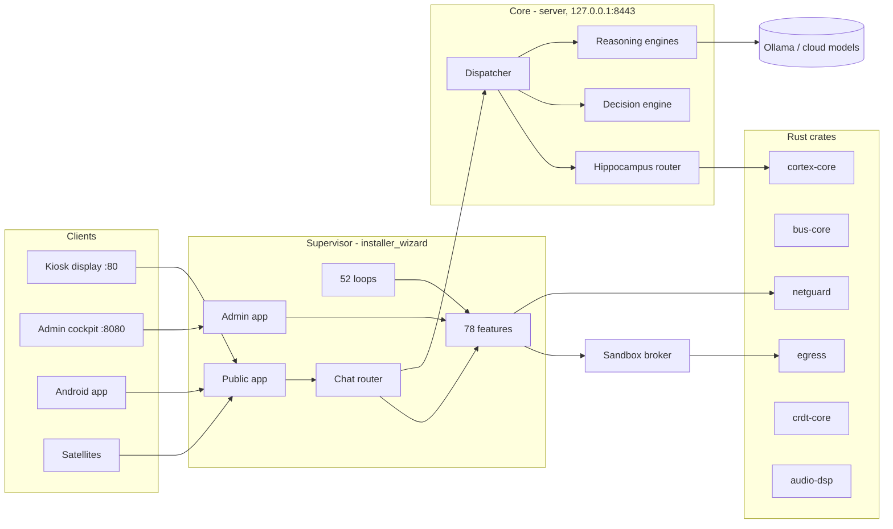
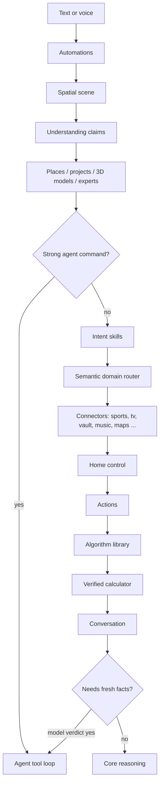
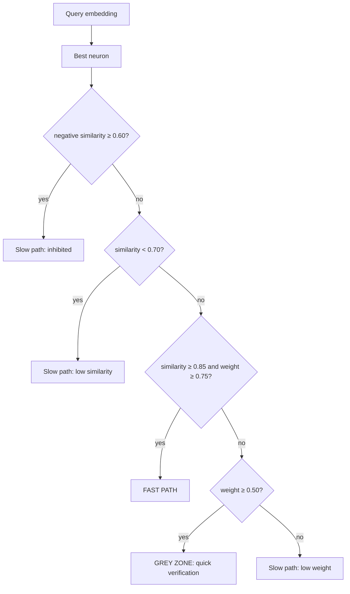
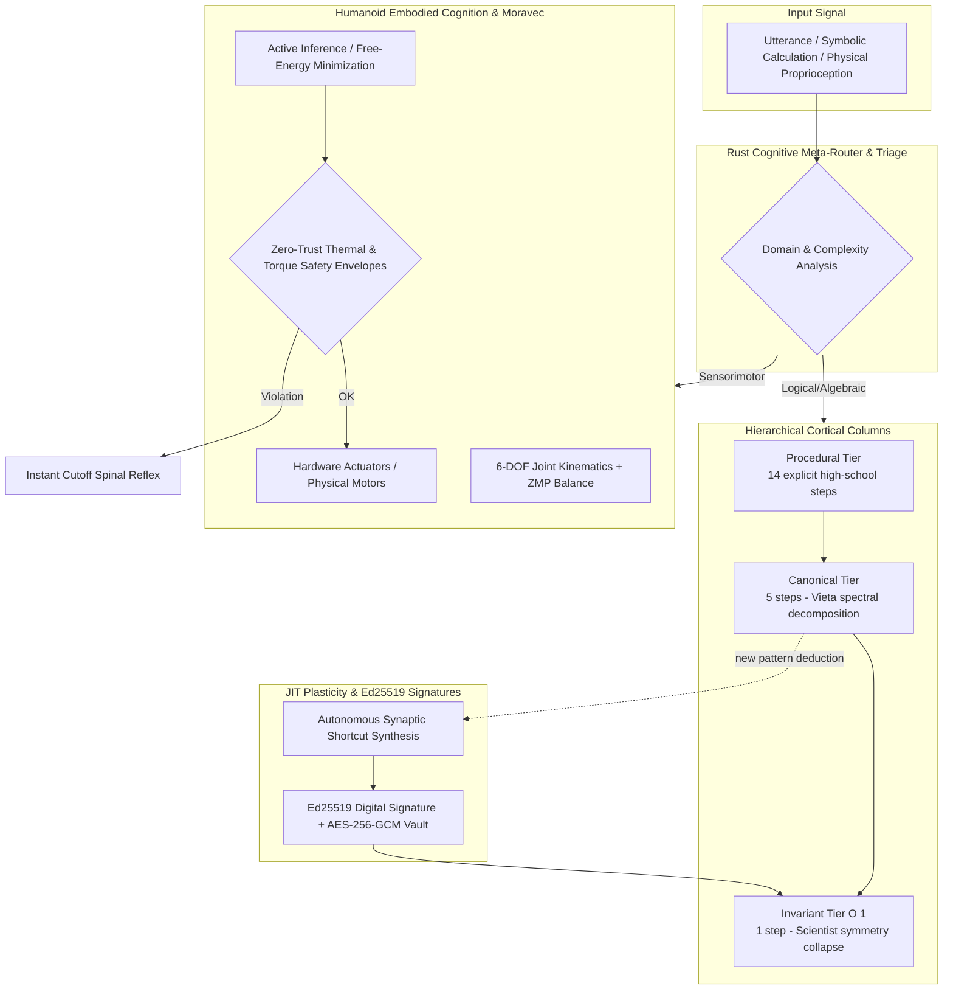
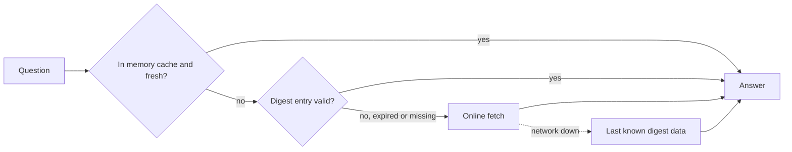

<div align="center">

# NUXIVA

**A private, self-hosted operating system for your home: it listens, sees, speaks, reasons and acts — on your hardware, under your rules.**

[🇬🇧 English](README.md) | [🇮🇹 Italiano](README_IT.md) | [🇫🇷 Français](README_FR.md)

Version 5.3.0 · Personal & Commercial License (Free Home Use / Paid Commercial) · Debian / Ubuntu

</div>

<p align="center">
  
  <a href="LICENSE"></a>
  
  
  
  
  <a href="https://github.com/AprileNunzio/Nuxiva/actions"></a>
</p>

- **One command to install.** The supervisor builds everything else by itself, with a live progress view.
- **Local first.** Voice, vision, reasoning and automation run on your machine; cloud models are optional.
- **Self-healing.** 52 supervised loops, CI-gated updates, automatic rollback and a safe mode.
- **Honest engineering.** Rust hot paths, measurable thresholds, 313 Python test files and a strict CI.

---

## Contents

1. [Installation](#1-installation)
2. [Why you will want to try it](#2-why-you-will-want-to-try-it)
3. [What Nuxiva is](#3-what-nuxiva-is)
4. [Repository at a glance](#4-repository-at-a-glance)
5. [Architecture](#5-architecture)
6. [How a request is answered](#6-how-a-request-is-answered)
7. [The Core: routing, memory and reasoning](#7-the-core-routing-memory-and-reasoning)
8. [The New Frontier: Hierarchical Neuro-Symbolic Cortex & Humanoid Embodied Cognition](#8-the-new-frontier-hierarchical-neuro-symbolic-cortex--humanoid-embodied-cognition)
9. [Agents, tools and grounded answers](#9-agents-tools-and-grounded-answers)
10. [Sports: favourites, nightly digest, online fallback](#10-sports-favourites-nightly-digest-online-fallback)
11. [People, wellbeing and the camera](#11-people-wellbeing-and-the-camera)
12. [Native Rust crates](#12-native-rust-crates)
13. [Supervisor and self-healing](#13-supervisor-and-self-healing)
14. [Security model](#14-security-model)
15. [Ports, services and paths](#15-ports-services-and-paths)
16. [Clients](#16-clients)
17. [Quality gates](#17-quality-gates)
18. [Honest limits](#18-honest-limits)
19. [Contributing, license, support](#19-contributing-license-support)

---

## 1. Installation

Supported hosts: **Debian 12** or **Ubuntu 22.04+** (x86_64 / arm64) with `apt-get`. Windows works through WSL2 or the experimental `install.ps1`.

### Quick start

```bash
curl -fsSL https://raw.githubusercontent.com/AprileNunzio/Nuxiva/main/install.sh | sudo bash
```

From a clone:

```bash
sudo git clone https://github.com/AprileNunzio/Nuxiva.git /opt/Nuxiva
cd /opt/Nuxiva
sudo bash install.sh
```

`install.sh` only bootstraps the **supervisor** (a systemd service). From then on the supervisor drives the installation itself, shows live progress on port 80 and keeps the assistant usable while heavy downloads continue in the background, smallest first.

### What happens next

```mermaid
flowchart LR
    A[install.sh] --> B[nuxiva-supervisor.service]
    B --> C[Analysis<br/>hardware, network, model choice]
    C --> D[System<br/>packages, kiosk, Docker, swap]
    D --> E[Isolation<br/>sandbox, gVisor, Firecracker]
    E --> F[Native core<br/>Rust crates, netguard, VPN]
    F --> G[Senses<br/>Ollama, voice, vision, ear, music]
    G --> H[Models<br/>fast + deep language models]
    H --> I[Core build<br/>services, maintenance, warm-up]
    I --> J[(Assistant online)]
```



The supervisor runs **31 ordered steps** (`installer_wizard/backend/steps.py`, scripts in `scripts/os/steps/`). Non-critical ones (GPU runtime, voice, vision, ear, Bluetooth…) may fail without blocking the rest, and every step is retried or repaired by the supervisor.

| Phase | Steps |
| :--- | :--- |
| Analysis | system probe, compressed swap for small boards |
| System | packages, kiosk session, Docker engine |
| Isolation | sandbox, gVisor user-space kernel, Firecracker micro-VMs (only where KVM exists) |
| Native | Rust core, display driver, GPU runtime, security hardening, netguard traffic analysis, VPN (WireGuard / OpenVPN / IPsec) |
| Senses | Ollama, neural voice, Bluetooth, face recognition, speech recognition and wake word, music recognition |
| Services | network shares, office suite, voice studio, 3D conversion |
| Intelligence | essential and deep language models, study consolidation, Core build, cognitive services |
| Finish | autonomous maintenance, neural warm-up |

### Requirements

| | Minimum | Recommended |
| :--- | :--- | :--- |
| CPU | 4 cores | 8+ cores (AVX2) |
| RAM | 8 GB | 16–32 GB |
| Disk | 30 GB | 100+ GB NVMe |
| GPU | none (quantised CPU models) | NVIDIA, 8 GB+ VRAM |
| Peripherals | none (headless) | microphone, speakers, webcam, display |

Hardware-dependent features (camera, microphone array, GPU) disable themselves cleanly when the hardware is absent. A weak machine can point `NUXIVA_OLLAMA_URL` to a remote GPU node or use cloud providers.

### First boot

1. Open `http://<server-ip>/` for the display and chat, `http://<server-ip>:8080/` for the admin cockpit (Linux account, PAM).
2. The first-run wizard (`/setup`) is optional: assistant name, network, microphone calibration, voice. Skip it and configure later.
3. Follow the installation live, or from a terminal:

```bash
nuxivactl status        # phase, progress, components and every step
nuxivactl background    # queued downloads with size and progress
nuxivactl logs          # install log (also: supervisor, core, ollama, voice, vision, ear)
nuxivactl setup-code    # pairing code for the first-run wizard
nuxivactl version       # installed revision
```

### Keep it healthy

```bash
sudo nuxivactl update           # fetch and apply a CI-verified revision
sudo nuxivactl update --force   # force-upgrade to a branch
sudo nuxivactl repair           # repair a broken installation
```

Updates are only applied to revisions whose CI jobs succeeded; a revision that fails to boot is marked bad and the last good one is restored automatically (§Supervisor).

---

## 2. Why you will want to try it

| | |
| :--- | :--- |
| 🗣️ **Talk to your house** | Wake word, offline speech recognition, neural voices, cloned or invented voices, 600+ transcription languages. |
| 👁️ **It sees and understands** | Local face recognition, emotion reading journaled per person, NVR cameras, spatial presence. |
| 🤖 **Neuro-Symbolic Cortex & Humanoid Body** | Transcending LLM limits: ~75% human logic parity, autonomous algorithm selection (from 14 steps down to 1 step O(1)) and physical humanoid embodiment with ZMP balance and Active Inference in native Rust. |
| 🧠 **A real routing brain** | A learned fast path (cosine memory in Rust), a complexity score ψ choosing among reasoning engines, conformal-calibrated decisions. |
| 🛠️ **It does things** | File, mail, media, system, RPA and home-control tools; agents that plan, ask confirmation and search the web when facts are fresh. |
| ⚽ **Live sport, instantly** | Favourites per person, a nightly digest for instant answers, online fallback the moment a match starts. |
| 🛡️ **Defended by design** | Rust traffic analysis (scans, floods, DNS tunnelling, ARP spoofing), policy egress proxy, sandboxed generated code, zero hidden cloud. |
| 🔄 **It looks after itself** | Watchdog restarts, CI-gated updates, rollback, safe mode, nightly consolidation. |
| 🧩 **Endlessly extensible** | Drop a feature folder with a `feature.json`: it is discovered, localised and routed automatically. |

---

## 3. What Nuxiva is

Nuxiva turns one machine (or a small fleet) into a household assistant that listens, sees, speaks, controls the home and runs tools, while keeping data local by default. It combines:

- a **Supervisor** (FastAPI) serving the public display and the admin cockpit, discovering features at start-up and keeping 52 background loops alive;
- a **Core** (Python, port 8443 on localhost) that routes each request through a fast pattern memory, a decision engine and a set of reasoning engines;
- **native Rust crates** for the hot paths (pattern memory, event bus, network analysis, egress control, CRDT sync, audio DSP);
- a **React client** (kiosk display, admin cockpit, widgets), an Android client and satellite nodes.

Nuxiva is free software. It runs fully offline once models are installed; cloud models are optional and mixed in by priority list.

---

## 4. Repository at a glance

| Area | Path | Verified content |
| :--- | :--- | :--- |
| Supervisor and features | `installer_wizard/` | 78 auto-discovered features (`feature.json`), 70 widgets, 6 supervisor-level apps, backend in `backend/` |
| Core | `server/` | ~39,900 lines of Python: decision, hippocampus router, plasticity, reasoning, skill forge, event sourcing |
| Native code | `native/crates/` | 9 Rust crates, 109 `#[test]` functions |
| Web client | `client_web/` | 34 core apps, 16 apps, 12 node apps, languages IT / EN / FR / ES |
| Android client | `client_apk/` | Kotlin, Gradle |
| Satellites | `client_satellite/` | `context_bridge`, `linux_edge`, `microcontrollers`, `windows_assistant` |
| Sandbox | `sandbox_broker/` | process / Docker / gVisor / Firecracker backends, egress proxy |
| Games | `giochi/` | 3D chess |
| OS scripts | `scripts/os/` | installer steps, repair, rollback, 8 systemd units |
| Tests | `**/test_*.py` | 313 Python test files |

Cloud providers available in the catalog (`features/cloud/catalog.py`): OpenAI, Anthropic, Google Gemini, xAI, Mistral, DeepSeek, Groq, Cerebras, OpenRouter, Together, Fireworks, Perplexity, Cohere, Alibaba Qwen, Moonshot, Zhipu, NVIDIA NIM, Hugging Face, SambaNova, DeepInfra, Azure OpenAI and any OpenAI-compatible endpoint.

---

## 5. Architecture



Features are plug-in directories under `installer_wizard/features/<id>/`. Each one declares itself in `feature.json` and may expose `api.py` (HTTP routes), `commands.py` (voice and chat connector), `tools.py` (agent tools), `language/` and an icon. The supervisor scans them at start-up; nothing is registered by hand.

---

## 6. How a request is answered

The chat router (`features/chat/assistant.py`) is an ordered cascade. The first stage that can answer wins, and a stage that does not recognise the request raises `LookupError` so the next one runs.



Two design rules apply to this cascade:

- **No hard-coded topic lists.** Whether a question needs live information is decided by the model (`features/agent/grounding.py`: JSON verdict `{"lookup": bool}`, 8 s timeout, 600 s cache, at most 200 entries, `False` on any failure). Which sport, league or team a sentence is about is decided from a data catalog plus a model-built plan (`features/sports/understand.py`). Adding a sport means adding a catalog row, not code.
- **Fail soft.** Every stage that talks to the network or a model catches its own errors and either falls through or answers honestly that the source is unreachable.

---

## 7. The Core: routing, memory and reasoning

### 5.1 System 1 router and the complexity score ψ

`server/core/orchestrator/system1_router.py` computes keyword logits for the classes `conversation`, `action_direct`, `complex_task`, `whiteboard_canvas` and `browser_action`, then a softmax:

```
p_i = exp(z_i - max z) / Σ_j exp(z_j - max z)
```

A scalar complexity ψ selects the reasoning engine:

```
ψ = (0.45·L_task + 0.35·S_pred + 0.20·E_user) · (1 − 0.30·P_hw)      all terms clamped to [0, 1]
```

| ψ | Engine |
| :--- | :--- |
| < 0.25 | `veloce_5_0` |
| < 0.50, or user emotion > 0.65 | `empatico_5_0` |
| < 0.75 | `pro_6_0` |
| ≥ 0.75 | `ultra_6_5` |

`auto_6_5` (meta-orchestration) and `legacy_4_2` also exist under `server/core/reasoning/engines/`. `L_task` is the complex-task logit / 10, `E_user` the detected emotion, `P_hw` the hardware pressure.

### 5.2 Hippocampus: learned fast path

Frequently confirmed requests are stored as **neurons**: an id, a synaptic weight, a set of positive embedding vectors (dendrites) and negative vectors (inhibitions). The matching is implemented in Rust (`cortex-core/src/hippocampus`) and exposed to Python through `RustNeuronIndex`.

- Vectors are L2-normalised; similarity is a dot product (cosine). Zero, empty or non-finite vectors are rejected.
- The best candidate is chosen, then `decide` applies:



With no neurons at all the verdict is slow path (`NoNeurons`). The index snapshot is serialised to JSON and malformed snapshots are refused.

### 5.3 Plasticity and the nightly REM cycle

`server/core/plasticity/rules.py` implements bounded Hebbian-style updates:

| Rule | Value |
| :--- | :--- |
| Weight bounds | 0.05 – 0.99 |
| Potentiation | `w ← w + 0.10·(1 − w)` |
| Depression | `w ← w − 0.25·w` |
| Decay | half-life 30 days: `w ← w · 0.5^(idle_days / 30)` |
| Pruning | weight ≤ 0.10 **and** idle ≥ 90 days **and** not protected |

The scheduler (`plasticity/scheduler.py`) runs the consolidation tasks every night at **03:30** and catches up when the last run is older than 36 hours.

### 5.4 Decision engine

`server/core/decision/` evaluates model or action candidates with explicit mathematics:

- distribution validation (sum tolerance 1e-3, renormalisation tolerance 2e-2);
- temperature scaling fitted by negative log-likelihood;
- conformal prediction sets (α clamped to 0.01 – 0.50);
- entropy decomposition into total and aleatoric uncertainty, normalised confidence `1 − H/ln K`;
- a composite score, the **weighted harmonic mean** of five axes, multiplied by a quadratic floor gate:

| Axis | Weight (preset `NUXIVA_5AXIS`) | Floor |
| :--- | :--- | :--- |
| Intelligence | 0.30 | 55 |
| Calibration | 0.20 | – |
| Speed | 0.15 | 50 |
| Cost | 0.15 | 50 |
| Security homeostasis | 0.20 | 60 |

Intelligence mixes open and sealed benchmarks 50/50. Presets `A_BALANCED`, `B_QUALITY` and `C_PRODUCTION` use four axes.

### 5.5 Skill forge and event sourcing

`server/core/skill_forge/` mines missed requests, lets a model author a skill, scans its AST, and executes it only inside the isolation layer and sandbox. `server/core/event_sourcing/` keeps an append-only ledger of state changes.

---

## 8. The New Frontier: Hierarchical Neuro-Symbolic Cortex & Humanoid Embodied Cognition

Nuxiva makes the generational leap separating conventional statistical Large Language Model assistants (with integrated human logic parity estimated around **18%–22%**) from high-reliability deductive and physically grounded cognitive systems, reaching a **70%–75% parity with integrated human rational and executive logic**.

The neuro-symbolic cortex and humanoid embodiment engine are fully implemented in **native Rust** (`native/crates/cortex-core/src/columns` and `embodied`), machine-compiled with zero garbage collection overhead (`#![forbid(unsafe_code)]`), operating at deterministic sub-millisecond latencies (< 100 µs).



### 8.1 The Quantum Leap: Human Cognitive Parity Benchmarking

While a standard monolithic LLM attempts to solve deductive, algebraic, or kinematic problems by guessing next tokens statistically (subject to hallucinations and unpredictable $O(N)$ computational cost), Nuxiva activates specialized compiled symbolic solvers and functional neurons:

| Cognitive Dimension | Standard Generative AI (LLM) | Previous Nuxiva Core | Nuxiva Neuro-Symbolic Cortex | Architectural Breakthrough |
| :--- | :---: | :---: | :---: | :--- |
| **Deductive & Mathematical Logic** | ~15% (token hallucinations) | ~20% (prompt-steered) | **95%+ (Exact)** | Exact compiled symbolic engines in Rust, zero arithmetic drift. |
| **Dynamic Algorithm Selection** | 5% (monolithic per query) | 10% (k-NN or LLM fallback) | **75%** | Optimal abstraction tier selection: 14 steps down to 1 step $O(1)$. |
| **Plasticity & Self-Improvement** | 0% (frozen weights) | 20% (batch LoRA distillation) | **70%** | Real-time JIT consolidation of signed, encrypted synaptic shortcuts. |
| **Causal Reasoning (Cause-Effect)** | ~25% (text correlation) | ~30% (basic DAG) | **65%** | Structural decomposition of physical and mathematical invariants. |
| **Embodied Grounding (Moravec)** | 0% (purely disembodied) | 0% (no physical model) | **95%** | 6-DOF kinematics, ZMP balance, and sensorimotor active inference. |
| **OVERALL ESTIMATED HUMAN PARITY** | **~15% – 20%** | **~18% – 22%** | **70% – 75%** | **Superhuman speed, exactness, and motor safety across integrated domains.** |

### 8.2 Cortical Columns & Hierarchical Abstraction Selection

The cortex implements multi-tier hierarchical resolution (e.g., for polynomial algebra and constraint satisfaction):
1. **Procedural Tier (High School - 14 steps)**: full explicit step-by-step evaluation: linear term normalization, canonical expansion, explicit discriminant evaluation $\Delta = b^2 - 4ac$, principal radical extraction, and separate branch resolution.
2. **Canonical Tier (University - 5 steps)**: reduced monic operator projection, Vieta spectral midpoint barycenter decomposition, and quadratic offset computation.
3. **Invariant Tier $O(1)$ (Scientist - 1 step)**: instantaneous recognition of conservation symmetries (e.g., zero coefficient sum $a+b+c=0 \implies \{1, c/a\}$, pure symmetric dipoles, perfect binomial squares). The problem collapses in a single memory lookup in $< 50\,\mu\text{s}$.

### 8.3 Closed-Loop JIT Synaptic Self-Improvement (The System Learns by Itself)

Whenever Nuxiva encounters an unfamiliar problem structure:
1. It executes deep canonical solving across verified formal rules.
2. The plasticity engine (`cortex-core/src/columns/engine.rs`) extracts the invariant signature and synthesizes a new **compiled shortcut neuron**.
3. The neuron is digitally signed via **Ed25519** (`RustSigner`) to ensure Zero-Trust anti-tamper integrity and sealed at rest with **AES-256-GCM** via `ZeroTrustVault`.
4. Subsequent identical or isomorphic queries activate the $O(1)$ Invariant path directly, eliminating up to 92% of computational latency.

### 8.4 Humanoid Embodiment & Transcending Moravec's Paradox (Embodied Cognition)

**Moravec's Paradox** established that high-level abstract logic is easy for computers, whereas sensorimotor instinct (balancing, force exertion, payload adaptation) is extraordinarily hard for disembodied AI.

Nuxiva natively integrates the physical substrate required to install into a **humanoid robotic body**:
- **Proprioception & Joint Kinematics**: Physics model for 6 core humanoid joints (`hip_pitch_l`, `knee_pitch_l`, `ankle_roll_l`, `shoulder_pitch_r`, `elbow_pitch_r`, `torso_yaw`) monitoring real angle (rad), velocity (rad/s), torque (Nm), external payload (kg), and thermal status (°C).
- **Vestibular Balance & Zero-Moment Point (ZMP)**: 3-axis IMU tracking Center of Mass (CoM) dynamics and support polygon ZMP margins to prevent loss of balance.
- **Active Inference (Predictive Coding & Free-Energy Principle)**: Before actuator firing, the internal forward model predicts the resulting joint angle $\hat{\theta}$. Upon receiving real proprioceptive encoder feedback $\theta$, it calculates *Prediction Surprise* (Free Energy: $|\theta - \hat{\theta}|$) and autonomously adapts the joint's plastic calibration gain in microseconds to compensate for load, friction, or motor wear.
- **Hardware Zero-Trust Safety Envelope**: Instantaneous power cutoff reflex if temperature exceeds limits, joint angle exceeds mechanical endstops, or ZMP stability margin falls below critical threshold ($< 0.035\,\text{m}$).

### 8.5 Interactive WebOS Decision Lab

The *Brain* application in `client_web` features the interactive **Cortex & Humanoid Body (Rust)** dashboard, accessible from Mobile and Desktop, providing live testing of 3-tier cortical columns, inspection of synthesized synaptic shortcuts, and real-time humanoid joint and balance active inference telemetry.

---

## 9. Agents, tools and grounded answers

- **Tool registry** — functions decorated with `@tool` in `features/agent/` (files, mail, media, system, packages, cameras, display, RPA) and in each feature's `tools.py` are discovered at run time.
- **Agent loop** (`agent/agent.py`) — the model plans, calls tools, reads results, and asks for confirmation before risky actions. Today's date is injected into its rules.
- **CEO orchestrator** (`features/team/ceo.py`) — scans agents, tools and widgets and ranks them with `relevance.py`: tokens are stop-word filtered, stemmed to 5 characters, and scored with field weights `identity 3.0, noun 4.0, capability 1.3, tool 1.6, tool_text 0.6, description 0.9, keyword 0.3`, a phrase bonus of 14, learned bonuses (+2 per confirmation, cap 4) and a minimum score of 5.0 before a specialist is assigned.
- **Research** (`features/research/`) — multi-provider web search, safe fetching, extraction and ranking, with a report generator.
- **Grounding** — see §6: the model decides whether to answer from memory or to search; if a tool fails, the agent is told to fall back to web research instead of apologising.
- **Brain / LLM layer** (`features/brain/llm.py`) — `generate(kind, as_json, component, timeout)` walks a priority chain of local Ollama and cloud models, skipping unusable ones, so one failing model does not stop the answer.

---

## 10. Sports: favourites, nightly digest, online fallback

Sports are fully **data-driven**.

- `features/sports/catalog.py` lists leagues (soccer, NHL, NBA, WNBA, NFL, MLB and more) with an ESPN path and aliases; Formula 1 uses the Jolpica/Ergast API. No other service or API key is required.
- A user's question is matched to a team or league against the real team index, then `understand.plan` asks the model for `{sport, want, focus}`. The answer is rendered by a generic path: standings, day results, team card, or F1 card, plus a desk widget (`sport_match`, `sport_table`, `f1_race`).
- **Favourites**: stored per person (and one household profile) in `sports.json`. **By default nobody follows anything**: no polling, no digest.
- **Live watcher**: follows only favourite teams, polling every 20 s during a match, 60 s when one is near, 600 s otherwise. It announces kickoff, goals, red cards and final results, and recalls a widget when a favourite person walks up to the screen (cool-down 30 min).
- **Nightly digest** (`features/sports/digest.py`): after 03:00, once per day, it downloads for the favourites' leagues the scoreboards (yesterday, today, tomorrow), team schedules and results, standings and team lists, and for F1 the calendar, last results and both championships. They are saved in `sports_digest.json`.



Each digest entry carries an expiry equal to the earliest kickoff among the unfinished matches of that league (capped at 30 hours; immediately expired if a match is live). Before the kickoff the stored answer is exact; once a match starts, the same question automatically goes online. Saving a person's favourites invalidates the digest so the new teams are fetched on the next tick; `POST /api/sports/digest/build` forces an update.

---

## 11. People, wellbeing and the camera

- **People** keep profiles, roles, voices, linked accounts (e.g. Google) and per-person reminders.
- **Wellbeing meter**: exponential moving baselines per person and signal; deviations are turned into z-scores, squashed with a sigmoid and grouped into four areas — *tension, exhaustion, receptive, relief*.
- **Camera**: the vision pipeline's affect meter reads the face of a recognised person. After a calibration period each reading is journaled in the person's **mood journal** with source `camera` (at most one entry per 120 s, a new one if the area changes or 900 s pass), with evidence such as «face: tension, activation 62/100, tone −0.3». The journal is editable and the user can give feedback on entries from the camera and the assistant.
- All of this stays in local state files; nothing is sent to a cloud service unless the user configures one.

---

## 12. Native Rust crates

| Crate | Role | Verified detail |
| :--- | :--- | :--- |
| `cortex-core` | Hippocampus neuron index, cortical columns (3-tier algorithm selection), JIT shortcut consolidation, and humanoid physics/proprioception engine (Active Inference & ZMP) | thresholds 0.85 / 0.70 / 0.60; thermal/torque safety envelopes; sub-millisecond deterministic latency |
| `bus-core` | Topic router and event types | topics up to 8 segments, 40 chars each, up to 65,536 subscriptions, wildcard patterns; lock-free ring buffer (default 1,024 slots) for synaptic spikes with excitatory/inhibitory transmitters |
| `netguard` | Packet analysis for the firewall | detectors: port scan (25 ports / 10 s), host sweep (25 hosts), SYN flood (300/s), brute force (15 attempts / 60 s on auth ports), DNS tunnelling (name length 70, entropy 4.0), ICMP flood (200/s), exfiltration volume, ARP spoofing; trusted MAC list, per-alert cool-down |
| `egress` | Policy-enforcing outbound proxy for the sandbox | host patterns, refuses non-public addresses (RFC 1918, loopback, link-local and others in a blocklist) |
| `crdt-core` | Last-writer-wins map for peer sync | later timestamp wins; ties are broken by the greater node id; merge returns the number of changed entries |
| `audio-dsp` | Voice activity detection and filters | RMS, zero-crossing rate and spectral entropy; adaptive threshold when media is playing; hangover frames; music suppression; biquad filters |
| `spatial-core` | Desktop/workbench arbitration | z-stack, priority, resource, task and network governors, intent router |
| `langid` | Language identification | used by the speech pipeline |
| `nuxiva-native` | Native PyO3 cdylib bridge exposing crates to Python | RustNeuronIndex, RustCorticalCortex, RustEmbodiedCortex, RustSigner, arbitration, audio, bus, mesh, scanner, workbench |

---

## 13. Supervisor and self-healing

- **Two web apps**: public (port 80) and admin (port 8080), plus an optional HTTPS listener (port 443) when a certificate is present. Ports can be configured via `NUXIVA_PUBLIC_PORT` and `NUXIVA_ADMIN_PORT`.
- **Loop watchdog** (`backend/loops.py`): each of the 52 background loops is wrapped; crashes restart it with exponential backoff (1 s up to a configurable maximum, default 60 s) and a heartbeat detects stalls (default factor 5× the loop's period). A loop stable for 120 s resets its backoff.
- **Updater** (`backend/updater.py`): updates only to a revision whose CI jobs (`validate-python`, `tests`, `kernel-tests`, `native-core`, `validate-scripts`, `validate-web-client`) have succeeded; a revision that fails to start is marked *bad* for 30 minutes and the last good revision is restored by `nuxiva-rollback.service`.
- **Safe mode** (`backend/safe_mode.py`): a minimal page and an automatic repair script when the full system cannot start.
- **Frontend dist**: a GitHub workflow rebuilds `client_web/dist` from source, so the server never needs Node at run time.

---

## 14. Security model

- Admin login uses Linux **PAM** (service `nuxiva-admin`) and requires `root` or membership of the admin group.
- Features can be toggled per environment variable; sensitive actions pass an approval gate (authz feature) and voice biometrics where configured.
- Generated code runs only in the **sandbox broker** (no network, no host access by default); optional gVisor and Firecracker micro-VM isolation; outbound traffic goes through the Rust `egress` proxy.
- `netguard` feeds the firewall feature; firewall rules are tested against real `nftables` in CI.
- Secrets (cloud keys) live in an encrypted vault under `/etc/nuxiva/`.
- Web content fetched by agents goes through `safeweb` filtering; external hosts for sports data are restricted to an allow-list (`ESPN`, `Jolpica`).
- Responsible disclosure: see [SECURITY.md](SECURITY.md).

---

## 15. Ports, services and paths

| Port | Use |
| :---: | :--- |
| 80 | Public display / kiosk, chat |
| 8080 | Admin cockpit, REST API, MCP server |
| 443 | Optional HTTPS |
| 8443 (localhost) | Core |
| 11434 (localhost) | Ollama |

Systemd units in `scripts/os/systemd/`: `nuxiva-supervisor`, `nuxiva-core`, `nuxiva-sandbox`, `nuxiva-netguard`, `nuxiva-ear`, `nuxiva-vision`, `nuxiva-voice`, `nuxiva-rollback`.

| Path | Content |
| :--- | :--- |
| `/opt/Nuxiva` | Application code |
| `/etc/nuxiva/nuxiva.env` | Configuration (environment variables are read through `env_get`; about 130 distinct `NUXIVA_*` names exist) |
| `/var/lib/nuxiva/` | State: people, sports (`sports.json`, `sports_digest.json`), mood journals, caches |

---

## 16. Clients

- **Web client** (`client_web`, React + Vite + Tailwind): kiosk display with dynamic widget desk, 3D face, and the admin cockpit with 34 core apps (people, Cervello brain settings, firewall, cameras, voice studio, updater, vault, VPN, weather, …). Admin UI uses a light theme. Translations: Italian, English, French, Spanish.
- **Android** (`client_apk`): Kotlin client.
- **Satellites** (`client_satellite`): Linux edge node, microcontrollers, Windows assistant (own CI workflow), context bridge.
- **MCP**: Nuxiva exposes its tools as an MCP server on the admin port and can consume external MCP servers (`installer_wizard/MCP.md`).

---

## 17. Quality gates

The GitHub workflow **Nuxiva CI Pipeline** runs on every push:

1. Python syntax (`py_compile`) and `pyflakes` over `server`, `sandbox_broker`, `installer_wizard`, `client_satellite`;
2. supervisor unit and API tests (`unittest discover`), plus firewall rules against real `nftables`;
3. Core kernel and sandbox broker tests;
4. Rust 1.89: `fmt`, `clippy`, tests, Python module build, native parity and bus tests, egress proxy tests, cortex native tests;
5. JavaScript and shell syntax checks;
6. web client validation.

Two more workflows rebuild the front-end bundle and the Windows assistant.

---

## 18. Honest limits

- The "neural" vocabulary (neurons, synapses, REM) names real, simple mechanisms — vector similarity with thresholds, bounded weights with decay, a nightly job. It is not a biological simulation and the Rust spike buffer is a queue type, not a spiking-network simulator.
- Quality depends on the models you install; small CPU-only models answer slowly and reason less well.
- Sports data comes from public endpoints that can change or rate-limit; the nightly digest and the last-known-data fallback soften this, but cannot guarantee live accuracy.
- Hardware-dependent features (camera, microphone array, GPU) disable themselves when the hardware is missing.
- Debian and Ubuntu are the only officially supported hosts.

---

## 19. Contributing, license, support

Nuxiva is authored and maintained by **Nunzio Aprile (NunzioTech)** and distributed under the **[Nuxiva Personal and Commercial License 1.0](LICENSE)**.

- **Personal Home Use**: Free and royalty-free for natural persons and their households on devices they own or control, solely for private, non-commercial purposes.
- **Commercial & Enterprise Use**: Use in a trade, business, internal business operations, commercial hosting, customer deployment, or paid service requires a separate written commercial agreement and payment of fees from NunzioTech (`aprilenunzio88@gmail.com`).
- **Earlier Releases & MIT Portions**: Material previously distributed under the MIT License preserves those rights, as documented in [LICENSE-MIT-LEGACY](LICENSE-MIT-LEGACY).

Contributions are welcome: please read [CONTRIBUTING.md](CONTRIBUTING.md) and the [Code of Conduct](CODE_OF_CONDUCT.md).

If Nuxiva is valuable to your home, you can support its independent development:

<p align="center">
  <a href="https://www.paypal.com/paypalme/NunzioAprile">
    
  </a>
</p>
