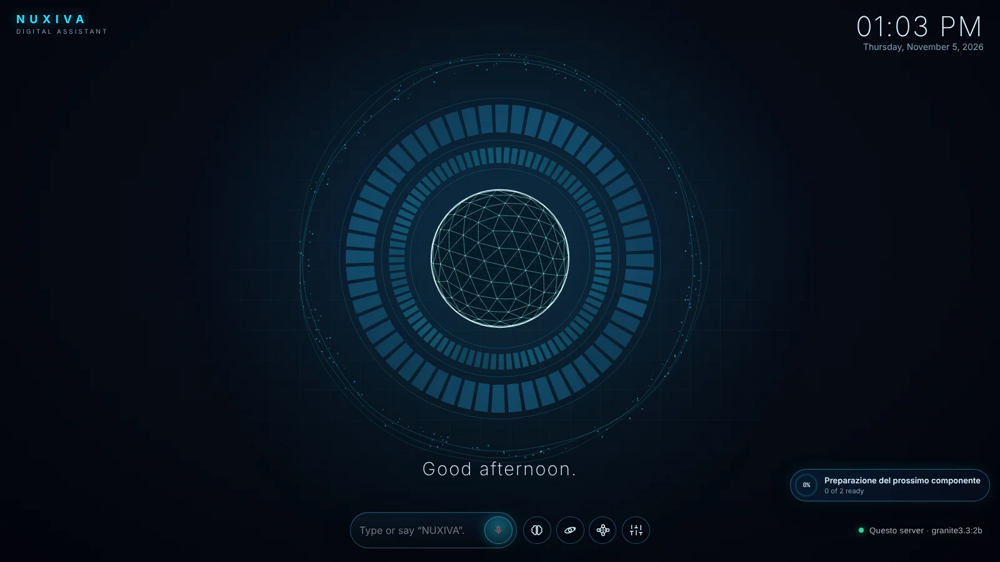
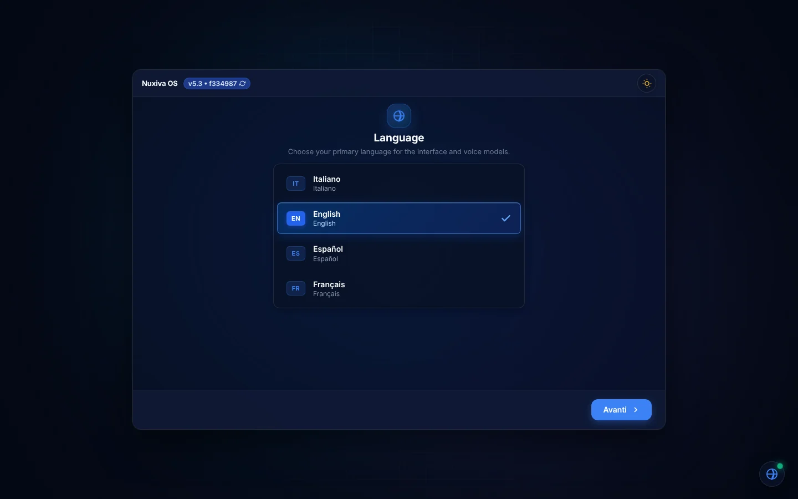
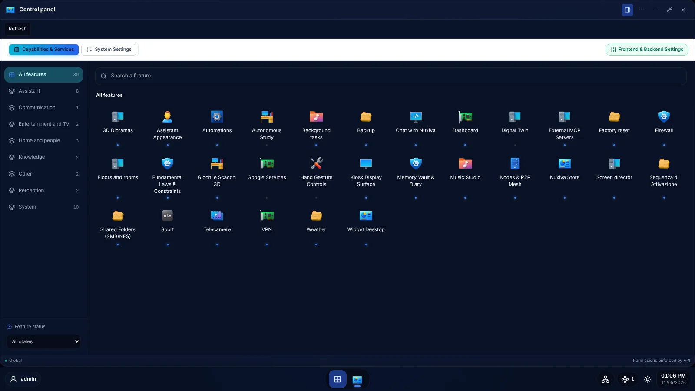
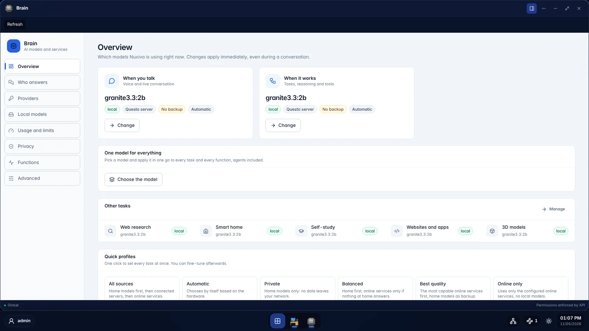
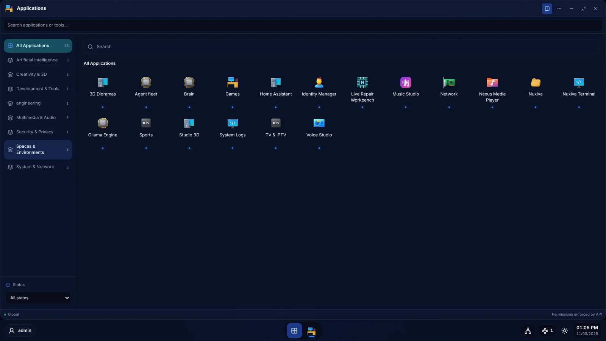
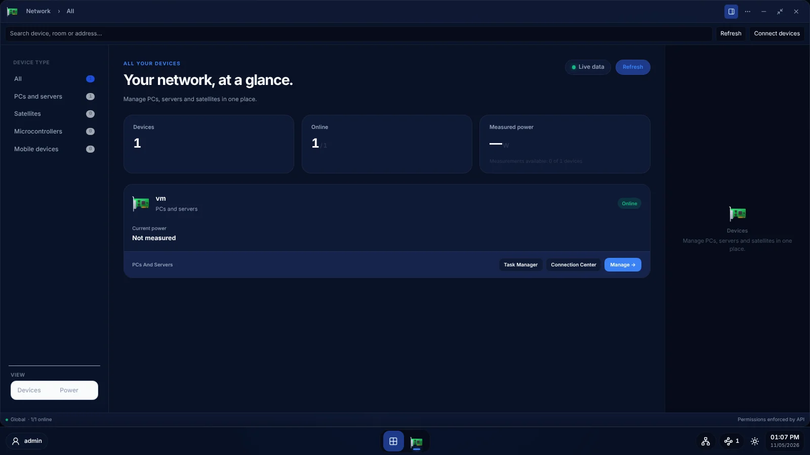
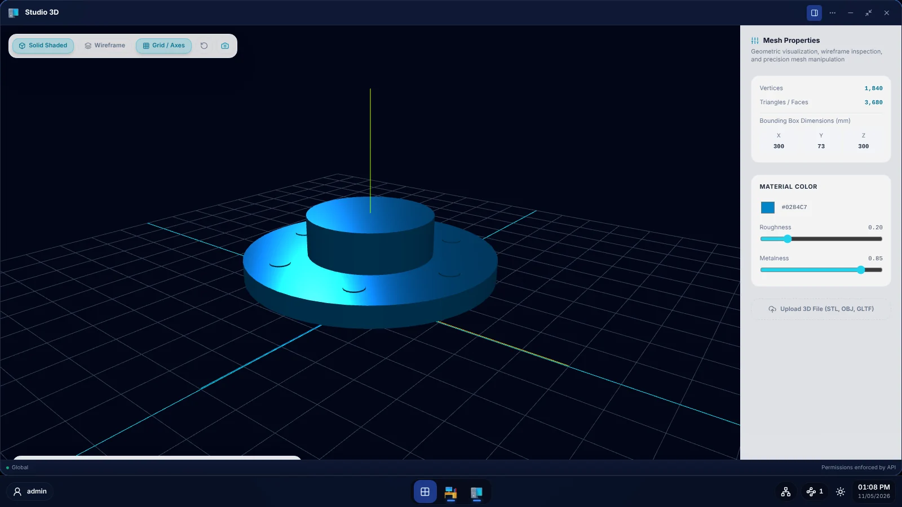
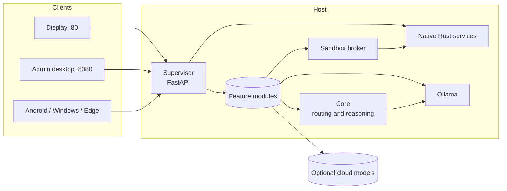
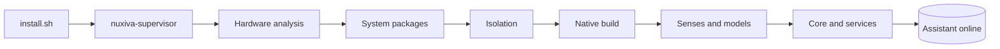

<div align="center">

# NUXIVA

**A self-hosted, local-first home and work assistant that runs on your own hardware.**

Voice, vision, home automation, agents and tools in one modular platform. Local language models by default, cloud models only when you add them.

[🇬🇧 English](README.md) · [🇮🇹 Italiano](README_IT.md) · [🇫🇷 Français](README_FR.md) · [🇪🇸 Español](README_ES.md)

[](https://github.com/AprileNunzio/Nuxiva/actions/workflows/ci.yml)


[](LICENSE)



</div>

---

## Contents

1. [Overview](#1-overview)
2. [Screenshots](#2-screenshots)
3. [Capabilities](#3-capabilities)
4. [Architecture](#4-architecture)
5. [Security model](#5-security-model)
6. [Installation](#6-installation)
7. [Operations](#7-operations)
8. [Configuration](#8-configuration)
9. [Extending Nuxiva](#9-extending-nuxiva)
10. [Engineering standards](#10-engineering-standards)
11. [Project](#11-project)

---

## 1. Overview

Nuxiva turns a Linux machine, or a small group of machines, into a private assistant for the household and the workplace. Everything it needs runs on hardware you own: speech recognition, speech synthesis, face recognition, language models, automations and storage. Nothing leaves the network unless you connect an external service on purpose.

Design principles:

| Principle | What it means in practice |
| :--- | :--- |
| **Local first** | Language models run through Ollama on the host or on a node you control. Cloud providers are optional and sit in the same priority list as local models. |
| **Modular** | Every capability is a self-describing module that the supervisor discovers at start-up. Adding a module requires no central registration. |
| **Adaptive to hardware** | Features that need a camera, a microphone or a GPU enable themselves only when that hardware is present and fast enough. |
| **Secure by default** | Admin access through Linux PAM, approval gates for risky actions, sandboxed execution of generated code, an allow-listed egress proxy and hardened systemd units. |
| **Self-maintaining** | Staged installation, CI-gated updates, automatic rollback, nightly self-tests and a safe-mode recovery page. |
| **Multilingual** | The interfaces are localised in English, Italian, French and Spanish, and the assistant answers in the language it is spoken to. |

---

## 2. Screenshots

All screenshots are taken from an unmodified build of the `main` branch.

| | |
| :---: | :---: |
| <br>**First-run setup wizard** | <br>**Admin desktop: control panel** |
| <br>**Brain: model routing and profiles** | <br>**Applications launcher** |
| <br>**Network, devices and nodes** | <br>**3D studio** |

---

## 3. Capabilities

Capabilities are grouped by area. Each area is made of independent modules under `installer_wizard/features/`; the list of modules grows over time, so this section describes what each area covers rather than enumerating every module.

### Conversation and voice
Offline wake word and speech recognition, neural speech synthesis in many languages, speaker recognition, continuous conversation, voice cloning and voice design, automatic media ducking while the user speaks, and remote text, voice and photo chat through messaging bridges.

### Models and reasoning
A single priority list that mixes local Ollama models with optional cloud providers (OpenAI-compatible endpoints included) and falls back automatically when a model fails. Per-task model routing, privacy profiles, usage limits, a fast path for requests that were already confirmed, a library of verified algorithms, and an idle-time study loop that feeds what it learns back into answers.

### Agents and automation
A tool-using agent that plans step by step and asks for confirmation before risky actions; a team of specialist agents selected by relevance; a project agency that turns a request into a planned task graph executed by parallel agents in an isolated workspace; background tasks that survive restarts; scheduled autonomy with human approval for sensitive actions; and a forge that composes new tools, widgets and modules.

### Home and environment
Home Assistant integration (rooms, floors, devices, presence), an automation engine with triggers, conditions, branches, loops, parallel steps and run traces, habit detection, a digital twin that simulates commands before execution, emergency alerting, floor and room mapping, location, weather and maps.

### People, vision and security
Per-person profiles with private data shown only to the recognised person, local face recognition, camera management with live view and per-camera sensors, NVR event archive with natural-language search, hand-gesture control, a network explorer, a firewall fed by native packet analysis, multi-protocol VPN management, an encrypted vault, verifiable backups and a guarded factory reset.

### Display, media and creativity
A widget desktop where information appears when it is relevant, a display director that arranges screens across devices, a kiosk mode, an animated assistant presence, media playback with casting, IPTV, live sports, a music studio, a shared whiteboard, 3D model generation and viewing, 3D scene composition and games.

### Work and productivity
Per-person Google account linking (calendar, mail, tasks, contacts, Drive), office document generation (Word, Excel, PowerPoint, OpenDocument, PDF), a software development studio with isolated test runs, protected network shares, printers and CNC devices, repair-bench integration and Proxmox management.

### System and maintenance
Service supervision with backoff and stall detection, cron-style scheduling with catch-up, a resource governor that defers background work under load, hardware and driver management, Bluetooth and audio device management, multi-node pairing and control, system logs with protected export, and a modular store for optional capabilities.

### Clients
| Client | Path | Role |
| :--- | :--- | :--- |
| Web | `client_web/` | Admin desktop on port 8080 (React, TypeScript, Vite, Tailwind) |
| Display | `installer_wizard/web/` | Kiosk display, setup wizard and activation pages on port 80 |
| Android | `client_apk/` | Wake word, voice match, camera stream, server discovery, health data from BLE devices and Health Connect |
| Windows | `client_satellite/windows_assistant/` | Desktop assistant with voice or hotkey activation, permission-gated file and app control, signed updates |
| Edge | `client_satellite/linux_edge/`, `client_satellite/microcontrollers/` | Linux edge nodes and ESP32 satellites |
| Context bridge | `client_satellite/context_bridge/` | Desktop sensor bridge |

---

## 4. Architecture



| Component | Path | Technology | Responsibility |
| :--- | :--- | :--- | :--- |
| Supervisor | `installer_wizard/backend/` | Python, FastAPI, Uvicorn | Installation, lifecycle, HTTP and WebSocket APIs, authentication, updates, module discovery |
| Feature modules | `installer_wizard/features/` | Python | Capabilities: routes, voice and chat commands, agent tools, translations |
| Widgets | `installer_wizard/widgets/` | JavaScript, CSS | Self-describing display widgets |
| Core | `server/` | Python | Request routing, reasoning engines, decision engine, plasticity, event sourcing, skill generation |
| Native layer | `native/crates/` | Rust (edition 2024) | Performance- and security-critical code, exposed to Python through PyO3 |
| Sandbox broker | `sandbox_broker/` | Python, Rust | Isolated execution of generated code, egress control |
| Installer | `scripts/os/` | Bash, systemd | Bootstrap, installation steps, units, `nuxivactl` |
| Web client | `client_web/` | React, TypeScript | Admin desktop |

### 4.1 Request flow

A text or voice request is handled by the chat router in `installer_wizard/features/chat/`. It passes through an ordered chain of stages (automations, direct commands, intent skills, connectors, home control, actions, conversation). The first stage that recognises the request answers it; the others are skipped. Requests that need current information are delegated to the agent, which searches before it answers. Generation walks the model priority list and skips any model that fails, so one unavailable model never blocks an answer.

### 4.2 Core reasoning

The Core (`server/core/`) classifies requests, estimates their complexity and selects a reasoning engine accordingly. A decision engine scores candidate models and actions on several axes (quality, calibration, speed, cost, security) with calibrated probabilities and uncertainty estimates. Confirmed requests are stored in a native embedding index so that they can be answered on a fast path; a plasticity scheduler reinforces, weakens, decays and prunes those entries over time. Exact formulas and thresholds live in the code under `server/core/orchestrator/`, `server/core/decision/` and `server/core/plasticity/`.

### 4.3 Native Rust layer

The Rust workspace in `native/` groups the crates that need speed, memory safety or strict isolation: message bus, packet analysis for the firewall, egress proxy, CRDT replication between nodes, audio DSP, gesture recognition, display and window arbitration, signed tokens, health-sensor parsing, satellite provisioning, the project agency engine (domain, planner, scheduler, HMAC-chained ledger, code index, daemon) and the PyO3 bridge. The full list of crates is in `native/Cargo.toml`.

### 4.4 Installation pipeline



`install.sh` installs only the supervisor. The supervisor then executes the installation steps defined in `installer_wizard/backend/steps.py` (scripts in `scripts/os/steps/`), shows progress on the display, and makes the assistant usable as early as possible while large downloads continue in the background. Non-critical steps can fail without blocking the others and are retried or repaired automatically.

---

## 5. Security model

| Layer | Mechanism |
| :--- | :--- |
| Authentication | Admin login through Linux PAM (service `nuxiva-admin`), restricted to administrative accounts; HMAC-signed, HTTP-only session cookies with expiry; login rate limiting |
| Request integrity | Origin and host validation, custom request header on state-changing calls, strict Content Security Policy with Trusted Types |
| First-run protection | The setup wizard is reachable only from the local network and only until setup is complete |
| Authorisation | Approval gates for risky actions, optional voice biometrics, per-person visibility of private data |
| Code execution | Generated code runs only inside the sandbox broker, with no network or host access by default, optionally under gVisor or Firecracker micro-VMs |
| Network | Outbound sandbox traffic through the Rust egress proxy (allow-listed hosts, private and loopback ranges refused); native packet analysis feeding the firewall; firewall rules tested against real `nftables` in CI |
| Secrets | Cloud credentials stored in an encrypted vault under `/etc/nuxiva/`; secrets zeroised in native code |
| Services | Isolated services (Core, agency, netguard) run under dedicated or dynamic users with `NoNewPrivileges`, restricted capability sets and `ProtectSystem` hardening |
| Updates | Only revisions whose CI checks passed are installed; failed revisions are rolled back automatically |
| Native code | Workspace-wide `unsafe_code = "forbid"`; Clippy denies `unwrap`, `expect` and `panic` |

Vulnerabilities should be reported privately as described in [SECURITY.md](SECURITY.md).

---

## 6. Installation

### Requirements

| | Minimum | Recommended |
| :--- | :--- | :--- |
| Operating system | Debian 12 or Ubuntu 22.04+ | Latest Debian stable or Ubuntu LTS |
| Architecture | x86_64 or arm64 | x86_64 with AVX2 |
| CPU | 4 cores | 8+ cores |
| Memory | 8 GB | 16–32 GB |
| Storage | 30 GB | 100+ GB NVMe |
| GPU | Not required (quantised CPU models) | NVIDIA with 8 GB+ VRAM |
| Peripherals | None (headless) | Microphone, speakers, webcam, display |

Smaller machines can use a remote Ollama node or cloud models. On Windows, use WSL2 or the experimental `install.ps1`.

### One-command install

```bash
curl -fsSL https://raw.githubusercontent.com/AprileNunzio/Nuxiva/main/install.sh | sudo bash
```

On minimal systems without `curl`:

```bash
sudo apt update && sudo apt install -y curl && curl -fsSL https://raw.githubusercontent.com/AprileNunzio/Nuxiva/main/install.sh | sudo bash
```

### Install from a clone

```bash
sudo git clone https://github.com/AprileNunzio/Nuxiva.git /opt/Nuxiva
cd /opt/Nuxiva
sudo bash install.sh
```

### First boot

1. Open `http://<host>/` on any device in the local network. The display shows installation progress and becomes the assistant once ready; no reboot is required.
2. Complete the optional first-run wizard at `http://<host>/setup`: language, network, components, AI engine (local, remote or cloud), assistant name, microphone and voice. Installation choices are persisted atomically and survive power loss.
3. Open the admin desktop at `http://<host>:8080/` and sign in with a Linux administrator account.

---

## 7. Operations

### Command line

```bash
nuxivactl status          # phase, progress and step status
nuxivactl background      # queued background downloads
nuxivactl logs [source]   # install, supervisor, core, ollama, voice, vision, ear
nuxivactl setup-code      # pairing code for the first-run wizard
nuxivactl version         # installed revision
sudo nuxivactl update     # install the latest revision that passed CI
sudo nuxivactl force-upgrade [branch]
sudo nuxivactl repair     # repair a damaged installation
```

### Updates and recovery

The updater (`installer_wizard/backend/updater.py`) installs a revision only after its CI checks have succeeded. A revision that fails to start is marked as bad and `nuxiva-rollback.service` restores the last known good revision. If the system cannot start at all, a safe-mode page and a repair script are served instead.

### Network ports

| Port | Service |
| :---: | :--- |
| 80 | Display, kiosk, setup wizard, chat |
| 8080 | Admin desktop, REST API, MCP server (`/mcp`) |
| 443 | Optional HTTPS with locally generated certificates |
| 8443 | Core API (internal) |
| 11434 | Ollama, bound to loopback |

### Services and paths

systemd units are defined in `scripts/os/systemd/` (supervisor, core, sandbox, netguard, agency, ear, vision, voice, rollback).

| Path | Content |
| :--- | :--- |
| `/opt/Nuxiva` | Application code |
| `/etc/nuxiva/nuxiva.env` | Configuration (`NUXIVA_*` variables) |
| `/etc/nuxiva/` | Keys, certificates and encrypted vault |
| `/var/lib/nuxiva/` | Application state |
| `/var/log/nuxiva/` | Installation and audit logs |

---

## 8. Configuration

Configuration is stored as `NUXIVA_*` variables in `/etc/nuxiva/nuxiva.env` and is editable from the admin desktop (Control panel → System settings). Every module declares its own settings in its `feature.json`, so new options appear in the interface automatically.

Common settings:

| Variable | Purpose |
| :--- | :--- |
| `NUXIVA_UI_LANG` | Interface language (`en`, `it`, `fr`, `es`) |
| `NUXIVA_OLLAMA_URL` | Use a remote Ollama node instead of the local one |
| `NUXIVA_ALLOWED_HOSTS` | Extra host names accepted by the origin guard |
| `NUXIVA_PUBLIC_PORT`, `NUXIVA_ADMIN_PORT` | Override the default ports |

Cloud model providers are added from the **Brain** application. They are optional, are mixed into the same priority list as local models, and can be restricted per task through privacy profiles.

---

## 9. Extending Nuxiva

A module is a folder in `installer_wizard/features/<id>/`, or in `/var/lib/nuxiva/features/<id>/` for locally installed modules:

```text
features/<id>/
├── feature.json     metadata, category, settings, capabilities, icon
├── api.py           HTTP routes                    (optional)
├── commands.py      voice and chat commands        (optional)
├── tools.py         tools exposed to agents and MCP (optional)
└── language/        en.json, it.json, fr.json, es.json
```

Widgets follow the same pattern in `installer_wizard/widgets/<id>/` (`widget.json`, `widget.js`, `widget.css`, `language/`). The supervisor discovers modules and widgets at start-up; tools are made available to the agent, to the specialist team and to external MCP clients without further wiring.

External MCP servers can be connected as tool sources, and Nuxiva exposes its own tools, resources and prompts as an MCP server on port 8080 (see `installer_wizard/MCP.md`).

---

## 10. Engineering standards

| Area | Standard |
| :--- | :--- |
| Architecture | Clean Architecture, separation of concerns, feature-based colocation, files kept small and single-purpose |
| Python | Python 3.11+, typed FastAPI services, syntax and `pyflakes` checks on every push |
| Rust | Edition 2024, `unsafe_code` forbidden workspace-wide, Clippy `all` denied, `rustfmt` enforced |
| Web | React and TypeScript, strict CSP, full i18n with no hardcoded strings, responsive layouts |
| Error handling | Exceptions handled at I/O, network and storage boundaries; global handlers; errors are never silently discarded |
| Testing | Unit and API tests for the supervisor, Core and sandbox; native parity tests; Rust tests; firewall rules on real `nftables`; web client tests |
| CI | `.github/workflows/ci.yml` runs all checks on every push; dedicated workflows build the web bundle and the Windows assistant |

---

## 11. Project

- **Contributing:** see [CONTRIBUTING.md](CONTRIBUTING.md) and the [Code of Conduct](CODE_OF_CONDUCT.md).
- **Security:** see [SECURITY.md](SECURITY.md).
- **Third-party software:** see [THIRD_PARTY_NOTICES.md](THIRD_PARTY_NOTICES.md).
- **License:** [Nuxiva Personal and Commercial License 1.0](LICENSE). Earlier revisions distributed under MIT remain covered by [LICENSE-MIT-LEGACY](LICENSE-MIT-LEGACY).

### Support the project

If Nuxiva is useful to you, you can support its development:

<p align="center">
  <a href="https://www.paypal.com/paypalme/NunzioAprile">
    
  </a>
</p>
