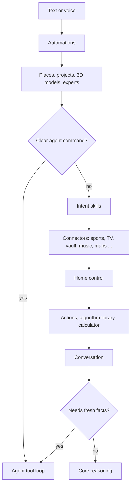

<div align="center">

# NUXIVA

**A self-hosted home assistant that runs on your own hardware: voice, cameras, home control, tools and agents, with local models by default and cloud models only if you add them.**

[🇬🇧 English](README.md) | [🇮🇹 Italiano](README_IT.md) | [🇫🇷 Français](README_FR.md)

Version 5.3.0 · Debian / Ubuntu · [Nuxiva Personal and Commercial License 1.0](LICENSE)

</div>

---

## Contents

0. [Installation](#0-installation)
1. [What Nuxiva is and the algorithms it uses](#1-what-nuxiva-is-and-the-algorithms-it-uses)
2. [What Nuxiva does](#2-what-nuxiva-does)
3. [Donations](#3-donations)

---

## 0. Installation

### Supported hosts

**Debian 12** or **Ubuntu 22.04+** (x86_64 / arm64) with `apt-get`. On Windows use WSL2, or the experimental `install.ps1`.

| | Minimum | Recommended |
| :--- | :--- | :--- |
| CPU | 4 cores | 8+ cores (AVX2) |
| RAM | 8 GB | 16–32 GB |
| Disk | 30 GB | 100+ GB NVMe |
| GPU | none (quantised CPU models) | NVIDIA, 8 GB+ VRAM |
| Peripherals | none (headless) | microphone, speakers, webcam, display |

Features that need hardware (camera, microphone, GPU) switch themselves off when the hardware is missing. A small machine can use a remote Ollama node (`NUXIVA_OLLAMA_URL`) or cloud models.

### Install

One command:

```bash
curl -fsSL https://raw.githubusercontent.com/AprileNunzio/Nuxiva/main/install.sh | sudo bash
```

Or from a clone:

```bash
sudo git clone https://github.com/AprileNunzio/Nuxiva.git /opt/Nuxiva
cd /opt/Nuxiva
sudo bash install.sh
```

`install.sh` only installs the **supervisor** (`nuxiva-supervisor.service`). The supervisor then runs the **31 installation steps** listed in `installer_wizard/backend/steps.py` (scripts in `scripts/os/steps/`), shows progress on port 80, and keeps the assistant usable while large downloads continue in the background, smallest first.

```mermaid
flowchart LR
    A[install.sh] --> B[nuxiva-supervisor.service]
    B --> C[Analysis<br/>hardware, swap]
    C --> D[System<br/>packages, kiosk, Docker]
    D --> E[Isolation<br/>sandbox, gVisor, Firecracker]
    E --> F[Native<br/>Rust crates, netguard, VPN]
    F --> G[Senses<br/>Ollama, voice, vision, ear]
    G --> H[Models<br/>fast + deep language models]
    H --> I[Core build<br/>services, maintenance]
    I --> J[(Assistant online)]
```



| Phase | Steps |
| :--- | :--- |
| Analysis | system probe, compressed swap on small boards |
| System | packages, kiosk session, Docker engine |
| Isolation | sandbox, gVisor, Firecracker micro-VMs (only where KVM is available) |
| Native | Rust crates, display driver, GPU runtime, hardening, netguard, VPN (WireGuard / OpenVPN / IPsec) |
| Senses | Ollama, neural voice, Bluetooth, face recognition, speech recognition and wake word, music recognition |
| Services | network shares, office suite, voice studio, 3D conversion |
| Intelligence | essential and deep language models, study consolidation, Core build |
| Finish | maintenance tools, warm-up |

Non-critical steps (GPU runtime, voice, vision, Bluetooth…) can fail without blocking the others; the supervisor retries or repairs them.

### First boot

1. Open `http://<server-ip>/` for the display and chat, and `http://<server-ip>:8080/` for the admin cockpit (login with a Linux account through PAM).
2. The first-run wizard (`/setup`) is optional: assistant name, network, microphone calibration, voice.
3. Follow the installation from a terminal:

```bash
nuxivactl status        # phase, progress and every step
nuxivactl background    # queued downloads with size and progress
nuxivactl logs          # install log (also: supervisor, core, ollama, voice, vision, ear)
nuxivactl setup-code    # pairing code for the first-run wizard
nuxivactl version       # installed revision
```

### Updates and repair

```bash
sudo nuxivactl update           # apply a revision whose CI passed
sudo nuxivactl force-upgrade    # force-upgrade to a branch
sudo nuxivactl repair           # repair a broken installation
```

The updater (`installer_wizard/backend/updater.py`) only installs a revision whose CI jobs succeeded. A revision that fails to start is marked bad for 30 minutes and `nuxiva-rollback.service` restores the last good one. If the full system cannot start, a safe mode page and a repair script are served instead.

### Ports, services and paths

| Port | Use |
| :---: | :--- |
| 80 | Display / kiosk and chat |
| 8080 | Admin cockpit, REST API, MCP server |
| 443 | Optional HTTPS, when a certificate is present |
| 8443 (localhost) | Core |
| 11434 (localhost) | Ollama |

Systemd units (`scripts/os/systemd/`): `nuxiva-supervisor`, `nuxiva-core`, `nuxiva-sandbox`, `nuxiva-netguard`, `nuxiva-ear`, `nuxiva-vision`, `nuxiva-voice`, `nuxiva-rollback`.

| Path | Content |
| :--- | :--- |
| `/opt/Nuxiva` | Application code |
| `/etc/nuxiva/nuxiva.env` | Configuration (`NUXIVA_*` variables) |
| `/var/lib/nuxiva/` | State: people, sports, mood journals, caches |

---

## 1. What Nuxiva is and the algorithms it uses

Nuxiva turns one Linux machine (or a small group of machines) into a household assistant. It is made of:

| Part | Path | Language |
| :--- | :--- | :--- |
| Supervisor, features and widgets | `installer_wizard/` | Python (FastAPI) |
| Core: routing, decision, reasoning engines | `server/` | Python |
| Native crates | `native/crates/` | Rust, every crate `#![forbid(unsafe_code)]` |
| Web client: kiosk display and admin cockpit | `client_web/` | React + Vite + Tailwind |
| Android client | `client_apk/` | Kotlin |
| Satellites: Windows assistant, Linux edge node, ESP32, context bridge | `client_satellite/` | Python, C++ |
| Code sandbox and egress proxy | `sandbox_broker/` | Python + Rust |

Every feature is a folder in `installer_wizard/features/<id>/` with a `feature.json` (82 today). It can add HTTP routes (`api.py`), voice and chat commands (`commands.py`), agent tools (`tools.py`), translations and an icon. The supervisor discovers them at start-up; nothing is registered by hand.

Language models run locally through **Ollama**. Cloud models are optional and are mixed into the same priority list (`installer_wizard/features/cloud/catalog.py`: OpenAI, Anthropic, Google Gemini, xAI, Mistral, DeepSeek, Groq, Cerebras, OpenRouter, Together, Fireworks, Perplexity, Cohere, Alibaba Qwen, Moonshot, Zhipu, NVIDIA NIM, Hugging Face, SambaNova, DeepInfra, Azure OpenAI and any OpenAI-compatible endpoint).

### 1.1 How a request is answered

The chat router (`installer_wizard/features/chat/assistant.py`) tries a fixed sequence of stages. The first stage that recognises the request answers it; a stage that does not recognise it raises `LookupError` and the next one runs.



**Fresh-facts check** (`features/agent/grounding.py`). The model is asked for a JSON verdict `{"lookup": true|false}` with temperature 0 and an 8 s timeout. Verdicts are cached for 600 s (at most 200 entries). Any error counts as `false`. When the verdict is `true`, the agent searches the web instead of answering from memory.

**LLM fallback chain** (`features/brain/llm.py`). `generate()` walks the priority list of local and cloud models and skips any that fails, so one broken model does not stop the answer.

### 1.2 Core router and complexity score

`server/core/orchestrator/system1_router.py` computes keyword scores for the classes `conversation`, `action_direct`, `complex_task`, `whiteboard_canvas` and `browser_action`, and turns them into probabilities with a softmax:

```
p_i = exp(z_i − max z) / Σ_j exp(z_j − max z)
```

A complexity score ψ picks the reasoning engine:

```
ψ = (0.45·L_task + 0.35·S_pred + 0.20·E_user) · (1 − 0.30·P_hw)        every term clamped to [0, 1]
```

`L_task` is the complex-task score, `S_pred` the predicted difficulty, `E_user` the detected user emotion and `P_hw` the hardware load.

| ψ | Engine (`server/core/reasoning/engines/`) |
| :--- | :--- |
| < 0.25 | `veloce_5_0` |
| < 0.50, or user emotion > 0.65 | `empatico_5_0` |
| < 0.75 | `pro_6_0` |
| ≥ 0.75 | `ultra_6_5` |

`auto_6_5` and `legacy_4_2` are also available.

### 1.3 Fast path for known requests (embedding memory)

Requests that were confirmed before are stored as entries with an id, a weight, positive example embeddings and negative example embeddings. Matching is written in Rust (`native/crates/cortex-core/src/hippocampus/`) and exposed to Python as `RustNeuronIndex`.

- Vectors are L2-normalised and compared by dot product (cosine similarity). Zero, empty or non-finite vectors are rejected.
- The best match is classified with fixed thresholds:

| Condition | Result |
| :--- | :--- |
| similarity to a negative example ≥ 0.60 | slow path (inhibited) |
| similarity < 0.70 | slow path |
| similarity ≥ 0.85 and weight ≥ 0.75 | fast path: answer without generating text |
| weight ≥ 0.50 | grey zone: quick verification |
| otherwise | slow path |

With no stored entries the result is always slow path.

### 1.4 Weight updates and nightly consolidation

`server/core/plasticity/rules.py` updates the weights of the fast-path entries:

| Rule | Formula |
| :--- | :--- |
| Bounds | 0.05 – 0.99 |
| Reinforce (confirmed) | `w ← w + 0.10·(1 − w)` |
| Weaken (rejected) | `w ← w − 0.25·w` |
| Decay | half-life 30 days: `w ← w · 0.5^(idle_days / 30)` |
| Remove | weight ≤ 0.10 **and** idle ≥ 90 days **and** not protected |

`server/core/plasticity/scheduler.py` runs this every night at **03:30**, and catches up if the last run is older than 36 hours.

### 1.5 Decision engine

`server/core/decision/` scores candidate models and actions:

- probability distributions are validated (sum tolerance 1e-3, renormalisation tolerance 2e-2);
- temperature scaling fitted by negative log-likelihood;
- conformal prediction sets (α clamped to 0.01 – 0.50);
- entropy split into total and aleatoric uncertainty, confidence `1 − H/ln K`;
- a final score that is the **weighted harmonic mean** of the axes, multiplied by a quadratic gate when an axis falls below its floor.

| Axis (preset `NUXIVA_5AXIS`) | Weight | Floor |
| :--- | :--- | :--- |
| Intelligence | 0.30 | 55 |
| Calibration | 0.20 | – |
| Speed | 0.15 | 50 |
| Cost | 0.15 | 50 |
| Security | 0.20 | 60 |

Presets `A_BALANCED`, `B_QUALITY` and `C_PRODUCTION` use four axes.

### 1.6 Choosing the right agent

`installer_wizard/features/team/relevance.py` ranks agents, tools and widgets for a request: stop words are removed, words are stemmed to 5 characters, and matches are weighted by field (`identity 3.0, noun 4.0, capability 1.3, tool 1.6, tool_text 0.6, description 0.9, keyword 0.3`), plus a phrase bonus of 14 and a learned bonus of +2 per past confirmation (capped at 4). A specialist is assigned only above a score of 5.0.

### 1.7 Wellbeing score

`installer_wizard/features/people/wellbeing/scoring.py` keeps a per-person baseline for each signal as an exponential moving mean and variance (α = 0.02). Each new reading becomes a z-score, is squashed with a sigmoid, and is grouped into four areas: *tension, exhaustion, receptive, relief*. Camera readings are written to the person's mood journal at most once every 120 s, or after 900 s / a change of area.

### 1.8 Generated code and skills

`server/core/skill_forge/` collects requests Nuxiva could not handle, lets a model write a skill for them, checks the code with an AST scanner (`ast_scanner.py`), and runs it only inside the sandbox. `server/core/event_sourcing/` keeps an append-only log of state changes.

### 1.9 Native Rust crates

| Crate | What it does |
| :--- | :--- |
| `cortex-core` | Embedding index and fast-path thresholds (§1.3), plus a set of small, unit-tested algorithm modules described below |
| `bus-core` | Topic router: up to 8 segments of 40 characters, up to 65,536 subscriptions, wildcards; lock-free ring buffer (default 1,024 slots) |
| `netguard` | Packet analysis for the firewall: port scan (25 ports), host sweep (25 hosts), SYN flood (300/s), brute force (15 attempts on auth ports), DNS tunnelling (name length 70, entropy 4.0), ICMP flood (200/s), data exfiltration volume, ARP spoofing |
| `egress` | Outbound proxy for the sandbox: allow-listed hosts only, refuses private, loopback and link-local addresses |
| `crdt-core` | Last-writer-wins map for syncing nodes: later timestamp wins, ties broken by node id |
| `audio-dsp` | Voice activity detection (RMS, zero-crossing rate, spectral entropy), adaptive threshold while media is playing, biquad filters |
| `spatial-core` | Window and widget arbitration on the display: z-order, priorities, resource / task / network governors |
| `stage-core` | Display planner (which surfaces to show, shrink or hide) and a compact encoder for 3D particle clouds |
| `agency-domain`, `agency-planner`, `agency-scheduler`, `agency-ledger`, `agency-codeindex`, `agency-daemon` | Project agency engine: validated projects and tasks, dependency graph and critical path, parallelism from CPU / RAM / VRAM and model, HMAC-chained ledger, code index and search, `nuxiva-agency` daemon on a Unix socket (mode 0600, peer uid check) |
| `langid` | Language identification for the speech pipeline (based on `whatlang`) |
| `nuxiva-native` | PyO3 bridge that exposes the crates to Python |

The extra modules in `cortex-core` are compact implementations (roughly 50–330 lines each) with their own unit tests:

| Module | Algorithm |
| :--- | :--- |
| `columns/cdcl.rs` | SAT solver: unit propagation, conflict clause learning, backjumping |
| `columns/egraph.rs` | E-graph with union-find, congruence rebuild and lowest-cost extraction |
| `columns/causal.rs` | Causal graph with conditional probability tables, observation vs. `do()` intervention, simple counterfactuals |
| `columns/invariant.rs` | Pattern matching and anti-unification to derive rewrite rules from examples |
| `columns/solver.rs` | Quadratic equation solver in three variants (step-by-step, canonical form, direct formula) |
| `columns/confrontation.rs` | Uncertainty check: when the entropy of the candidate answers is too high or the margin too small, Nuxiva asks the user and stores the answer |
| `columns/ontology.rs` | Residual check on observations and a fixed catalogue of five mathematical frameworks to label them |
| `neurons/` | Izhikevich spiking neuron model, 2048-bit sparse binary vectors with k-winner-take-all encoding, reward-modulated STDP weight update |
| `self_model/` | Justification-based truth maintenance (retracts conclusions when a premise is removed), calibration error and uncertainty split |
| `social_tom/` | Belief–desire–intention records and Bayesian goal inference from observed actions |
| `subcortical/`, `workspace/` | Action-selection gating, signal routing and threshold-based broadcast between modules |
| `embodied/` | Joint table for a 34-joint robot with limits and simple forward kinematics, CANopen CiA 402 state machine and controlword encoding, EtherCAT working-counter check, balance and free-energy helpers |

These modules are building blocks. The embodied (robot) part is a software model only: Nuxiva does not ship or drive a physical robot.

### 1.10 Security

- Admin login through Linux **PAM** (service `nuxiva-admin`), only for `root` or the admin group.
- Risky actions go through an approval gate, and voice biometrics where configured.
- Generated code runs only in the **sandbox broker** (no network and no host access by default), optionally inside gVisor or Firecracker; outbound traffic goes through the Rust `egress` proxy.
- `netguard` feeds the firewall feature; firewall rules are tested against real `nftables` in CI.
- Cloud API keys are kept in an encrypted vault under `/etc/nuxiva/`.
- Pages fetched by agents are filtered by `safeweb`; sports data hosts are allow-listed (ESPN, Jolpica).
- Responsible disclosure: [SECURITY.md](SECURITY.md).

### 1.11 Tests and CI

The workflow `.github/workflows/ci.yml` runs on every push: Python syntax and `pyflakes`; supervisor unit and API tests plus firewall rules on `nftables`; Core and sandbox tests; Rust `fmt`, `clippy` and tests; JavaScript and shell syntax checks; web client validation. The repository contains 337 Python test files. Two more workflows rebuild the web bundle and the Windows assistant.

### 1.12 Limits

- Answer quality depends on the models you install; small CPU-only models are slower and less accurate.
- Sports data comes from public endpoints that may change or rate-limit.
- Some features are experimental (for example `soup`, which needs a suitable GPU).
- Debian and Ubuntu are the only supported hosts.

---

## 2. What Nuxiva does

### Voice and conversation

- **Wake word and listening** (`ear`): say «Nuxiva» or «Ehi, Nuxiva»; offline speech recognition with noise cleaning, continuous conversation and speaker recognition by voice.
- **Voices** (`voices`): over 600 voices in more than 60 languages; Nuxiva answers in the language you speak or ask for and downloads the voice it needs.
- **Voice studio** (`voicestudio`): create new voices, designed from parameters or cloned from your own voice reading a sentence.
- **Volume ducking** (`ducking`): lowers music, Chromecast TV and Home Assistant speakers while you talk, and restores the previous volume afterwards.
- **Sounds** (`sounds`): listening / thinking sound effects, notifications, alarms, quiet hours and do-not-disturb.
- **Chat** (`chat`): test conversation showing which model answered and how long it took.
- **Telegram** (`telegram`): talk to Nuxiva by text, voice and photos from anywhere; notifications for arrivals, faults and anniversaries.

### Models and reasoning

- **Brain** (`brain`): local and cloud models in one priority list, with the model in use always visible.
- **Ollama engine** (`ollama`): local inference with hardware-based tuning and long-context handling.
- **Capabilities** (`capabilities`): tells every connected model what Nuxiva can do, so a model does not answer «I can't» for something Nuxiva supports.
- **Command understanding** (`understanding`): reads the whole sentence, open widgets and recent conversation; if two features are equally likely, asks the model to decide.
- **Mind** (`mind`): after each exchange decides what to keep in long- or short-term memory and what to send to study.
- **Fast path** (`cortex`): answers already-learned requests without generating text (§1.3).
- **Algorithms** (`skills`): calculations, conversions and procedures written once as verified Python and reused.
- **Study** (`study`): when idle, studies subjects you choose or that come up in conversation, and uses what it learned in answers.
- **Soup** (`soup`, experimental): at night fine-tunes a personal LoRA from what was studied; needs a suitable GPU.

### Agents and tools

- **Agent with tools** (`agent`): plans step by step and calls real tools until the task is done, including chains like «make a 3D hammer and email it to Marco». Asks for confirmation before risky actions.
- **Team** (`team`): every feature acts as an agent with its own tools and priority; a coordinator assigns requests with the ranking in §1.6.
- **Experts** (`experts`): role-based expert agents that use only the skills and tools of their field; you can talk to them directly.
- **Fleet** (`fleet`): catalogue of specialised agents, created on demand and linked to tools and widgets.
- **Project agency** (`agency`): a request such as "make me an e-commerce site" becomes a project. The Director plans the solution, roles and a task graph with acceptance criteria; the Critic asks itself questions about the plan and reviews each delivered task on its evidence; agents work in parallel inside the project folder with tools (list, search, read and write files, run checks in an offline sandbox) and can have new tools written and tested by the Toolsmith. Files go to the `09 Progetti` shared folder. The `nuxiva-agency` Rust daemon keeps the task graph, schedules agents from the host hardware and the model chosen in Brain, and records every change in an HMAC-chained ledger. Page 80 shows the projects as a galaxy with a detail view, controllable by touch, hands and voice.
- **Background tasks** (`tasks`): progress, steps and cancel for long jobs; they survive restarts.
- **Autonomy** (`autonomy`): runs scheduled tasks, diagnoses faults, and sends an evening summary; sensitive actions wait for your approval.
- **Forge** (`forge`): builds new tools (by combining existing ones), widgets and features, available to agents and MCP clients.
- **Research** (`research`): multi-provider web search with safe fetching, ranking and cited sources; says so when nothing is found.
- **Actions** (`actions`): files, websites, shared folders, device search, speed test, updates, programs and verified calculations.
- **MCP** (`mcpclient`): uses tools from external MCP servers; Nuxiva also exposes its own tools as an MCP server on port 8080.
- **Laws** (`laws`): four fixed base rules every agent must follow, plus your own mandatory rules.

### Home

- **Home Assistant** (`home_assistant`): reads rooms, floors and devices (Zigbee, Thread, Matter, Wi-Fi, Z-Wave, Bluetooth), controls them by voice and knows where there is motion or presence.
- **Automations** (`automations`): multiple triggers, nested conditions, branches, waits, loops, parallel steps, voice confirmations, variables and a step-by-step trace of each run.
- **Habits** (`habits`): spots recurring patterns and proposes them as automations; reports unusual events when nobody is home.
- **Digital twin** (`twin`): simulates a home command on a copy of the current state and drops actions that break safety rules.
- **Red alert** (`redalert`): on smoke, water or intrusion alarms, flashes Home Assistant lights red and repeats the message on every Chromecast, then restores the lights.
- **Floors and rooms** (`places`): where servers, satellites, PCs, cameras and microphones are, so «turn on the light» targets your room.
- **Scene and presence** (`scene`): spatial map of rooms, furniture and objects seen by cameras; fuses face, voice and trackers into one presence estimate.
- **Location** (`location`): phone GPS, display, Wi-Fi networks or a manual address; IP address only as a last resort.
- **Weather** (`weather`): hourly and weekly forecast, wind, air quality, humidity, pressure, UV, pollen, sunrise / sunset and moon phases.
- **Maps** (`maps`): directions, traffic times and departure alerts for your commute and calendar appointments.

### People, cameras and security

- **People** (`people`): profiles with faces, relationships, anniversaries, preferences, linked accounts, reminders, mood journal and the wellbeing score in §1.7.
- **Vision** (`vision`): local face recognition, personalised greetings, new people added automatically.
- **Cameras** (`cameras`): webcams, infrared and network cameras in one place, with live view, brand templates and per-camera settings.
- **Camera sensors** (`camsense`): teach a camera zone states such as door open / closed and Nuxiva recognises them locally.
- **NVR** (`nvr`): event archive from cameras and external NVRs over MQTT, natural-language search, retention and alerts.
- **Hand gestures** (`hands`): pinch, drag, swipe and two-hand zoom in front of the webcam, enabled only if the display GPU can keep up.
- **Firewall** (`firewall`): real-time traffic analysis from `netguard`, expert rules and AI-assisted suggestions.
- **VPN** (`vpn`): WireGuard client and server with QR, OpenVPN, IPsec IKEv2, Tailscale, Headscale and ZeroTier, with kill switch, DNS protection and split tunnelling.
- **Network explorer** (`network`): discovers and classifies devices on the home network.
- **Vault** (`vault`): Nuxiva's memory as readable text files on the server (people, facts, habits, automations, daily diary); edits to the files go back into memory.
- **Backup** (`backup`): compressed archives with SHA-256 fingerprint, verifiable and downloadable, manual or scheduled.
- **Factory reset** (`factory_reset`): wipes all data and credentials with multiple confirmations and a final check.

### Display and media

- **Widget desktop** (`desktop`, 71 widgets): each piece of information is a widget that appears when needed, ordered by priority.
- **Display director** (`stage`): decides what to show, shrink or hide, avoids duplicates and learns from your corrections; can show particle sculptures of objects you talk about.
- **Kiosk** (`kiosk`): dedicated always-on display mode.
- **Appearance** (`appearance`): full-body animated 3D character, wireframe hologram or a light core, chosen by device capability.
- **Media player** (`music`): library, video, playlists, synced karaoke, Chromecast and DLNA, music recognition.
- **Music studio** (`musicstudio`): writes songs and lyrics, adds instruments, effects and voices, with timeline, piano roll and mixer.
- **TV and IPTV** (`tv`): M3U playlists with groups and favourites (HLS and MPEG-DASH), on Nuxiva screens, a Windows PC, Chromecast or DLNA TVs.
- **Sports** (`sports`): favourite teams per person (none by default); live polling every 20 s during a match, 60 s near kickoff, 600 s otherwise; goals and final scores announced; a nightly digest of results, standings and F1 so most answers are instant, with an automatic online fetch once a match starts.
- **Whiteboard** (`whiteboard`): full-screen board to write and draw together.
- **3D models** (`models3d`): creates 3D objects on request and opens any 3D file in a rotatable widget.
- **3D dioramas** (`diorama`): builds a 3D scene from a sentence, piece by piece.
- **Games** (`games`): 3D chess against Nuxiva with tactical analysis and voice commands.
- **Hub** (`hub`): 3D view of how a request moves through Nuxiva and which agents are working.

### Work and productivity

- **Google** (`google`): each person links their own account; calendar, mail, tasks, contacts, Drive and notes, shown only to the recognised person.
- **Office documents** (`documents`): Word, Excel, PowerPoint, ODT, ODS, ODP and PDF with themes, tables and charts.
- **Software development** (`devstudio`): creates projects (websites, Python apps, APIs, Node and React apps) in a confined folder, runs tests in isolation and publishes sites on the home network.
- **Shared folder** (`shares`): protected network folder for documents, sites, 3D models, code and music; Nuxiva's memory is never shared.
- **Printers** (`printers`): USB and network printers and CNC devices.
- **Repair workbench** (`repair_workbench`): connects a repair bench to analysis and specialist agents.
- **Proxmox** (`proxmox`): manages and monitors LXC containers and VMs.

### System and maintenance

- **Scheduler** (`scheduler`): keeps background services alive (restart with exponential backoff, stall detection) and runs cron jobs, catching up on missed runs.
- **Self-test** (`selftest`): tests its own functions every night and after each update; rolls back if something essential breaks.
- **Automatic updates** (`auto_update`): updates from GitHub, verifies and rolls back on failure.
- **Resource governor** (`governor`): measures the cost of features and widgets and postpones background work when the machine is busy.
- **Hardware and drivers** (`hardware`): USB, PCIe and ACPI detection and managed driver updates.
- **Bluetooth** (`bluetooth`): pairing, preferred output and microphone order, automatic reconnect.
- **Display audio** (`devices`): speakers, headphones and microphones, volume and mute.
- **Nodes** (`nodes`): status, secure pairing and commands for satellites, displays, other servers and microcontrollers.
- **System logs** (`system_logs`): machine and device logs with analysis and protected export.

### Clients

- **Web** (`client_web`): kiosk display and admin cockpit; Italian, English, French and Spanish.
- **Android** (`client_apk`): wake word, voice match, camera stream, server discovery and health data from BLE devices and Health Connect.
- **Windows assistant** (`client_satellite/windows_assistant`): voice or Ctrl+Alt+Space, reads the screen or webcam on request, works with files and apps through a permission gate, signed updates.
- **Linux edge node** and **ESP32** satellites, and a context bridge for desktop sensors.

---

## 3. Donations

If Nuxiva is useful in your home, you can support its development:

<p align="center">
  <a href="https://www.paypal.com/paypalme/NunzioAprile">
    
  </a>
</p>
