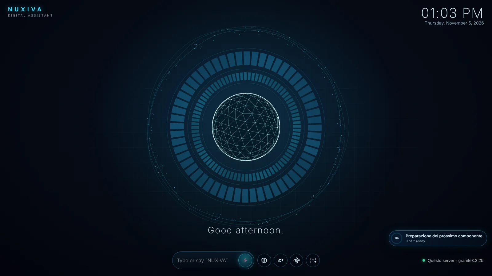
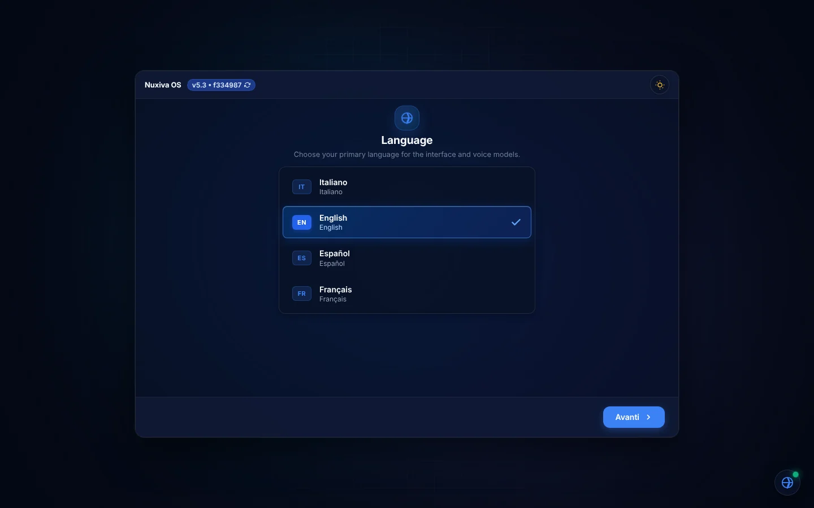
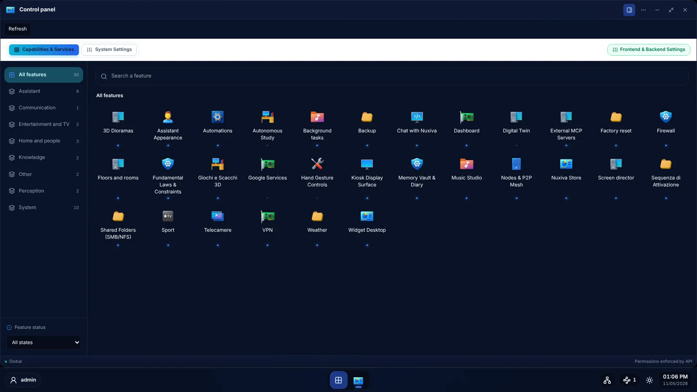
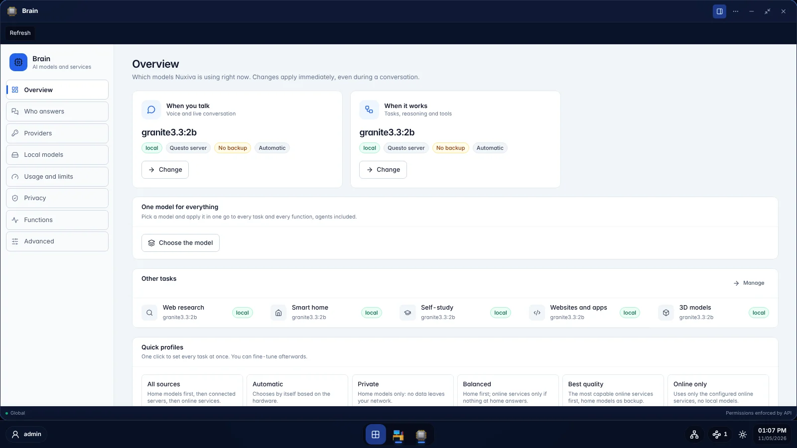
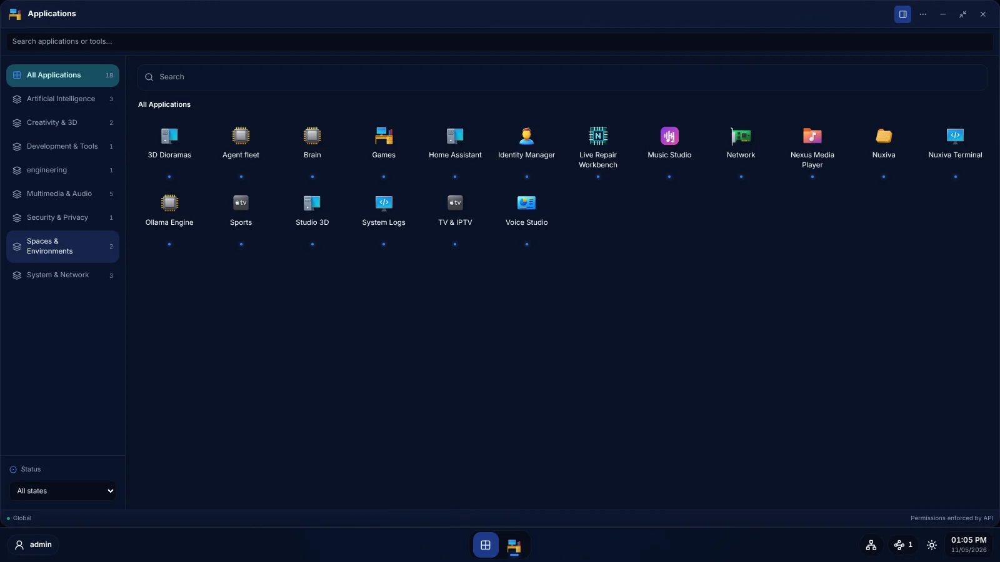
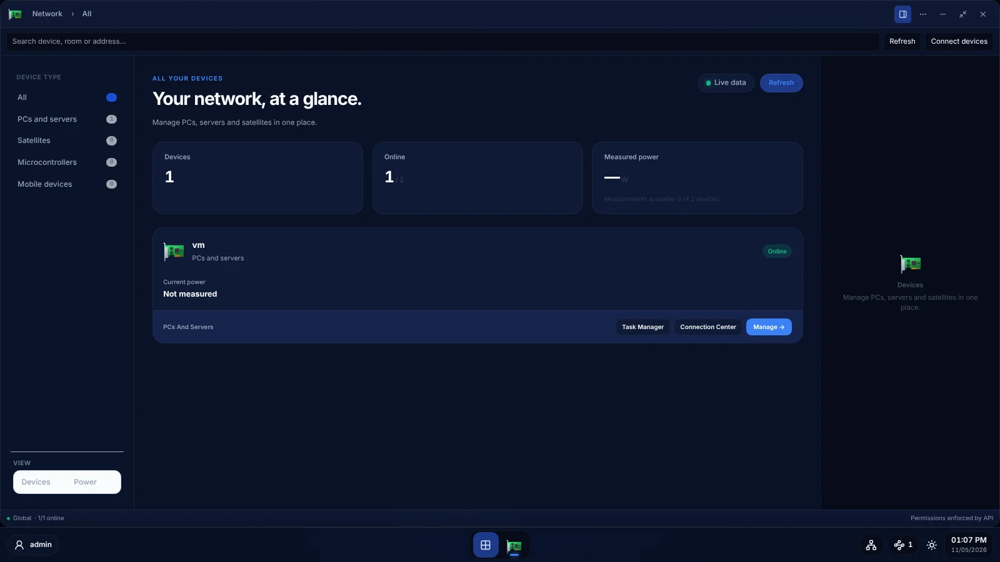
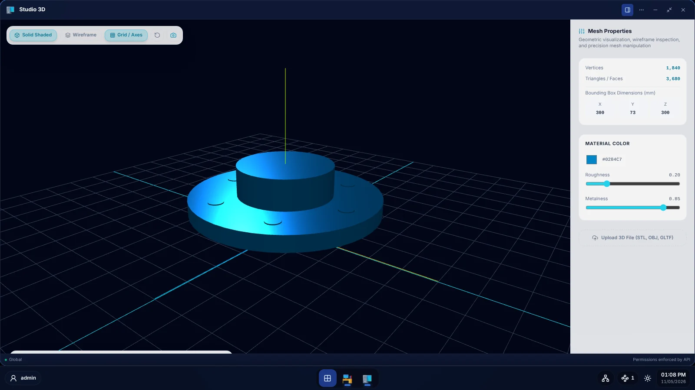
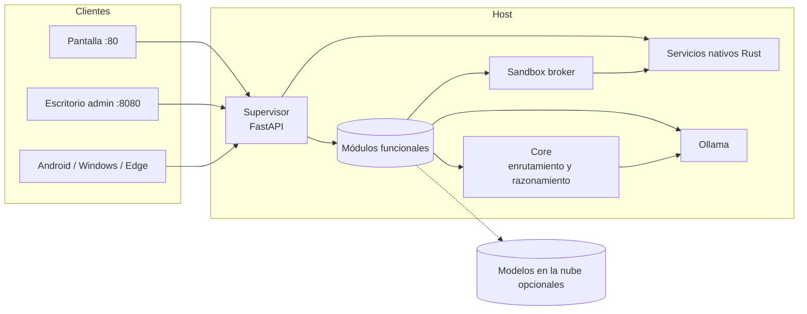
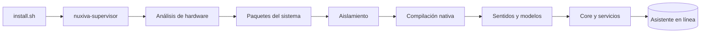

<div align="center">

# NUXIVA

**Un asistente para el hogar y el trabajo, autoalojado y local-first, que funciona en tu propio hardware.**

Voz, visión, domótica, agentes y herramientas en una única plataforma modular. Modelos de lenguaje locales por defecto, modelos en la nube solo si tú los añades.

[🇬🇧 English](README.md) · [🇮🇹 Italiano](README_IT.md) · [🇫🇷 Français](README_FR.md) · [🇪🇸 Español](README_ES.md)

[](https://github.com/AprileNunzio/Nuxiva/actions/workflows/ci.yml)


[](LICENSE)



</div>

---

## Índice

1. [Descripción general](#1-descripción-general)
2. [Capturas de pantalla](#2-capturas-de-pantalla)
3. [Capacidades](#3-capacidades)
4. [Arquitectura](#4-arquitectura)
5. [Modelo de seguridad](#5-modelo-de-seguridad)
6. [Instalación](#6-instalación)
7. [Operación](#7-operación)
8. [Configuración](#8-configuración)
9. [Ampliar Nuxiva](#9-ampliar-nuxiva)
10. [Estándares de ingeniería](#10-estándares-de-ingeniería)
11. [Proyecto](#11-proyecto)

---

## 1. Descripción general

Nuxiva convierte una máquina Linux, o un pequeño grupo de máquinas, en un asistente privado para el hogar y el trabajo. Todo lo que necesita se ejecuta en hardware de tu propiedad: reconocimiento de voz, síntesis de voz, reconocimiento facial, modelos de lenguaje, automatizaciones y almacenamiento. Nada sale de la red a menos que conectes un servicio externo a propósito.

Principios de diseño:

| Principio | Qué significa en la práctica |
| :--- | :--- |
| **Local first** | Los modelos de lenguaje se ejecutan mediante Ollama en el host o en un nodo que tú controlas. Los proveedores en la nube son opcionales y forman parte de la misma lista de prioridad que los modelos locales. |
| **Modular** | Cada capacidad es un módulo autodescriptivo que el supervisor descubre al arrancar. Añadir un módulo no requiere ningún registro central. |
| **Adaptado al hardware** | Las funciones que necesitan cámara, micrófono o GPU solo se activan cuando ese hardware está presente y es lo bastante rápido. |
| **Seguro por defecto** | Acceso de administración mediante Linux PAM, confirmaciones obligatorias para las acciones de riesgo, ejecución en sandbox del código generado, proxy de salida con lista de hosts permitidos y unidades systemd reforzadas. |
| **Automantenimiento** | Instalación por fases, actualizaciones condicionadas a la CI, reversión automática, autopruebas nocturnas y página de recuperación en modo seguro. |
| **Multilingüe** | Las interfaces están localizadas en inglés, italiano, francés y español, y el asistente responde en el idioma en que se le habla. |

---

## 2. Capturas de pantalla

Todas las capturas proceden de una compilación sin modificar de la rama `main`.

| | |
| :---: | :---: |
| <br>**Asistente de primer arranque** | <br>**Escritorio de administración: panel de control** |
| <br>**Brain: enrutamiento de modelos y perfiles** | <br>**Lanzador de aplicaciones** |
| <br>**Red, dispositivos y nodos** | <br>**Estudio 3D** |

---

## 3. Capacidades

Las capacidades se agrupan por área. Cada área se compone de módulos independientes en `installer_wizard/features/`; la lista de módulos crece con el tiempo, por lo que esta sección describe qué cubre cada área en lugar de enumerar cada módulo.

### Conversación y voz
Palabra de activación y reconocimiento de voz sin conexión, síntesis de voz neuronal en muchos idiomas, reconocimiento del hablante, conversación continua, clonación y diseño de voces, atenuación automática de los medios mientras el usuario habla, y chat remoto por texto, voz y foto mediante puentes de mensajería.

### Modelos y razonamiento
Una única lista de prioridad que combina los modelos locales de Ollama con proveedores en la nube opcionales (incluidos los endpoints compatibles con OpenAI) y cambia automáticamente de modelo cuando uno falla. Enrutamiento de modelos por tarea, perfiles de privacidad, límites de uso, ruta rápida para las solicitudes ya confirmadas, una biblioteca de algoritmos verificados y un ciclo de estudio en los momentos de inactividad que incorpora a las respuestas lo que ha aprendido.

### Agentes y automatización
Un agente que usa herramientas, planifica paso a paso y pide confirmación antes de las acciones de riesgo; un equipo de agentes especialistas elegidos por relevancia; una agencia de proyectos que convierte una solicitud en un grafo de tareas planificado y ejecutado por agentes en paralelo en un espacio de trabajo aislado; tareas en segundo plano que sobreviven a los reinicios; autonomía programada con aprobación humana para las acciones sensibles; y una forja que compone nuevas herramientas, widgets y módulos.

### Hogar y entorno
Integración con Home Assistant (habitaciones, plantas, dispositivos, presencia), un motor de automatizaciones con disparadores, condiciones, ramas, bucles, pasos en paralelo y trazas de ejecución, detección de hábitos, un gemelo digital que simula los comandos antes de ejecutarlos, alertas de emergencia, mapa de plantas y habitaciones, ubicación, meteorología y mapas.

### Personas, visión y seguridad
Perfiles por persona con datos privados que solo se muestran a la persona reconocida, reconocimiento facial local, gestión de cámaras con vista en directo y sensores por cámara, archivo de eventos NVR con búsqueda en lenguaje natural, control mediante gestos de las manos, explorador de red, cortafuegos alimentado por análisis nativo de paquetes, gestión de VPN multiprotocolo, caja fuerte cifrada, copias de seguridad verificables y restablecimiento de fábrica protegido.

### Pantalla, medios y creatividad
Un escritorio de widgets en el que la información aparece cuando es relevante, un director de pantalla que organiza las pantallas entre dispositivos, modo quiosco, una presencia animada del asistente, reproducción multimedia con transmisión, IPTV, deportes en directo, un estudio de música, una pizarra compartida, generación y visualización de modelos 3D, composición de escenas 3D y juegos.

### Trabajo y productividad
Vinculación de la cuenta de Google por persona (calendario, correo, tareas, contactos, Drive), generación de documentos de oficina (Word, Excel, PowerPoint, OpenDocument, PDF), un estudio de desarrollo de software con ejecución aislada de pruebas, carpetas de red protegidas, impresoras y dispositivos CNC, integración con el banco de reparación y gestión de Proxmox.

### Sistema y mantenimiento
Supervisión de servicios con backoff y detección de bloqueos, planificación de tipo cron con recuperación de ejecuciones perdidas, un regulador de recursos que aplaza el trabajo en segundo plano bajo carga, gestión de hardware y controladores, gestión de Bluetooth y dispositivos de audio, emparejamiento y control multinodo, registros del sistema con exportación protegida y una tienda modular para capacidades opcionales.

### Clientes
| Cliente | Ruta | Función |
| :--- | :--- | :--- |
| Web | `client_web/` | Escritorio de administración en el puerto 8080 (React, TypeScript, Vite, Tailwind) |
| Pantalla | `installer_wizard/web/` | Pantalla de quiosco, asistente de configuración y páginas de activación en el puerto 80 |
| Android | `client_apk/` | Palabra de activación, reconocimiento de la voz, flujo de cámara, descubrimiento del servidor, datos de salud de dispositivos BLE y Health Connect |
| Windows | `client_satellite/windows_assistant/` | Asistente de escritorio activable por voz o atajo de teclado, control de archivos y aplicaciones con permisos, actualizaciones firmadas |
| Edge | `client_satellite/linux_edge/`, `client_satellite/microcontrollers/` | Nodos edge Linux y satélites ESP32 |
| Context bridge | `client_satellite/context_bridge/` | Puente para los sensores del escritorio |

---

## 4. Arquitectura



| Componente | Ruta | Tecnología | Responsabilidad |
| :--- | :--- | :--- | :--- |
| Supervisor | `installer_wizard/backend/` | Python, FastAPI, Uvicorn | Instalación, ciclo de vida, API HTTP y WebSocket, autenticación, actualizaciones, descubrimiento de módulos |
| Módulos funcionales | `installer_wizard/features/` | Python | Capacidades: rutas, comandos de voz y chat, herramientas para agentes, traducciones |
| Widgets | `installer_wizard/widgets/` | JavaScript, CSS | Widgets de pantalla autodescriptivos |
| Core | `server/` | Python | Enrutamiento de solicitudes, motores de razonamiento, motor de decisión, plasticidad, event sourcing, generación de habilidades |
| Capa nativa | `native/crates/` | Rust (edition 2024) | Código crítico para el rendimiento y la seguridad, expuesto a Python mediante PyO3 |
| Sandbox broker | `sandbox_broker/` | Python, Rust | Ejecución aislada del código generado, control del tráfico saliente |
| Instalador | `scripts/os/` | Bash, systemd | Arranque, pasos de instalación, unidades, `nuxivactl` |
| Cliente web | `client_web/` | React, TypeScript | Escritorio de administración |

### 4.1 Flujo de una solicitud

Una solicitud de texto o voz la gestiona el enrutador del chat en `installer_wizard/features/chat/`. Recorre una cadena ordenada de etapas (automatizaciones, comandos directos, habilidades de intención, conectores, control del hogar, acciones, conversación). La primera etapa que reconoce la solicitud responde; las demás se omiten. Las solicitudes que necesitan información actualizada se delegan al agente, que busca antes de responder. La generación recorre la lista de prioridad de modelos y omite los que fallan, de modo que un modelo no disponible nunca bloquea una respuesta.

### 4.2 Razonamiento del Core

El Core (`server/core/`) clasifica las solicitudes, estima su complejidad y elige en consecuencia un motor de razonamiento. Un motor de decisión evalúa los modelos y acciones candidatos en varios ejes (calidad, calibración, velocidad, coste, seguridad) con probabilidades calibradas y estimaciones de incertidumbre. Las solicitudes confirmadas se guardan en un índice nativo de embeddings para poder responderlas por una ruta rápida; un planificador de plasticidad refuerza, debilita, hace decaer y elimina esas entradas con el tiempo. Las fórmulas y umbrales exactos están en el código en `server/core/orchestrator/`, `server/core/decision/` y `server/core/plasticity/`.

### 4.3 Capa nativa Rust

El workspace de Rust en `native/` agrupa los crates que necesitan velocidad, seguridad de memoria o aislamiento estricto: bus de mensajes, análisis de paquetes para el cortafuegos, proxy de salida, replicación CRDT entre nodos, DSP de audio, reconocimiento de gestos, arbitraje de pantallas y ventanas, tokens firmados, lectura de sensores de salud, aprovisionamiento de satélites, motor de la agencia de proyectos (dominio, planificador, programador, registro encadenado con HMAC, índice de código, demonio) y el puente PyO3. La lista completa de crates está en `native/Cargo.toml`.

### 4.4 Proceso de instalación



`install.sh` solo instala el supervisor. Después, el supervisor ejecuta los pasos de instalación definidos en `installer_wizard/backend/steps.py` (scripts en `scripts/os/steps/`), muestra el progreso en pantalla y deja el asistente utilizable lo antes posible mientras las descargas grandes continúan en segundo plano. Los pasos no críticos pueden fallar sin bloquear a los demás y se reintentan o reparan automáticamente.

---

## 5. Modelo de seguridad

| Capa | Mecanismo |
| :--- | :--- |
| Autenticación | Inicio de sesión de administración mediante Linux PAM (servicio `nuxiva-admin`), restringido a cuentas administrativas; cookies de sesión HTTP-only firmadas con HMAC y con caducidad; límite de intentos de inicio de sesión |
| Integridad de las solicitudes | Validación de origen y host, cabecera dedicada en las llamadas que modifican el estado, Content Security Policy estricta con Trusted Types |
| Protección del primer arranque | El asistente de configuración solo es accesible desde la red local y solo hasta que la configuración se completa |
| Autorización | Confirmaciones obligatorias para las acciones de riesgo, biometría de voz opcional, visibilidad por persona de los datos privados |
| Ejecución de código | El código generado solo se ejecuta dentro del sandbox broker, sin red ni acceso al host por defecto, opcionalmente con gVisor o en micro-VM Firecracker |
| Red | Tráfico saliente de la sandbox a través del proxy Rust (solo hosts permitidos, direcciones privadas y de loopback rechazadas); análisis nativo de paquetes para el cortafuegos; reglas del cortafuegos probadas con `nftables` real en la CI |
| Secretos | Credenciales de la nube en una caja fuerte cifrada en `/etc/nuxiva/`; secretos borrados de la memoria en el código nativo |
| Servicios | Los servicios aislados (Core, agencia, netguard) se ejecutan con usuarios dedicados o dinámicos, `NoNewPrivileges`, capacidades restringidas y refuerzo `ProtectSystem` |
| Actualizaciones | Solo se instalan revisiones cuyas comprobaciones de CI han sido satisfactorias; las revisiones que fallan se revierten automáticamente |
| Código nativo | `unsafe_code = "forbid"` en todo el workspace; Clippy prohíbe `unwrap`, `expect` y `panic` |

Las vulnerabilidades deben comunicarse de forma privada como se describe en [SECURITY.md](SECURITY.md).

---

## 6. Instalación

### Requisitos

| | Mínimo | Recomendado |
| :--- | :--- | :--- |
| Sistema operativo | Debian 12 o Ubuntu 22.04+ | Última Debian estable o Ubuntu LTS |
| Arquitectura | x86_64 o arm64 | x86_64 con AVX2 |
| CPU | 4 núcleos | 8+ núcleos |
| Memoria | 8 GB | 16–32 GB |
| Almacenamiento | 30 GB | 100+ GB NVMe |
| GPU | No necesaria (modelos CPU cuantizados) | NVIDIA con 8 GB+ de VRAM |
| Periféricos | Ninguno (headless) | Micrófono, altavoces, webcam, pantalla |

Las máquinas más pequeñas pueden usar un nodo Ollama remoto o modelos en la nube. En Windows, usa WSL2 o el script experimental `install.ps1`.

### Instalación con un solo comando

```bash
curl -fsSL https://raw.githubusercontent.com/AprileNunzio/Nuxiva/main/install.sh | sudo bash
```

En sistemas mínimos sin `curl`:

```bash
sudo apt update && sudo apt install -y curl && curl -fsSL https://raw.githubusercontent.com/AprileNunzio/Nuxiva/main/install.sh | sudo bash
```

### Instalación desde un clon

```bash
sudo git clone https://github.com/AprileNunzio/Nuxiva.git /opt/Nuxiva
cd /opt/Nuxiva
sudo bash install.sh
```

### Primer arranque

1. Abre `http://<host>/` desde cualquier dispositivo de la red local. La pantalla muestra el progreso de la instalación y se convierte en el asistente en cuanto está listo; no hace falta reiniciar.
2. Completa el asistente opcional en `http://<host>/setup`: idioma, red, componentes, motor de inteligencia artificial (local, remoto o en la nube), nombre del asistente, micrófono y voz. Las elecciones se guardan de forma atómica y sobreviven a los cortes de corriente.
3. Abre el escritorio de administración en `http://<host>:8080/` e inicia sesión con una cuenta de administrador de Linux.

---

## 7. Operación

### Línea de comandos

```bash
nuxivactl status          # fase, progreso y estado de los pasos
nuxivactl background      # descargas en cola en segundo plano
nuxivactl logs [origen]   # install, supervisor, core, ollama, voice, vision, ear
nuxivactl setup-code      # código de emparejamiento para el asistente de configuración
nuxivactl version         # revisión instalada
sudo nuxivactl update     # instala la última revisión que superó la CI
sudo nuxivactl force-upgrade [rama]
sudo nuxivactl repair     # repara una instalación dañada
```

### Actualizaciones y recuperación

El actualizador (`installer_wizard/backend/updater.py`) instala una revisión solo después de que sus comprobaciones de CI hayan sido satisfactorias. Una revisión que no arranca se marca como defectuosa y `nuxiva-rollback.service` restaura la última revisión que funcionaba. Si el sistema no puede arrancar en absoluto, se sirven una página en modo seguro y un script de reparación.

### Puertos de red

| Puerto | Servicio |
| :---: | :--- |
| 80 | Pantalla, quiosco, asistente de configuración, chat |
| 8080 | Escritorio de administración, API REST, servidor MCP (`/mcp`) |
| 443 | HTTPS opcional con certificados generados localmente |
| 8443 | API del Core (interna) |
| 11434 | Ollama, escuchando en loopback |

### Servicios y rutas

Las unidades systemd están definidas en `scripts/os/systemd/` (supervisor, core, sandbox, netguard, agency, ear, vision, voice, rollback).

| Ruta | Contenido |
| :--- | :--- |
| `/opt/Nuxiva` | Código de la aplicación |
| `/etc/nuxiva/nuxiva.env` | Configuración (variables `NUXIVA_*`) |
| `/etc/nuxiva/` | Claves, certificados y caja fuerte cifrada |
| `/var/lib/nuxiva/` | Estado de la aplicación |
| `/var/log/nuxiva/` | Registros de instalación y auditoría |

---

## 8. Configuración

La configuración se guarda como variables `NUXIVA_*` en `/etc/nuxiva/nuxiva.env` y se puede modificar desde el escritorio de administración (Panel de control → Ajustes del sistema). Cada módulo declara sus propios ajustes en su `feature.json`, así que las nuevas opciones aparecen automáticamente en la interfaz.

Ajustes habituales:

| Variable | Finalidad |
| :--- | :--- |
| `NUXIVA_UI_LANG` | Idioma de la interfaz (`en`, `it`, `fr`, `es`) |
| `NUXIVA_OLLAMA_URL` | Usar un nodo Ollama remoto en lugar del local |
| `NUXIVA_ALLOWED_HOSTS` | Nombres de host adicionales aceptados por el control de origen |
| `NUXIVA_PUBLIC_PORT`, `NUXIVA_ADMIN_PORT` | Sustituyen los puertos predeterminados |

Los proveedores de modelos en la nube se añaden desde la aplicación **Brain**. Son opcionales, se integran en la misma lista de prioridad que los modelos locales y pueden limitarse por tarea mediante los perfiles de privacidad.

---

## 9. Ampliar Nuxiva

Un módulo es una carpeta en `installer_wizard/features/<id>/`, o en `/var/lib/nuxiva/features/<id>/` para los módulos instalados localmente:

```text
features/<id>/
├── feature.json     metadatos, categoría, ajustes, capacidades, icono
├── api.py           rutas HTTP                             (opcional)
├── commands.py      comandos de voz y chat                 (opcional)
├── tools.py         herramientas para agentes y clientes MCP (opcional)
└── language/        en.json, it.json, fr.json, es.json
```

Los widgets siguen el mismo esquema en `installer_wizard/widgets/<id>/` (`widget.json`, `widget.js`, `widget.css`, `language/`). El supervisor descubre módulos y widgets al arrancar; las herramientas quedan disponibles para el agente, el equipo de especialistas y los clientes MCP externos sin conexiones adicionales.

Se pueden conectar servidores MCP externos como fuentes de herramientas, y Nuxiva expone sus propias herramientas, recursos y prompts como servidor MCP en el puerto 8080 (consulta `installer_wizard/MCP.md`).

---

## 10. Estándares de ingeniería

| Área | Estándar |
| :--- | :--- |
| Arquitectura | Clean Architecture, separación de responsabilidades, colocación por funcionalidad, archivos pequeños y de propósito único |
| Python | Python 3.11+, servicios FastAPI tipados, comprobaciones de sintaxis y `pyflakes` en cada push |
| Rust | Edition 2024, `unsafe_code` prohibido en todo el workspace, Clippy `all` como error, `rustfmt` obligatorio |
| Web | React y TypeScript, CSP estricta, i18n completa sin textos escritos en el código, diseños adaptables |
| Gestión de errores | Excepciones gestionadas en los límites de E/S, red y almacenamiento; manejadores globales; los errores nunca se descartan en silencio |
| Pruebas | Pruebas unitarias y de API para el supervisor, el Core y la sandbox; pruebas de paridad nativa; pruebas de Rust; reglas del cortafuegos con `nftables` real; pruebas del cliente web |
| CI | `.github/workflows/ci.yml` ejecuta todas las comprobaciones en cada push; flujos de trabajo dedicados compilan el paquete web y el asistente de Windows |

---

## 11. Proyecto

- **Contribuir:** consulta [CONTRIBUTING.md](CONTRIBUTING.md) y el [Código de conducta](CODE_OF_CONDUCT.md).
- **Seguridad:** consulta [SECURITY.md](SECURITY.md).
- **Software de terceros:** consulta [THIRD_PARTY_NOTICES.md](THIRD_PARTY_NOTICES.md).
- **Licencia:** [Nuxiva Personal and Commercial License 1.0](LICENSE). Las revisiones anteriores distribuidas con licencia MIT siguen cubiertas por [LICENSE-MIT-LEGACY](LICENSE-MIT-LEGACY).

### Apoya el proyecto

Si Nuxiva te resulta útil, puedes apoyar su desarrollo:

<p align="center">
  <a href="https://www.paypal.com/paypalme/NunzioAprile">
    
  </a>
</p>
