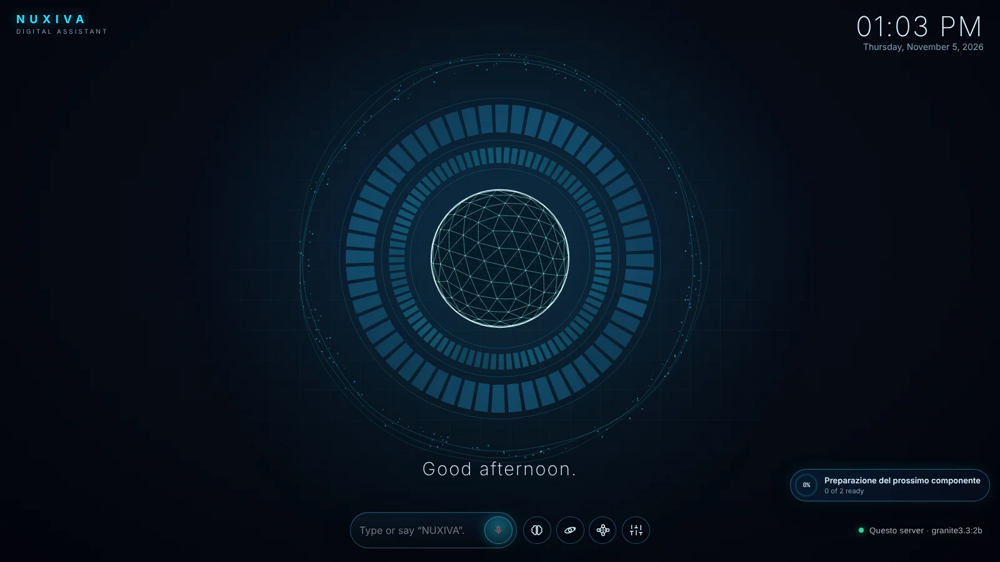
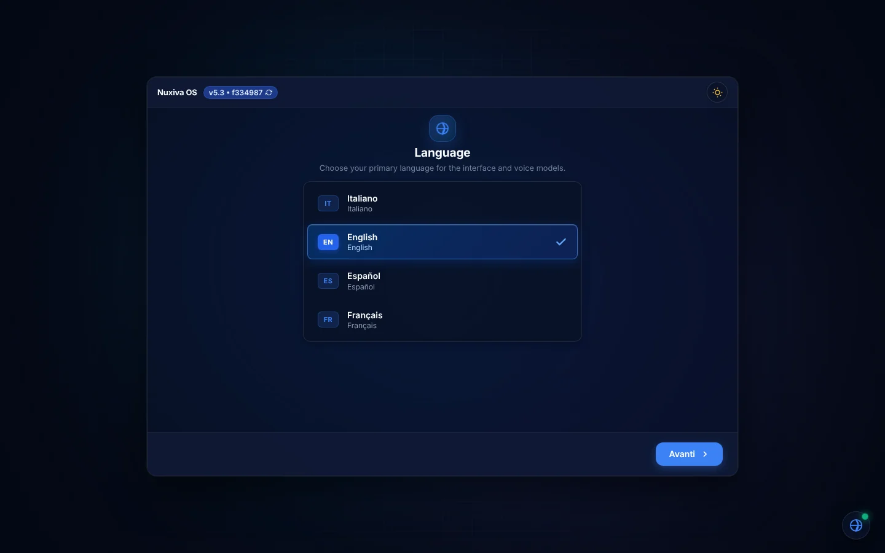
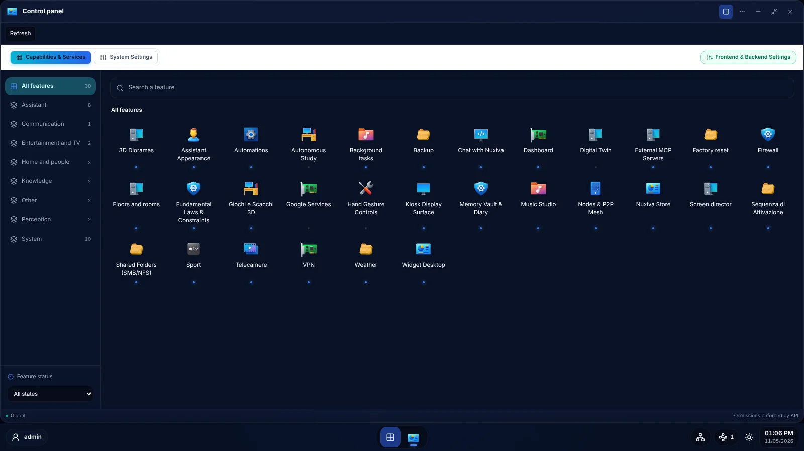
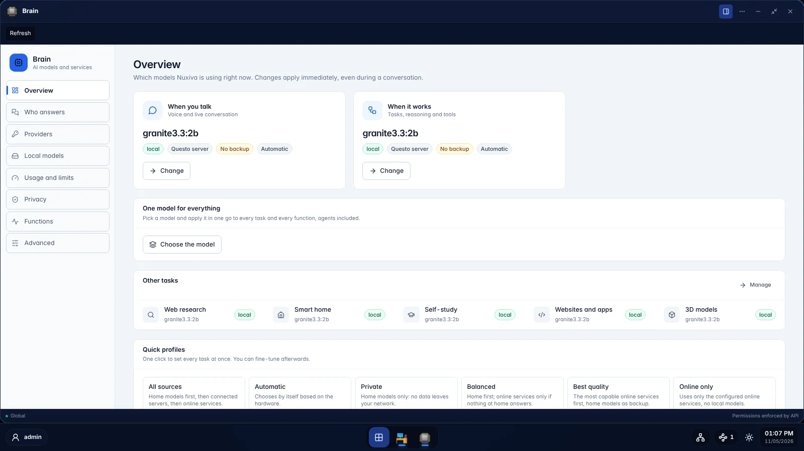
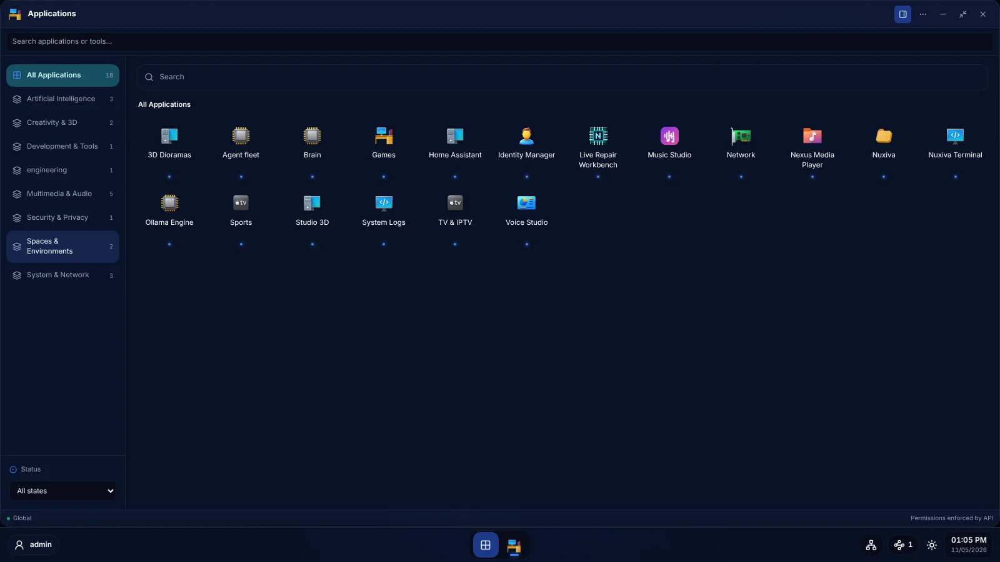
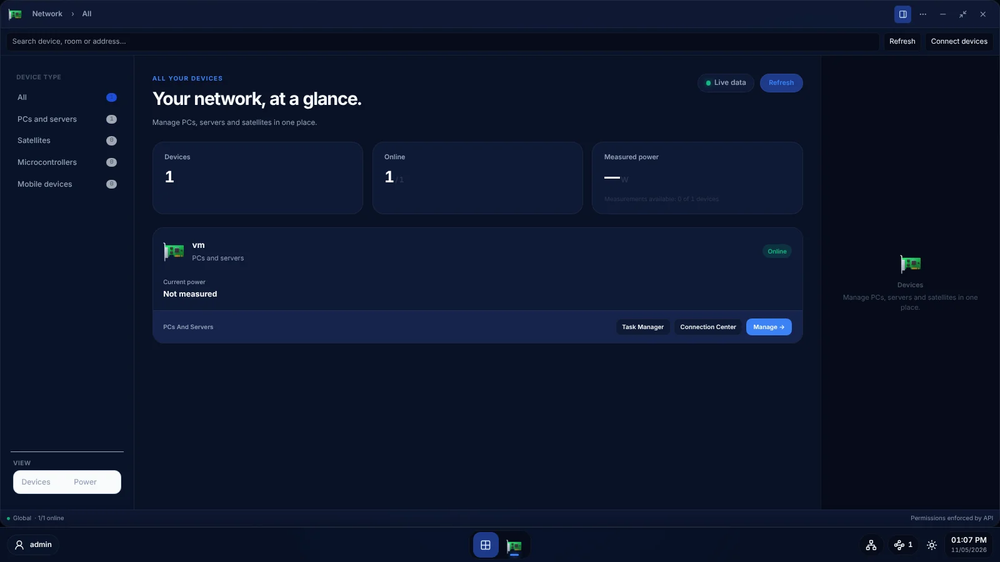
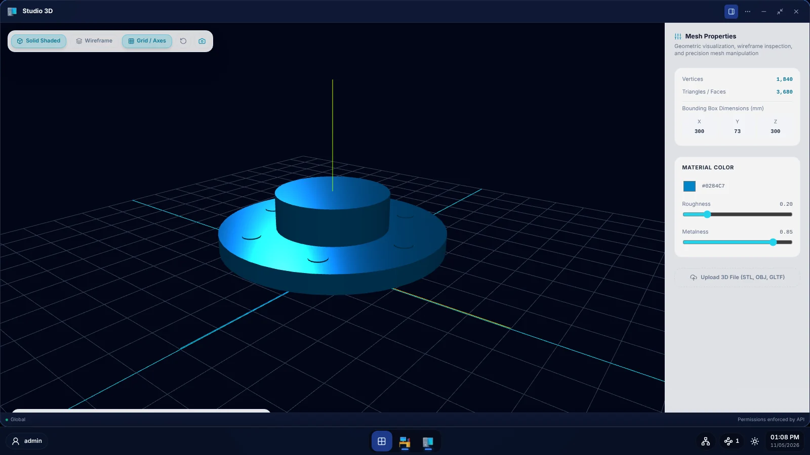
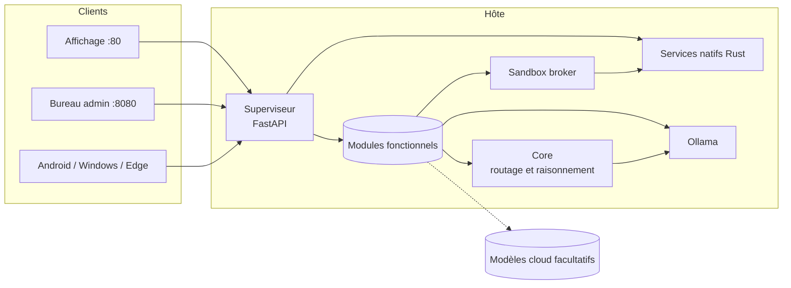
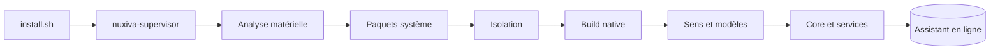

<div align="center">

# NUXIVA

**Un assistant pour la maison et le travail, auto-hébergé et local-first, qui fonctionne sur votre propre matériel.**

Voix, vision, domotique, agents et outils réunis dans une plateforme modulaire. Modèles de langage locaux par défaut, modèles cloud uniquement si vous les ajoutez.

[🇬🇧 English](README.md) · [🇮🇹 Italiano](README_IT.md) · [🇫🇷 Français](README_FR.md) · [🇪🇸 Español](README_ES.md)

[](https://github.com/AprileNunzio/Nuxiva/actions/workflows/ci.yml)


[](LICENSE)



</div>

---

## Sommaire

1. [Présentation](#1-présentation)
2. [Captures d'écran](#2-captures-décran)
3. [Fonctionnalités](#3-fonctionnalités)
4. [Architecture](#4-architecture)
5. [Modèle de sécurité](#5-modèle-de-sécurité)
6. [Installation](#6-installation)
7. [Exploitation](#7-exploitation)
8. [Configuration](#8-configuration)
9. [Étendre Nuxiva](#9-étendre-nuxiva)
10. [Normes d'ingénierie](#10-normes-dingénierie)
11. [Projet](#11-projet)

---

## 1. Présentation

Nuxiva transforme une machine Linux, ou un petit groupe de machines, en assistant privé pour la maison et le travail. Tout ce dont il a besoin tourne sur du matériel qui vous appartient : reconnaissance vocale, synthèse vocale, reconnaissance faciale, modèles de langage, automatisations et stockage. Rien ne quitte le réseau, sauf si vous connectez volontairement un service externe.

Principes de conception :

| Principe | Ce que cela signifie en pratique |
| :--- | :--- |
| **Local first** | Les modèles de langage tournent via Ollama sur l'hôte ou sur un nœud que vous contrôlez. Les fournisseurs cloud sont facultatifs et figurent dans la même liste de priorité que les modèles locaux. |
| **Modulaire** | Chaque fonctionnalité est un module autodescriptif que le superviseur découvre au démarrage. Ajouter un module ne demande aucun enregistrement central. |
| **Adapté au matériel** | Les fonctions qui nécessitent une caméra, un microphone ou un GPU ne s'activent que si ce matériel est présent et suffisamment rapide. |
| **Sécurisé par défaut** | Accès administrateur via Linux PAM, validations obligatoires pour les actions à risque, exécution en sandbox du code généré, proxy de sortie à liste d'hôtes autorisés et unités systemd renforcées. |
| **Auto-maintenance** | Installation par étapes, mises à jour conditionnées à la CI, retour arrière automatique, autotests nocturnes et page de récupération en mode sans échec. |
| **Multilingue** | Les interfaces sont localisées en anglais, italien, français et espagnol, et l'assistant répond dans la langue dans laquelle on lui parle. |

---

## 2. Captures d'écran

Toutes les captures proviennent d'une build non modifiée de la branche `main`.

| | |
| :---: | :---: |
| <br>**Assistant de premier démarrage** | <br>**Bureau d'administration : panneau de configuration** |
| <br>**Brain : routage des modèles et profils** | <br>**Lanceur d'applications** |
| <br>**Réseau, appareils et nœuds** | <br>**Studio 3D** |

---

## 3. Fonctionnalités

Les fonctionnalités sont regroupées par domaine. Chaque domaine est composé de modules indépendants dans `installer_wizard/features/` ; la liste des modules s'enrichit au fil du temps, cette section décrit donc ce que couvre chaque domaine plutôt que d'énumérer chaque module.

### Conversation et voix
Mot d'activation et reconnaissance vocale hors ligne, synthèse vocale neuronale en de nombreuses langues, reconnaissance du locuteur, conversation continue, clonage et conception de voix, atténuation automatique des médias pendant que l'utilisateur parle, et discussion à distance par texte, voix et photo via des passerelles de messagerie.

### Modèles et raisonnement
Une liste de priorité unique qui combine les modèles locaux d'Ollama avec des fournisseurs cloud facultatifs (points de terminaison compatibles OpenAI inclus) et bascule automatiquement lorsqu'un modèle échoue. Routage des modèles par tâche, profils de confidentialité, limites d'utilisation, chemin rapide pour les requêtes déjà confirmées, bibliothèque d'algorithmes vérifiés et boucle d'étude pendant les périodes d'inactivité qui réinjecte dans les réponses ce qu'elle a appris.

### Agents et automatisation
Un agent qui utilise des outils, planifie étape par étape et demande confirmation avant les actions à risque ; une équipe d'agents spécialistes choisis selon leur pertinence ; une agence de projet qui transforme une demande en graphe de tâches planifié, exécuté par des agents en parallèle dans un espace de travail isolé ; des tâches en arrière-plan qui survivent aux redémarrages ; une autonomie planifiée avec approbation humaine pour les actions sensibles ; et une forge qui compose de nouveaux outils, widgets et modules.

### Maison et environnement
Intégration Home Assistant (pièces, étages, appareils, présence), moteur d'automatisations avec déclencheurs, conditions, branches, boucles, étapes parallèles et traces d'exécution, détection des habitudes, jumeau numérique qui simule les commandes avant de les exécuter, alertes d'urgence, cartographie des étages et des pièces, localisation, météo et cartes.

### Personnes, vision et sécurité
Profils par personne avec des données privées affichées uniquement à la personne reconnue, reconnaissance faciale locale, gestion des caméras avec vue en direct et capteurs par caméra, archive d'événements NVR avec recherche en langage naturel, contrôle par gestes de la main, explorateur réseau, pare-feu alimenté par une analyse native des paquets, gestion VPN multiprotocole, coffre-fort chiffré, sauvegardes vérifiables et réinitialisation d'usine protégée.

### Affichage, médias et création
Un bureau à widgets où l'information apparaît quand elle est pertinente, un directeur d'affichage qui organise les écrans entre les appareils, un mode kiosque, une présence animée de l'assistant, lecture multimédia avec diffusion, IPTV, sport en direct, un studio de musique, un tableau blanc partagé, génération et visualisation de modèles 3D, composition de scènes 3D et jeux.

### Travail et productivité
Liaison du compte Google par personne (agenda, courrier, tâches, contacts, Drive), génération de documents bureautiques (Word, Excel, PowerPoint, OpenDocument, PDF), un studio de développement logiciel avec exécution isolée des tests, dossiers réseau protégés, imprimantes et appareils CNC, intégration avec un banc de réparation et gestion de Proxmox.

### Système et maintenance
Supervision des services avec backoff et détection des blocages, planification de type cron avec rattrapage des exécutions manquées, un régulateur de ressources qui reporte le travail en arrière-plan sous charge, gestion du matériel et des pilotes, gestion du Bluetooth et des périphériques audio, appairage et contrôle multi-nœuds, journaux système avec export protégé et un store modulaire pour les fonctionnalités facultatives.

### Clients
| Client | Chemin | Rôle |
| :--- | :--- | :--- |
| Web | `client_web/` | Bureau d'administration sur le port 8080 (React, TypeScript, Vite, Tailwind) |
| Affichage | `installer_wizard/web/` | Écran kiosque, assistant de configuration et pages d'activation sur le port 80 |
| Android | `client_apk/` | Mot d'activation, reconnaissance de la voix, flux caméra, découverte du serveur, données de santé depuis des appareils BLE et Health Connect |
| Windows | `client_satellite/windows_assistant/` | Assistant de bureau activable par la voix ou par raccourci, contrôle des fichiers et applications soumis à autorisation, mises à jour signées |
| Edge | `client_satellite/linux_edge/`, `client_satellite/microcontrollers/` | Nœuds edge Linux et satellites ESP32 |
| Context bridge | `client_satellite/context_bridge/` | Passerelle pour les capteurs du poste de travail |

---

## 4. Architecture



| Composant | Chemin | Technologie | Responsabilité |
| :--- | :--- | :--- | :--- |
| Superviseur | `installer_wizard/backend/` | Python, FastAPI, Uvicorn | Installation, cycle de vie, API HTTP et WebSocket, authentification, mises à jour, découverte des modules |
| Modules fonctionnels | `installer_wizard/features/` | Python | Fonctionnalités : routes, commandes vocales et de chat, outils pour les agents, traductions |
| Widgets | `installer_wizard/widgets/` | JavaScript, CSS | Widgets d'affichage autodescriptifs |
| Core | `server/` | Python | Routage des requêtes, moteurs de raisonnement, moteur de décision, plasticité, event sourcing, génération de compétences |
| Couche native | `native/crates/` | Rust (edition 2024) | Code critique pour les performances et la sécurité, exposé à Python via PyO3 |
| Sandbox broker | `sandbox_broker/` | Python, Rust | Exécution isolée du code généré, contrôle du trafic sortant |
| Installateur | `scripts/os/` | Bash, systemd | Amorçage, étapes d'installation, unités, `nuxivactl` |
| Client web | `client_web/` | React, TypeScript | Bureau d'administration |

### 4.1 Traitement d'une requête

Une requête texte ou vocale est prise en charge par le routeur de chat dans `installer_wizard/features/chat/`. Elle traverse une chaîne ordonnée d'étapes (automatisations, commandes directes, compétences d'intention, connecteurs, contrôle de la maison, actions, conversation). La première étape qui reconnaît la requête y répond ; les autres sont ignorées. Les requêtes qui nécessitent des informations à jour sont confiées à l'agent, qui effectue une recherche avant de répondre. La génération parcourt la liste de priorité des modèles et ignore ceux qui échouent, si bien qu'un modèle indisponible ne bloque jamais une réponse.

### 4.2 Raisonnement du Core

Le Core (`server/core/`) classe les requêtes, estime leur complexité et choisit en conséquence un moteur de raisonnement. Un moteur de décision évalue les modèles et actions candidats sur plusieurs axes (qualité, calibration, vitesse, coût, sécurité) avec des probabilités calibrées et des estimations d'incertitude. Les requêtes confirmées sont stockées dans un index natif d'embeddings afin d'y répondre par un chemin rapide ; un planificateur de plasticité renforce, affaiblit, fait décroître et supprime ces entrées au fil du temps. Les formules et seuils exacts se trouvent dans le code sous `server/core/orchestrator/`, `server/core/decision/` et `server/core/plasticity/`.

### 4.3 Couche native Rust

Le workspace Rust dans `native/` regroupe les crates qui exigent rapidité, sûreté mémoire ou isolation stricte : bus de messages, analyse de paquets pour le pare-feu, proxy de sortie, réplication CRDT entre nœuds, DSP audio, reconnaissance des gestes, arbitrage des écrans et des fenêtres, jetons signés, lecture des capteurs de santé, provisionnement des satellites, moteur de l'agence de projet (domaine, planificateur, ordonnanceur, registre chaîné par HMAC, index du code, démon) et la passerelle PyO3. La liste complète des crates se trouve dans `native/Cargo.toml`.

### 4.4 Pipeline d'installation



`install.sh` n'installe que le superviseur. Le superviseur exécute ensuite les étapes d'installation définies dans `installer_wizard/backend/steps.py` (scripts dans `scripts/os/steps/`), affiche la progression à l'écran et rend l'assistant utilisable le plus tôt possible pendant que les gros téléchargements se poursuivent en arrière-plan. Les étapes non critiques peuvent échouer sans bloquer les autres et sont relancées ou réparées automatiquement.

---

## 5. Modèle de sécurité

| Couche | Mécanisme |
| :--- | :--- |
| Authentification | Connexion administrateur via Linux PAM (service `nuxiva-admin`), réservée aux comptes administratifs ; cookies de session HTTP-only signés par HMAC avec expiration ; limitation des tentatives de connexion |
| Intégrité des requêtes | Validation de l'origine et de l'hôte, en-tête dédié sur les appels qui modifient l'état, Content Security Policy stricte avec Trusted Types |
| Protection du premier démarrage | L'assistant de configuration n'est accessible que depuis le réseau local et seulement tant que la configuration n'est pas terminée |
| Autorisation | Validations obligatoires pour les actions à risque, biométrie vocale facultative, visibilité des données privées par personne |
| Exécution du code | Le code généré ne s'exécute que dans le sandbox broker, sans réseau ni accès à l'hôte par défaut, éventuellement sous gVisor ou dans des micro-VM Firecracker |
| Réseau | Trafic sortant de la sandbox via le proxy Rust (hôtes autorisés uniquement, adresses privées et de bouclage refusées) ; analyse native des paquets pour le pare-feu ; règles du pare-feu testées sur un `nftables` réel en CI |
| Secrets | Identifiants cloud dans un coffre-fort chiffré sous `/etc/nuxiva/` ; secrets effacés de la mémoire dans le code natif |
| Services | Les services isolés (Core, agence, netguard) tournent avec des utilisateurs dédiés ou dynamiques, `NoNewPrivileges`, des capacités restreintes et un durcissement `ProtectSystem` |
| Mises à jour | Seules les révisions dont les vérifications CI ont réussi sont installées ; les révisions défaillantes sont annulées automatiquement |
| Code natif | `unsafe_code = "forbid"` sur tout le workspace ; Clippy interdit `unwrap`, `expect` et `panic` |

Les vulnérabilités doivent être signalées en privé comme décrit dans [SECURITY.md](SECURITY.md).

---

## 6. Installation

### Prérequis

| | Minimum | Recommandé |
| :--- | :--- | :--- |
| Système d'exploitation | Debian 12 ou Ubuntu 22.04+ | Dernière Debian stable ou Ubuntu LTS |
| Architecture | x86_64 ou arm64 | x86_64 avec AVX2 |
| CPU | 4 cœurs | 8+ cœurs |
| Mémoire | 8 Go | 16–32 Go |
| Stockage | 30 Go | 100+ Go NVMe |
| GPU | Non requis (modèles CPU quantifiés) | NVIDIA avec 8 Go+ de VRAM |
| Périphériques | Aucun (headless) | Microphone, haut-parleurs, webcam, écran |

Les machines plus modestes peuvent utiliser un nœud Ollama distant ou des modèles cloud. Sous Windows, utilisez WSL2 ou le script expérimental `install.ps1`.

### Installation en une commande

```bash
curl -fsSL https://raw.githubusercontent.com/AprileNunzio/Nuxiva/main/install.sh | sudo bash
```

Sur les systèmes minimaux sans `curl` :

```bash
sudo apt update && sudo apt install -y curl && curl -fsSL https://raw.githubusercontent.com/AprileNunzio/Nuxiva/main/install.sh | sudo bash
```

### Installation depuis un clone

```bash
sudo git clone https://github.com/AprileNunzio/Nuxiva.git /opt/Nuxiva
cd /opt/Nuxiva
sudo bash install.sh
```

### Premier démarrage

1. Ouvrez `http://<hôte>/` depuis n'importe quel appareil du réseau local. L'écran affiche la progression de l'installation et devient l'assistant dès qu'il est prêt ; aucun redémarrage n'est nécessaire.
2. Complétez l'assistant facultatif sur `http://<hôte>/setup` : langue, réseau, composants, moteur d'intelligence artificielle (local, distant ou cloud), nom de l'assistant, microphone et voix. Les choix sont enregistrés de manière atomique et survivent aux coupures de courant.
3. Ouvrez le bureau d'administration sur `http://<hôte>:8080/` et connectez-vous avec un compte administrateur Linux.

---

## 7. Exploitation

### Ligne de commande

```bash
nuxivactl status          # phase, progression et état des étapes
nuxivactl background      # téléchargements en file d'attente
nuxivactl logs [source]   # install, supervisor, core, ollama, voice, vision, ear
nuxivactl setup-code      # code d'appairage pour l'assistant de configuration
nuxivactl version         # révision installée
sudo nuxivactl update     # installe la dernière révision validée par la CI
sudo nuxivactl force-upgrade [branche]
sudo nuxivactl repair     # répare une installation endommagée
```

### Mises à jour et récupération

Le programme de mise à jour (`installer_wizard/backend/updater.py`) n'installe une révision qu'après la réussite de ses vérifications CI. Une révision qui ne démarre pas est marquée comme défectueuse et `nuxiva-rollback.service` restaure la dernière révision fonctionnelle. Si le système ne peut pas démarrer du tout, une page en mode sans échec et un script de réparation sont servis à la place.

### Ports réseau

| Port | Service |
| :---: | :--- |
| 80 | Affichage, kiosque, assistant de configuration, chat |
| 8080 | Bureau d'administration, API REST, serveur MCP (`/mcp`) |
| 443 | HTTPS facultatif avec certificats générés localement |
| 8443 | API du Core (interne) |
| 11434 | Ollama, en écoute sur l'interface de bouclage |

### Services et chemins

Les unités systemd sont définies dans `scripts/os/systemd/` (supervisor, core, sandbox, netguard, agency, ear, vision, voice, rollback).

| Chemin | Contenu |
| :--- | :--- |
| `/opt/Nuxiva` | Code de l'application |
| `/etc/nuxiva/nuxiva.env` | Configuration (variables `NUXIVA_*`) |
| `/etc/nuxiva/` | Clés, certificats et coffre-fort chiffré |
| `/var/lib/nuxiva/` | État de l'application |
| `/var/log/nuxiva/` | Journaux d'installation et d'audit |

---

## 8. Configuration

La configuration est stockée sous forme de variables `NUXIVA_*` dans `/etc/nuxiva/nuxiva.env` et se modifie depuis le bureau d'administration (Panneau de configuration → Paramètres système). Chaque module déclare ses propres paramètres dans son `feature.json`, de sorte que les nouvelles options apparaissent automatiquement dans l'interface.

Paramètres courants :

| Variable | Rôle |
| :--- | :--- |
| `NUXIVA_UI_LANG` | Langue de l'interface (`en`, `it`, `fr`, `es`) |
| `NUXIVA_OLLAMA_URL` | Utiliser un nœud Ollama distant au lieu du nœud local |
| `NUXIVA_ALLOWED_HOSTS` | Noms d'hôte supplémentaires acceptés par le contrôle d'origine |
| `NUXIVA_PUBLIC_PORT`, `NUXIVA_ADMIN_PORT` | Remplacent les ports par défaut |

Les fournisseurs de modèles cloud s'ajoutent depuis l'application **Brain**. Ils sont facultatifs, s'insèrent dans la même liste de priorité que les modèles locaux et peuvent être restreints par tâche grâce aux profils de confidentialité.

---

## 9. Étendre Nuxiva

Un module est un dossier dans `installer_wizard/features/<id>/`, ou dans `/var/lib/nuxiva/features/<id>/` pour les modules installés localement :

```text
features/<id>/
├── feature.json     métadonnées, catégorie, paramètres, fonctionnalités, icône
├── api.py           routes HTTP                           (facultatif)
├── commands.py      commandes vocales et de chat          (facultatif)
├── tools.py         outils pour les agents et clients MCP (facultatif)
└── language/        en.json, it.json, fr.json, es.json
```

Les widgets suivent le même schéma dans `installer_wizard/widgets/<id>/` (`widget.json`, `widget.js`, `widget.css`, `language/`). Le superviseur découvre modules et widgets au démarrage ; les outils sont mis à la disposition de l'agent, de l'équipe de spécialistes et des clients MCP externes sans câblage supplémentaire.

Des serveurs MCP externes peuvent être connectés comme sources d'outils, et Nuxiva expose ses propres outils, ressources et prompts en tant que serveur MCP sur le port 8080 (voir `installer_wizard/MCP.md`).

---

## 10. Normes d'ingénierie

| Domaine | Norme |
| :--- | :--- |
| Architecture | Clean Architecture, séparation des responsabilités, colocalisation par fonctionnalité, fichiers courts à responsabilité unique |
| Python | Python 3.11+, services FastAPI typés, vérifications de syntaxe et `pyflakes` à chaque push |
| Rust | Edition 2024, `unsafe_code` interdit sur tout le workspace, Clippy `all` en erreur, `rustfmt` obligatoire |
| Web | React et TypeScript, CSP stricte, i18n complète sans texte codé en dur, mises en page responsives |
| Gestion des erreurs | Exceptions gérées aux frontières des E/S, du réseau et du stockage ; gestionnaires globaux ; les erreurs ne sont jamais ignorées silencieusement |
| Tests | Tests unitaires et d'API pour le superviseur, le Core et la sandbox ; tests de parité native ; tests Rust ; règles du pare-feu sur un `nftables` réel ; tests du client web |
| CI | `.github/workflows/ci.yml` exécute toutes les vérifications à chaque push ; des workflows dédiés construisent le bundle web et l'assistant Windows |

---

## 11. Projet

- **Contribuer :** voir [CONTRIBUTING.md](CONTRIBUTING.md) et le [Code de conduite](CODE_OF_CONDUCT.md).
- **Sécurité :** voir [SECURITY.md](SECURITY.md).
- **Logiciels tiers :** voir [THIRD_PARTY_NOTICES.md](THIRD_PARTY_NOTICES.md).
- **Licence :** [Nuxiva Personal and Commercial License 1.0](LICENSE). Les révisions antérieures distribuées sous licence MIT restent couvertes par [LICENSE-MIT-LEGACY](LICENSE-MIT-LEGACY).

### Soutenir le projet

Si Nuxiva vous est utile, vous pouvez soutenir son développement :

<p align="center">
  <a href="https://www.paypal.com/paypalme/NunzioAprile">
    
  </a>
</p>
