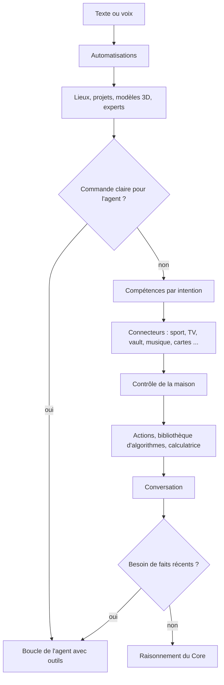

<div align="center">

# NUXIVA

**Un assistant domestique auto-hébergé qui tourne sur votre propre matériel : voix, caméras, contrôle de la maison, outils et agents, avec des modèles locaux par défaut et des modèles cloud seulement si vous les ajoutez.**

[🇬🇧 English](README.md) | [🇮🇹 Italiano](README_IT.md) | [🇫🇷 Français](README_FR.md)

Version 5.3.0 · Debian / Ubuntu · [Nuxiva Personal and Commercial License 1.0](LICENSE)

</div>

---

## Sommaire

0. [Installation](#0-installation)
1. [Ce qu'est Nuxiva et les algorithmes utilisés](#1-ce-quest-nuxiva-et-les-algorithmes-utilisés)
2. [Ce que fait Nuxiva](#2-ce-que-fait-nuxiva)
3. [Dons](#3-dons)

---

## 0. Installation

### Systèmes pris en charge

**Debian 12** ou **Ubuntu 22.04+** (x86_64 / arm64) avec `apt-get`. Sous Windows, utilisez WSL2 ou le script expérimental `install.ps1`.

| | Minimum | Recommandé |
| :--- | :--- | :--- |
| CPU | 4 cœurs | 8+ cœurs (AVX2) |
| RAM | 8 Go | 16–32 Go |
| Disque | 30 Go | 100+ Go NVMe |
| GPU | aucun (modèles CPU quantifiés) | NVIDIA, 8 Go+ de VRAM |
| Périphériques | aucun (headless) | microphone, haut-parleurs, webcam, écran |

Les fonctions qui ont besoin de matériel (caméra, microphone, GPU) se désactivent d'elles-mêmes si le matériel est absent. Une petite machine peut utiliser un nœud Ollama distant (`NUXIVA_OLLAMA_URL`) ou des modèles cloud.

### Installer

Une seule commande :

```bash
curl -fsSL https://raw.githubusercontent.com/AprileNunzio/Nuxiva/main/install.sh | sudo bash
```

Ou depuis un clone :

```bash
sudo git clone https://github.com/AprileNunzio/Nuxiva.git /opt/Nuxiva
cd /opt/Nuxiva
sudo bash install.sh
```

`install.sh` installe seulement le **superviseur** (`nuxiva-supervisor.service`). Le superviseur exécute ensuite les **31 étapes d'installation** listées dans `installer_wizard/backend/steps.py` (scripts dans `scripts/os/steps/`), affiche la progression sur le port 80 et garde l'assistant utilisable pendant que les gros téléchargements continuent en arrière-plan, du plus petit au plus grand.

```mermaid
flowchart LR
    A[install.sh] --> B[nuxiva-supervisor.service]
    B --> C[Analyse<br/>matériel, swap]
    C --> D[Système<br/>paquets, kiosque, Docker]
    D --> E[Isolation<br/>sandbox, gVisor, Firecracker]
    E --> F[Natif<br/>crates Rust, netguard, VPN]
    F --> G[Sens<br/>Ollama, voix, vision, écoute]
    G --> H[Modèles<br/>rapides + approfondis]
    H --> I[Build du Core<br/>services, maintenance]
    I --> J[(Assistant en ligne)]
```



| Phase | Étapes |
| :--- | :--- |
| Analyse | détection du système, swap compressé sur les petites cartes |
| Système | paquets, session kiosque, moteur Docker |
| Isolation | sandbox, gVisor, micro-VM Firecracker (seulement avec KVM) |
| Natif | crates Rust, pilote d'affichage, runtime GPU, durcissement, netguard, VPN (WireGuard / OpenVPN / IPsec) |
| Sens | Ollama, voix neuronale, Bluetooth, reconnaissance faciale, reconnaissance vocale et mot d'activation, reconnaissance musicale |
| Services | partages réseau, suite bureautique, studio de voix, conversion 3D |
| Intelligence | modèles de langage essentiels et approfondis, consolidation de l'étude, build du Core |
| Fin | outils de maintenance, préchauffage |

Les étapes non critiques (runtime GPU, voix, vision, Bluetooth…) peuvent échouer sans bloquer les autres ; le superviseur les relance ou les répare.

### Premier démarrage

1. Ouvrez `http://<ip-du-serveur>/` pour l'écran et le chat, et `http://<ip-du-serveur>:8080/` pour le cockpit d'administration (connexion avec un compte Linux via PAM).
2. L'assistant de premier démarrage (`/setup`) est facultatif : nom de l'assistant, réseau, calibrage du microphone, voix.
3. Suivez l'installation depuis un terminal :

```bash
nuxivactl status        # phase, progression et chaque étape
nuxivactl background    # téléchargements en file avec taille et progression
nuxivactl logs          # journal d'installation (aussi : supervisor, core, ollama, voice, vision, ear)
nuxivactl setup-code    # code d'appairage pour l'assistant de démarrage
nuxivactl version       # révision installée
```

### Mises à jour et réparation

```bash
sudo nuxivactl update           # applique une révision dont la CI a réussi
sudo nuxivactl force-upgrade    # force la mise à jour vers une branche
sudo nuxivactl repair           # répare une installation endommagée
```

Le programme de mise à jour (`installer_wizard/backend/updater.py`) n'installe que des révisions dont les jobs CI ont réussi. Une révision qui ne démarre pas est marquée défectueuse pendant 30 minutes et `nuxiva-rollback.service` restaure la dernière qui fonctionnait. Si le système complet ne peut pas démarrer, une page en mode sans échec et un script de réparation sont servis à la place.

### Ports, services et chemins

| Port | Usage |
| :---: | :--- |
| 80 | Écran / kiosque et chat |
| 8080 | Cockpit d'administration, API REST, serveur MCP |
| 443 | HTTPS facultatif, si un certificat est présent |
| 8443 (localhost) | Core |
| 11434 (localhost) | Ollama |

Unités systemd (`scripts/os/systemd/`) : `nuxiva-supervisor`, `nuxiva-core`, `nuxiva-sandbox`, `nuxiva-netguard`, `nuxiva-ear`, `nuxiva-vision`, `nuxiva-voice`, `nuxiva-rollback`.

| Chemin | Contenu |
| :--- | :--- |
| `/opt/Nuxiva` | Code de l'application |
| `/etc/nuxiva/nuxiva.env` | Configuration (variables `NUXIVA_*`) |
| `/var/lib/nuxiva/` | État : personnes, sport, journaux d'humeur, caches |

---

## 1. Ce qu'est Nuxiva et les algorithmes utilisés

Nuxiva transforme une machine Linux (ou un petit groupe de machines) en assistant domestique. Il se compose de :

| Partie | Chemin | Langage |
| :--- | :--- | :--- |
| Superviseur, fonctionnalités et widgets | `installer_wizard/` | Python (FastAPI) |
| Core : routage, décision, moteurs de raisonnement | `server/` | Python |
| Crates natives | `native/crates/` | Rust, chaque crate `#![forbid(unsafe_code)]` |
| Client web : écran kiosque et cockpit d'administration | `client_web/` | React + Vite + Tailwind |
| Client Android | `client_apk/` | Kotlin |
| Satellites : assistant Windows, nœud Linux, ESP32, context bridge | `client_satellite/` | Python, C++ |
| Sandbox du code et proxy sortant | `sandbox_broker/` | Python + Rust |

Chaque fonctionnalité est un dossier `installer_wizard/features/<id>/` avec un `feature.json` (82 aujourd'hui). Elle peut ajouter des routes HTTP (`api.py`), des commandes vocales et de chat (`commands.py`), des outils pour les agents (`tools.py`), des traductions et une icône. Le superviseur les découvre au démarrage ; rien n'est enregistré à la main.

Les modèles de langage tournent en local via **Ollama**. Les modèles cloud sont facultatifs et ajoutés à la même liste de priorité (`installer_wizard/features/cloud/catalog.py` : OpenAI, Anthropic, Google Gemini, xAI, Mistral, DeepSeek, Groq, Cerebras, OpenRouter, Together, Fireworks, Perplexity, Cohere, Alibaba Qwen, Moonshot, Zhipu, NVIDIA NIM, Hugging Face, SambaNova, DeepInfra, Azure OpenAI et tout point d'accès compatible OpenAI).

### 1.1 Comment une requête est traitée

Le routeur du chat (`installer_wizard/features/chat/assistant.py`) essaie une suite fixe d'étapes. La première étape qui reconnaît la requête y répond ; une étape qui ne la reconnaît pas lève `LookupError` et la suivante s'exécute.



**Vérification des faits récents** (`features/agent/grounding.py`). Le modèle doit renvoyer un verdict JSON `{"lookup": true|false}` avec une température 0 et un délai de 8 s. Les verdicts restent en cache 600 s (200 entrées au maximum). Toute erreur vaut `false`. Si le verdict est `true`, l'agent cherche sur le web au lieu de répondre de mémoire.

**Chaîne de modèles de secours** (`features/brain/llm.py`). `generate()` parcourt la liste de priorité des modèles locaux et cloud et ignore ceux qui échouent, donc un modèle en panne n'empêche pas la réponse.

### 1.2 Routeur du Core et score de complexité

`server/core/orchestrator/system1_router.py` calcule des scores par mots-clés pour les classes `conversation`, `action_direct`, `complex_task`, `whiteboard_canvas` et `browser_action`, puis les transforme en probabilités avec une softmax :

```
p_i = exp(z_i − max z) / Σ_j exp(z_j − max z)
```

Un score de complexité ψ choisit le moteur de raisonnement :

```
ψ = (0.45·L_task + 0.35·S_pred + 0.20·E_user) · (1 − 0.30·P_hw)        chaque terme borné à [0, 1]
```

`L_task` est le score de tâche complexe, `S_pred` la difficulté prévue, `E_user` l'émotion détectée chez l'utilisateur et `P_hw` la charge matérielle.

| ψ | Moteur (`server/core/reasoning/engines/`) |
| :--- | :--- |
| < 0.25 | `veloce_5_0` |
| < 0.50, ou émotion de l'utilisateur > 0.65 | `empatico_5_0` |
| < 0.75 | `pro_6_0` |
| ≥ 0.75 | `ultra_6_5` |

`auto_6_5` et `legacy_4_2` sont aussi disponibles.

### 1.3 Chemin rapide pour les requêtes connues (mémoire d'embeddings)

Les requêtes déjà confirmées sont enregistrées comme entrées avec un id, un poids, des embeddings d'exemples positifs et d'exemples négatifs. La comparaison est écrite en Rust (`native/crates/cortex-core/src/hippocampus/`) et exposée à Python sous le nom `RustNeuronIndex`.

- Les vecteurs sont normalisés L2 et comparés par produit scalaire (similarité cosinus). Les vecteurs nuls, vides ou non finis sont refusés.
- La meilleure entrée est classée avec des seuils fixes :

| Condition | Résultat |
| :--- | :--- |
| similarité avec un exemple négatif ≥ 0.60 | chemin lent (inhibé) |
| similarité < 0.70 | chemin lent |
| similarité ≥ 0.85 et poids ≥ 0.75 | chemin rapide : réponse sans générer de texte |
| poids ≥ 0.50 | zone grise : vérification rapide |
| sinon | chemin lent |

Sans aucune entrée, le résultat est toujours le chemin lent.

### 1.4 Mise à jour des poids et consolidation nocturne

`server/core/plasticity/rules.py` met à jour les poids des entrées du chemin rapide :

| Règle | Formule |
| :--- | :--- |
| Bornes | 0.05 – 0.99 |
| Renforcement (confirmée) | `w ← w + 0.10·(1 − w)` |
| Affaiblissement (rejetée) | `w ← w − 0.25·w` |
| Décroissance | demi-vie 30 jours : `w ← w · 0.5^(jours_inactifs / 30)` |
| Suppression | poids ≤ 0.10 **et** inactive depuis ≥ 90 jours **et** non protégée |

`server/core/plasticity/scheduler.py` exécute cela chaque nuit à **03:30** et rattrape le retard si la dernière exécution date de plus de 36 heures.

### 1.5 Moteur de décision

`server/core/decision/` évalue les modèles et actions candidats :

- les distributions de probabilité sont validées (tolérance sur la somme 1e-3, tolérance de renormalisation 2e-2) ;
- temperature scaling ajusté par log-vraisemblance négative ;
- ensembles de prédiction conforme (α borné à 0.01 – 0.50) ;
- entropie décomposée en incertitude totale et aléatoire, confiance `1 − H/ln K` ;
- un score final égal à la **moyenne harmonique pondérée** des axes, multipliée par un facteur quadratique quand un axe passe sous son seuil minimal.

| Axe (preset `NUXIVA_5AXIS`) | Poids | Seuil minimal |
| :--- | :--- | :--- |
| Intelligence | 0.30 | 55 |
| Calibration | 0.20 | – |
| Vitesse | 0.15 | 50 |
| Coût | 0.15 | 50 |
| Sécurité | 0.20 | 60 |

Les presets `A_BALANCED`, `B_QUALITY` et `C_PRODUCTION` utilisent quatre axes.

### 1.6 Choix du bon agent

`installer_wizard/features/team/relevance.py` classe agents, outils et widgets pour une requête : les mots vides sont retirés, les mots sont réduits à une racine de 5 caractères et les correspondances sont pondérées par champ (`identity 3.0, noun 4.0, capability 1.3, tool 1.6, tool_text 0.6, description 0.9, keyword 0.3`), plus un bonus de 14 pour les phrases entières et un bonus appris de +2 par confirmation passée (plafonné à 4). Un spécialiste n'est attribué qu'au-dessus d'un score de 5.0.

### 1.7 Score de bien-être

`installer_wizard/features/people/wellbeing/scoring.py` garde pour chaque personne et chaque signal une référence sous forme de moyenne et variance mobiles exponentielles (α = 0.02). Chaque nouvelle mesure devient un z-score, est compressée par une sigmoïde et regroupée en quatre zones : *tension, fatigue, réceptivité, soulagement*. Les mesures de la caméra sont écrites dans le journal d'humeur de la personne au plus une fois toutes les 120 s, ou après 900 s / un changement de zone.

### 1.8 Code généré et compétences

`server/core/skill_forge/` collecte les requêtes que Nuxiva n'a pas su traiter, fait écrire une compétence par un modèle, vérifie le code avec un analyseur AST (`ast_scanner.py`) et l'exécute seulement dans la sandbox. `server/core/event_sourcing/` tient un journal en ajout seul des changements d'état.

### 1.9 Crates Rust natives

| Crate | Ce qu'elle fait |
| :--- | :--- |
| `cortex-core` | Index d'embeddings et seuils du chemin rapide (§1.3), plus un ensemble de petits modules algorithmiques testés, décrits ci-dessous |
| `bus-core` | Routeur de topics : jusqu'à 8 segments de 40 caractères, jusqu'à 65 536 abonnements, jokers ; tampon circulaire sans verrou (1 024 cases par défaut) |
| `netguard` | Analyse de paquets pour le pare-feu : scan de ports (25 ports), balayage d'hôtes (25 hôtes), SYN flood (300/s), force brute (15 tentatives sur les ports d'authentification), tunnel DNS (longueur de nom 70, entropie 4.0), ICMP flood (200/s), volume d'exfiltration, ARP spoofing |
| `egress` | Proxy sortant pour la sandbox : seulement les hôtes autorisés, refuse les adresses privées, de loopback et link-local |
| `crdt-core` | Map last-writer-wins pour synchroniser les nœuds : l'horodatage le plus récent gagne, égalité tranchée par l'id du nœud |
| `audio-dsp` | Détection d'activité vocale (RMS, taux de passage par zéro, entropie spectrale), seuil adaptatif pendant la lecture d'un média, filtres biquad |
| `spatial-core` | Arbitrage des fenêtres et widgets à l'écran : ordre z, priorités, gestionnaires de ressources / tâches / réseau |
| `stage-core` | Planificateur d'écran (quelles surfaces afficher, réduire ou masquer) et encodeur compact de nuages de particules 3D |
| `agency-domain`, `agency-planner`, `agency-scheduler`, `agency-ledger`, `agency-codeindex`, `agency-daemon` | Moteur de l'agence de projets : projets et tâches validés, graphe des dépendances et chemin critique, parallélisme selon CPU / RAM / VRAM et modèle, journal chaîné par HMAC, index et recherche dans le code, démon `nuxiva-agency` sur socket Unix (droits 0600, contrôle de l'uid) |
| `langid` | Identification de la langue pour la chaîne vocale (basée sur `whatlang`) |
| `nuxiva-native` | Pont PyO3 qui expose les crates à Python |

Les modules supplémentaires de `cortex-core` sont des implémentations compactes (environ 50–330 lignes chacune) avec leurs propres tests unitaires :

| Module | Algorithme |
| :--- | :--- |
| `columns/cdcl.rs` | Solveur SAT : propagation unitaire, apprentissage de clauses sur conflit, backjumping |
| `columns/egraph.rs` | E-graph avec union-find, reconstruction par congruence et extraction au coût minimal |
| `columns/causal.rs` | Graphe causal avec tables de probabilités conditionnelles, observation contre intervention `do()`, contrefactuels simples |
| `columns/invariant.rs` | Filtrage par motif et anti-unification pour déduire des règles de réécriture à partir d'exemples |
| `columns/solver.rs` | Résolution d'équations du second degré en trois variantes (pas à pas, forme canonique, formule directe) |
| `columns/confrontation.rs` | Contrôle d'incertitude : quand l'entropie des réponses candidates est trop haute ou la marge trop faible, Nuxiva interroge l'utilisateur et enregistre la réponse |
| `columns/ontology.rs` | Contrôle des résidus sur les observations et un catalogue fixe de cinq cadres mathématiques pour les étiqueter |
| `neurons/` | Modèle de neurone impulsionnel d'Izhikevich, vecteurs binaires creux de 2048 bits avec encodage k-winner-take-all, mise à jour des poids STDP modulée par récompense |
| `self_model/` | Maintien de la vérité par justifications (retire les conclusions quand une prémisse est supprimée), erreur de calibration et décomposition de l'incertitude |
| `social_tom/` | Enregistrements croyances–désirs–intentions et inférence bayésienne des objectifs à partir des actions observées |
| `subcortical/`, `workspace/` | Sélection d'actions, routage des signaux et diffusion à seuil entre modules |
| `embodied/` | Table des articulations d'un robot à 34 articulations avec limites et cinématique directe simple, machine à états CANopen CiA 402 et encodage du controlword, vérification du working counter EtherCAT, fonctions d'équilibre et d'énergie libre |

Ces modules sont des briques de base. La partie robotique (embodied) est uniquement un modèle logiciel : Nuxiva ne fournit ni ne pilote de robot physique.

### 1.10 Sécurité

- Connexion d'administration via **PAM** Linux (service `nuxiva-admin`), seulement pour `root` ou le groupe admin.
- Les actions risquées passent par une validation et, si configurée, par la biométrie vocale.
- Le code généré tourne uniquement dans le **sandbox broker** (sans réseau ni accès à l'hôte par défaut), éventuellement dans gVisor ou Firecracker ; le trafic sortant passe par le proxy Rust `egress`.
- `netguard` alimente la fonctionnalité pare-feu ; les règles du pare-feu sont testées sur un vrai `nftables` dans la CI.
- Les clés API cloud sont gardées dans un coffre chiffré sous `/etc/nuxiva/`.
- Les pages récupérées par les agents sont filtrées par `safeweb` ; les hôtes des données sportives sont en liste autorisée (ESPN, Jolpica).
- Signalement responsable des vulnérabilités : [SECURITY.md](SECURITY.md).

### 1.11 Tests et CI

Le workflow `.github/workflows/ci.yml` s'exécute à chaque push : syntaxe Python et `pyflakes` ; tests unitaires et API du superviseur plus règles du pare-feu sur `nftables` ; tests du Core et de la sandbox ; `fmt`, `clippy` et tests Rust ; contrôles de syntaxe JavaScript et shell ; validation du client web. Le dépôt contient 337 fichiers de tests Python. Deux autres workflows reconstruisent le bundle web et l'assistant Windows.

### 1.12 Limites

- La qualité des réponses dépend des modèles installés ; les petits modèles sur CPU seul sont plus lents et moins précis.
- Les données sportives viennent de points d'accès publics qui peuvent changer ou limiter les requêtes.
- Certaines fonctionnalités sont expérimentales (par exemple `soup`, qui demande un GPU adapté).
- Debian et Ubuntu sont les seuls systèmes pris en charge.

---

## 2. Ce que fait Nuxiva

### Voix et conversation

- **Mot d'activation et écoute** (`ear`) : dites « Nuxiva » ou « Ehi, Nuxiva » ; reconnaissance vocale hors ligne avec réduction du bruit, conversation continue et reconnaissance du locuteur par la voix.
- **Voix** (`voices`) : plus de 600 voix dans plus de 60 langues ; Nuxiva répond dans la langue que vous parlez ou demandez et télécharge la voix nécessaire.
- **Studio de voix** (`voicestudio`) : crée de nouvelles voix, conçues à partir de paramètres ou clonées depuis votre voix lisant une phrase.
- **Atténuation du volume** (`ducking`) : baisse la musique, la TV sur Chromecast et les enceintes Home Assistant pendant que vous parlez, puis rétablit le volume.
- **Sons** (`sounds`) : effets pendant l'écoute ou la réflexion, notifications, alarmes, heures calmes et ne pas déranger.
- **Chat** (`chat`) : conversation de test indiquant quel modèle a répondu et en combien de temps.
- **Telegram** (`telegram`) : parlez à Nuxiva de partout par texte, voix et photos ; notifications d'arrivées, pannes et anniversaires.

### Modèles et raisonnement

- **Cerveau** (`brain`) : modèles locaux et cloud dans une seule liste de priorité, avec le modèle utilisé toujours visible.
- **Moteur Ollama** (`ollama`) : inférence locale avec réglage selon le matériel et gestion des longs contextes.
- **Capacités** (`capabilities`) : indique à chaque modèle connecté ce que Nuxiva sait faire, pour qu'aucun modèle ne réponde « je ne peux pas » à tort.
- **Compréhension des commandes** (`understanding`) : lit toute la phrase, les widgets ouverts et la conversation récente ; si deux fonctions sont aussi probables, fait trancher le modèle.
- **Esprit** (`mind`) : après chaque échange, décide quoi garder en mémoire à long ou court terme et quoi envoyer à l'étude.
- **Chemin rapide** (`cortex`) : répond aux requêtes déjà apprises sans générer de texte (§1.3).
- **Algorithmes** (`skills`) : calculs, conversions et procédures écrits une fois en Python vérifié et réutilisés.
- **Étude** (`study`) : au repos, étudie les sujets que vous choisissez ou qui apparaissent dans les conversations, et s'en sert dans ses réponses.
- **Soup** (`soup`, expérimental) : la nuit, entraîne un LoRA personnel avec ce qui a été étudié ; demande un GPU adapté.

### Agents et outils

- **Agent avec outils** (`agent`) : planifie pas à pas et appelle de vrais outils jusqu'à la fin de la tâche, y compris des chaînes comme « crée un marteau en 3D et envoie-le par e-mail à Marco ». Demande confirmation avant les actions risquées.
- **Équipe** (`team`) : chaque fonctionnalité agit comme un agent avec ses outils et sa priorité ; un coordinateur attribue les requêtes avec le classement du §1.6.
- **Experts** (`experts`) : agents experts définis par leur rôle, qui n'utilisent que les compétences et outils de leur domaine ; vous pouvez leur parler directement.
- **Flotte** (`fleet`) : catalogue d'agents spécialisés, créés à la demande et reliés à des outils et widgets.
- **Agence de projets** (`agency`) : une demande comme « crée-moi un site e-commerce » devient un projet. Le Directeur planifie la solution, les rôles et un graphe de tâches avec critères d'acceptation ; le Critique se pose des questions sur le plan et relit chaque tâche livrée d'après ses preuves ; les agents travaillent en parallèle dans le dossier du projet avec des outils (lister, chercher, lire et écrire des fichiers, lancer des contrôles dans un bac à sable hors ligne) et peuvent faire écrire et tester de nouveaux outils par le Forgeron. Les fichiers vont dans le dossier partagé `09 Progetti`. Le démon Rust `nuxiva-agency` garde le graphe des tâches, décide combien d'agents lancer selon le matériel et le modèle choisi dans Cerveau et enregistre chaque changement dans un journal chaîné par HMAC. La page 80 affiche les projets comme une galaxie avec une vue détaillée, pilotable au toucher, aux mains et à la voix.
- **Tâches en arrière-plan** (`tasks`) : progression, étapes et annulation pour les longs travaux ; elles survivent aux redémarrages.
- **Autonomie** (`autonomy`) : exécute les tâches planifiées, diagnostique les pannes et envoie un résumé le soir ; les actions sensibles attendent votre accord.
- **Forge** (`forge`) : crée de nouveaux outils (en combinant ceux existants), widgets et fonctionnalités, disponibles pour les agents et les clients MCP.
- **Recherche** (`research`) : recherche web multi-fournisseurs avec récupération sécurisée, classement et sources citées ; le dit quand rien n'est trouvé.
- **Actions** (`actions`) : fichiers, sites web, dossiers partagés, recherche d'appareils, test de débit, mises à jour, programmes et calculs vérifiés.
- **MCP** (`mcpclient`) : utilise les outils de serveurs MCP externes ; Nuxiva expose aussi ses propres outils comme serveur MCP sur le port 8080.
- **Lois** (`laws`) : quatre règles de base fixes que chaque agent doit respecter, plus vos propres règles obligatoires.

### Maison

- **Home Assistant** (`home_assistant`) : lit pièces, étages et appareils (Zigbee, Thread, Matter, Wi-Fi, Z-Wave, Bluetooth), les commande à la voix et sait où il y a du mouvement ou une présence.
- **Automatisations** (`automations`) : déclencheurs multiples, conditions imbriquées, branches, attentes, boucles, étapes en parallèle, confirmations vocales, variables et trace pas à pas de chaque exécution.
- **Habitudes** (`habits`) : repère les comportements récurrents et les propose comme automatisations ; signale les événements inhabituels quand personne n'est là.
- **Jumeau numérique** (`twin`) : simule une commande pour la maison sur une copie de l'état actuel et écarte les actions qui enfreignent les règles de sécurité.
- **Alerte rouge** (`redalert`) : en cas d'alarme fumée, eau ou intrusion, fait clignoter en rouge les lumières Home Assistant et répète le message sur chaque Chromecast, puis rétablit les lumières.
- **Étages et pièces** (`places`) : où se trouvent serveurs, satellites, PC, caméras et microphones, pour que « allume la lumière » vise votre pièce.
- **Scène et présence** (`scene`) : carte spatiale des pièces, meubles et objets vus par les caméras ; fusionne visage, voix et trackers en une seule estimation de présence.
- **Localisation** (`location`) : GPS du téléphone, écran, réseaux Wi-Fi ou adresse saisie ; l'adresse IP seulement en dernier recours.
- **Météo** (`weather`) : prévisions horaires et hebdomadaires, vent, qualité de l'air, humidité, pression, UV, pollens, lever / coucher du soleil et phases de la lune.
- **Cartes** (`maps`) : itinéraires, temps avec trafic et alertes de départ pour le trajet du travail et les rendez-vous de l'agenda.

### Personnes, caméras et sécurité

- **Personnes** (`people`) : profils avec visages, relations, anniversaires, préférences, comptes liés, rappels, journal d'humeur et score de bien-être du §1.7.
- **Vision** (`vision`) : reconnaissance faciale locale, salutations personnalisées, nouvelles personnes ajoutées automatiquement.
- **Caméras** (`cameras`) : webcams, infrarouge et caméras réseau au même endroit, avec vue en direct, modèles par marque et réglages par caméra.
- **Capteurs par caméra** (`camsense`) : apprenez à une zone de caméra des états comme porte ouverte / fermée et Nuxiva les reconnaît en local.
- **NVR** (`nvr`) : archive des événements des caméras et des NVR externes via MQTT, recherche en langage naturel, conservation et alertes.
- **Gestes de la main** (`hands`) : pincer, glisser, balayer et zoom à deux mains devant la webcam, activé seulement si le GPU de l'écran suit.
- **Pare-feu** (`firewall`) : analyse du trafic en temps réel par `netguard`, règles expertes et suggestions assistées par l'IA.
- **VPN** (`vpn`) : WireGuard client et serveur avec QR, OpenVPN, IPsec IKEv2, Tailscale, Headscale et ZeroTier, avec kill switch, protection DNS et split tunneling.
- **Explorateur réseau** (`network`) : découvre et classe les appareils du réseau domestique.
- **Vault** (`vault`) : la mémoire de Nuxiva en fichiers texte lisibles sur le serveur (personnes, faits, habitudes, automatisations, journal quotidien) ; les modifications des fichiers retournent dans la mémoire.
- **Sauvegarde** (`backup`) : archives compressées avec empreinte SHA-256, vérifiables et téléchargeables, manuelles ou planifiées.
- **Réinitialisation d'usine** (`factory_reset`) : efface toutes les données et identifiants avec plusieurs confirmations et une vérification finale.

### Écran et médias

- **Bureau à widgets** (`desktop`, 71 widgets) : chaque information est un widget qui apparaît quand il le faut, par ordre de priorité.
- **Régisseur d'écran** (`stage`) : décide quoi afficher, réduire ou masquer, évite les doublons et apprend de vos corrections ; peut afficher des sculptures de particules des objets dont vous parlez.
- **Kiosque** (`kiosk`) : mode écran dédié et toujours allumé.
- **Apparence** (`appearance`) : personnage 3D animé en pied, hologramme filaire ou noyau léger, selon l'appareil.
- **Lecteur multimédia** (`music`) : bibliothèque, vidéo, playlists, karaoké synchronisé, Chromecast et DLNA, reconnaissance musicale.
- **Studio musical** (`musicstudio`) : écrit des chansons et des paroles, ajoute instruments, effets et voix, avec timeline, piano roll et table de mixage.
- **TV et IPTV** (`tv`) : playlists M3U avec groupes et favoris (HLS et MPEG-DASH), sur les écrans de Nuxiva, un PC Windows, Chromecast ou TV DLNA.
- **Sport** (`sports`) : équipes favorites par personne (aucune par défaut) ; suivi en direct toutes les 20 s pendant un match, 60 s près du coup d'envoi, 600 s sinon ; buts et scores finaux annoncés ; un résumé nocturne des résultats, classements et F1 pour des réponses immédiates, avec récupération en ligne automatique dès qu'un match commence.
- **Tableau blanc** (`whiteboard`) : tableau plein écran pour écrire et dessiner ensemble.
- **Modèles 3D** (`models3d`) : crée des objets 3D sur demande et ouvre tout fichier 3D dans un widget orientable.
- **Dioramas 3D** (`diorama`) : construit une scène 3D à partir d'une phrase, pièce par pièce.
- **Jeux** (`games`) : échecs 3D contre Nuxiva avec analyse tactique et commandes vocales.
- **Hub** (`hub`) : vue 3D du parcours d'une requête dans Nuxiva et des agents au travail.

### Travail et productivité

- **Google** (`google`) : chaque personne relie son propre compte ; agenda, mail, tâches, contacts, Drive et notes, affichés seulement à la personne reconnue.
- **Documents Office** (`documents`) : Word, Excel, PowerPoint, ODT, ODS, ODP et PDF avec thèmes, tableaux et graphiques.
- **Développement logiciel** (`devstudio`) : crée des projets (sites, applis Python, API, applis Node et React) dans un dossier confiné, lance les tests en isolation et publie les sites sur le réseau domestique.
- **Dossier partagé** (`shares`) : dossier réseau protégé pour documents, sites, modèles 3D, code et musique ; la mémoire de Nuxiva n'est jamais partagée.
- **Imprimantes** (`printers`) : imprimantes USB et réseau et appareils CNC.
- **Établi de réparation** (`repair_workbench`) : relie un établi de réparation à l'analyse et aux agents spécialistes.
- **Proxmox** (`proxmox`) : gère et surveille conteneurs LXC et machines virtuelles.

### Système et maintenance

- **Planificateur** (`scheduler`) : garde les services d'arrière-plan en vie (redémarrage avec attente exponentielle, détection des blocages) et exécute les tâches cron en rattrapant celles manquées.
- **Autotest** (`selftest`) : teste ses propres fonctions chaque nuit et après chaque mise à jour ; revient en arrière si quelque chose d'essentiel casse.
- **Mises à jour automatiques** (`auto_update`) : se met à jour depuis GitHub, vérifie et revient en arrière en cas d'échec.
- **Gestion des ressources** (`governor`) : mesure le coût des fonctionnalités et widgets et reporte le travail de fond quand la machine est chargée.
- **Matériel et pilotes** (`hardware`) : détection USB, PCIe et ACPI et mises à jour gérées des pilotes.
- **Bluetooth** (`bluetooth`) : appairage, ordre préféré pour la sortie et le microphone, reconnexion automatique.
- **Audio de l'écran** (`devices`) : haut-parleurs, casques et microphones, volume et sourdine.
- **Nœuds** (`nodes`) : état, appairage sécurisé et commandes pour satellites, écrans, autres serveurs et microcontrôleurs.
- **Journaux système** (`system_logs`) : journaux de la machine et des appareils avec analyse et export protégé.

### Clients

- **Web** (`client_web`) : écran kiosque et cockpit d'administration ; italien, anglais, français et espagnol.
- **Android** (`client_apk`) : mot d'activation, reconnaissance de la voix, flux caméra, découverte du serveur et données de santé depuis des appareils BLE et Health Connect.
- **Assistant Windows** (`client_satellite/windows_assistant`) : voix ou Ctrl+Alt+Espace, lit l'écran ou la webcam sur demande, travaille sur fichiers et programmes via un contrôle des permissions, mises à jour signées.
- Satellites **nœud Linux** et **ESP32**, et un context bridge pour les capteurs du bureau.

---

## 3. Dons

Si Nuxiva vous est utile à la maison, vous pouvez soutenir son développement :

<p align="center">
  <a href="https://www.paypal.com/paypalme/NunzioAprile">
    
  </a>
</p>
