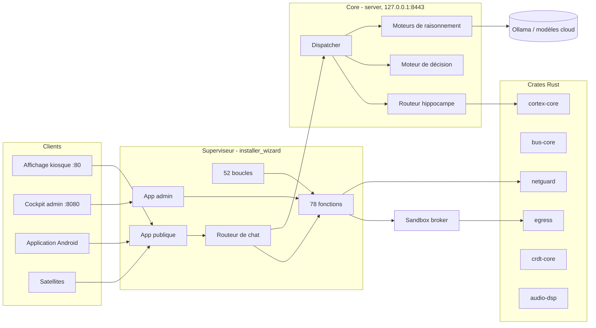
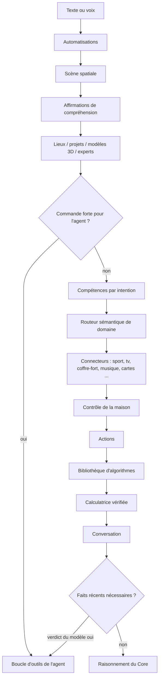
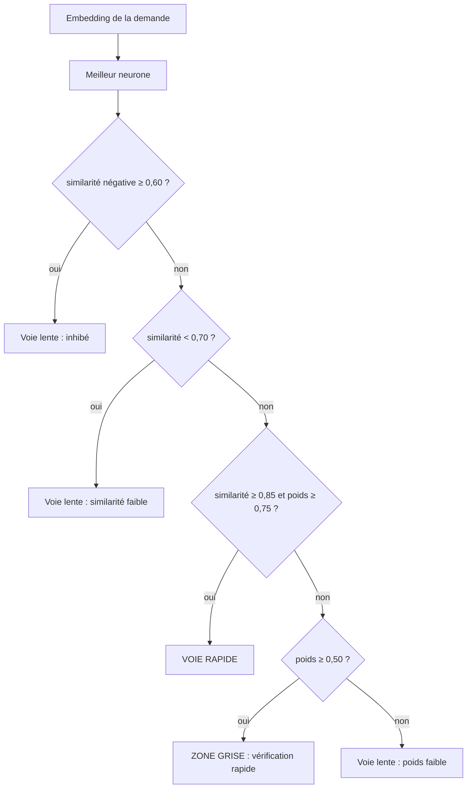
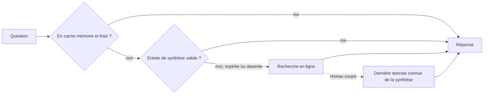

<div align="center">

# NUXIVA

**Un système d'exploitation privé et auto-hébergé pour l'assistant domestique et le maillage d'intelligence artificielle.**

[🇬🇧 English](README.md) | [🇮🇹 Italiano](README_IT.md) | [🇫🇷 Français](README_FR.md)

Version 5.3.0 · Licence MIT · Debian / Ubuntu

</div>

Ce document décrit ce que le dépôt contient **aujourd'hui**. Chaque nombre, seuil et formule ci-dessous a été lu dans le code source ; lorsqu'il s'agit d'un choix de conception et non d'une garantie, c'est indiqué.

---

## Sommaire

1. [Ce qu'est Nuxiva](#1-ce-quest-nuxiva)
2. [Le dépôt en bref](#2-le-dépôt-en-bref)
3. [Architecture](#3-architecture)
4. [Comment une demande reçoit sa réponse](#4-comment-une-demande-reçoit-sa-réponse)
5. [Le Core : routage, mémoire et raisonnement](#5-le-core--routage-mémoire-et-raisonnement)
6. [Agents, outils et réponses ancrées dans les faits](#6-agents-outils-et-réponses-ancrées-dans-les-faits)
7. [Sport : favoris, synthèse nocturne, recherche en ligne](#7-sport--favoris-synthèse-nocturne-recherche-en-ligne)
8. [Personnes, bien-être et caméra](#8-personnes-bien-être-et-caméra)
9. [Crates Rust natifs](#9-crates-rust-natifs)
10. [Superviseur et auto-réparation](#10-superviseur-et-auto-réparation)
11. [Modèle de sécurité](#11-modèle-de-sécurité)
12. [Installation](#12-installation)
13. [Ports, services et chemins](#13-ports-services-et-chemins)
14. [Clients](#14-clients)
15. [Contrôles qualité](#15-contrôles-qualité)
16. [Limites assumées](#16-limites-assumées)
17. [Contribuer, licence, soutien](#17-contribuer-licence-soutien)

---

## 1. Ce qu'est Nuxiva

Nuxiva transforme une machine (ou une petite flotte) en assistant domestique qui écoute, voit, parle, pilote la maison et exécute des outils, en gardant les données en local par défaut. Il combine :

- un **Superviseur** (FastAPI) qui sert l'affichage public et le cockpit d'administration, découvre les fonctions au démarrage et maintient en vie 52 boucles d'arrière-plan ;
- un **Core** (Python, port 8443 en local uniquement) qui fait passer chaque demande par une mémoire rapide de motifs, un moteur de décision et un ensemble de moteurs de raisonnement ;
- des **crates Rust natifs** pour les chemins critiques (mémoire de motifs, bus d'événements, analyse réseau, contrôle des sorties, synchronisation CRDT, DSP audio) ;
- un **client React** (affichage kiosque, cockpit admin, widgets), un client Android et des nœuds satellites.

Nuxiva est un logiciel libre. Il fonctionne entièrement hors ligne une fois les modèles installés ; les modèles cloud sont optionnels et se mélangent par listes de priorité.

## 2. Le dépôt en bref

| Zone | Chemin | Contenu vérifié |
| :--- | :--- | :--- |
| Superviseur et fonctions | `installer_wizard/` | 78 fonctions auto-découvertes (`feature.json`), 70 widgets, 6 apps au niveau superviseur, backend dans `backend/` |
| Core | `server/` | ~39 900 lignes de Python : décision, routeur de l'hippocampe, plasticité, raisonnement, forge de compétences, event sourcing |
| Code natif | `native/crates/` | 9 crates Rust, 109 fonctions `#[test]` |
| Client web | `client_web/` | 34 apps core, 16 apps, 12 apps nœud, langues IT / EN / FR / ES |
| Client Android | `client_apk/` | Kotlin, Gradle |
| Satellites | `client_satellite/` | `context_bridge`, `linux_edge`, `microcontrollers`, `windows_assistant` |
| Bac à sable | `sandbox_broker/` | backends processus / Docker / gVisor / Firecracker, proxy de sortie |
| Jeux | `giochi/` | échecs 3D |
| Scripts système | `scripts/os/` | étapes d'installation, réparation, retour arrière, 8 unités systemd |
| Tests | `**/test_*.py` | 313 fichiers de test Python |

Fournisseurs cloud du catalogue (`features/cloud/catalog.py`) : OpenAI, Anthropic, Google Gemini, xAI, Mistral, DeepSeek, Groq, Cerebras, OpenRouter, Together, Fireworks, Perplexity, Cohere, Alibaba Qwen, Moonshot, Zhipu, NVIDIA NIM, Hugging Face, SambaNova, DeepInfra, Azure OpenAI et tout point d'accès compatible OpenAI.

## 3. Architecture



Les fonctions sont des dossiers enfichables dans `installer_wizard/features/<id>/`. Chacune se déclare dans `feature.json` et peut exposer `api.py` (routes HTTP), `commands.py` (connecteur voix et chat), `tools.py` (outils de l'agent), `language/` et une icône. Le superviseur les analyse au démarrage ; rien n'est enregistré à la main.

## 4. Comment une demande reçoit sa réponse

Le routeur de chat (`features/chat/assistant.py`) est une cascade ordonnée. La première étape capable de répondre l'emporte ; une étape qui ne reconnaît pas la demande lève `LookupError` et la suivante prend le relais.



Deux règles de conception s'appliquent à cette cascade :

- **Aucune liste de sujets écrite dans le code.** Savoir si une question demande des informations récentes est décidé par le modèle (`features/agent/grounding.py` : verdict JSON `{"lookup": bool}`, délai 8 s, cache 600 s, 200 entrées au maximum, `False` en cas d'erreur). Le sport, le championnat ou l'équipe visés par une phrase sont déterminés par un catalogue de données et un plan construit par le modèle (`features/sports/understand.py`). Ajouter un sport revient à ajouter une ligne au catalogue, pas du code.
- **Dégrader en douceur.** Chaque étape qui parle au réseau ou à un modèle intercepte ses propres erreurs et passe son tour, ou répond honnêtement que la source est injoignable.

## 5. Le Core : routage, mémoire et raisonnement

### 5.1 Routeur de Système 1 et score de complexité ψ

`server/core/orchestrator/system1_router.py` calcule des logits par mots-clés pour les classes `conversation`, `action_direct`, `complex_task`, `whiteboard_canvas` et `browser_action`, puis une softmax :

```
p_i = exp(z_i - max z) / Σ_j exp(z_j - max z)
```

Un scalaire de complexité ψ choisit le moteur de raisonnement :

```
ψ = (0.45·L_task + 0.35·S_pred + 0.20·E_user) · (1 − 0.30·P_hw)      tous les termes bornés à [0, 1]
```

| ψ | Moteur |
| :--- | :--- |
| < 0,25 | `veloce_5_0` |
| < 0,50, ou émotion de l'utilisateur > 0,65 | `empatico_5_0` |
| < 0,75 | `pro_6_0` |
| ≥ 0,75 | `ultra_6_5` |

`auto_6_5` (méta-orchestration) et `legacy_4_2` existent aussi dans `server/core/reasoning/engines/`. `L_task` est le logit de tâche complexe / 10, `E_user` l'émotion détectée, `P_hw` la pression matérielle.

### 5.2 Hippocampe : voie rapide apprise

Les demandes souvent confirmées sont mémorisées sous forme de **neurones** : un identifiant, un poids synaptique, un ensemble de vecteurs d'embedding positifs (dendrites) et de vecteurs négatifs (inhibitions). La comparaison est implémentée en Rust (`cortex-core/src/hippocampus`) et exposée à Python via `RustNeuronIndex`.

- Les vecteurs sont normalisés L2 ; la similarité est un produit scalaire (cosinus). Les vecteurs nuls, vides ou non finis sont rejetés.
- Le meilleur candidat est retenu, puis `decide` applique :



Sans aucun neurone, le verdict est voie lente (`NoNeurons`). L'instantané de l'index est sérialisé en JSON et les instantanés corrompus sont refusés.

### 5.3 Plasticité et cycle REM nocturne

`server/core/plasticity/rules.py` implémente des mises à jour bornées de type hebbien :

| Règle | Valeur |
| :--- | :--- |
| Bornes du poids | 0,05 – 0,99 |
| Potentialisation | `w ← w + 0,10·(1 − w)` |
| Dépression | `w ← w − 0,25·w` |
| Décroissance | demi-vie 30 jours : `w ← w · 0,5^(jours_inactifs / 30)` |
| Élagage | poids ≤ 0,10 **et** inactif depuis ≥ 90 jours **et** non protégé |

Le planificateur (`plasticity/scheduler.py`) exécute les tâches de consolidation chaque nuit à **03:30** et rattrape le retard si la dernière exécution date de plus de 36 heures.

### 5.4 Moteur de décision

`server/core/decision/` évalue des candidats (modèles ou actions) avec des mathématiques explicites :

- validation de la distribution (tolérance sur la somme 1e-3, tolérance de renormalisation 2e-2) ;
- temperature scaling estimé par log-vraisemblance négative ;
- ensembles de prédiction conforme (α borné à 0,01 – 0,50) ;
- décomposition de l'entropie en incertitude totale et aléatoire, confiance normalisée `1 − H/ln K` ;
- un score composite, la **moyenne harmonique pondérée** de cinq axes, multipliée par une porte quadratique de seuil minimal :

| Axe | Poids (preset `NUXIVA_5AXIS`) | Seuil minimal |
| :--- | :--- | :--- |
| Intelligence | 0,30 | 55 |
| Calibration | 0,20 | – |
| Vitesse | 0,15 | 50 |
| Coût | 0,15 | 50 |
| Homéostasie de sécurité | 0,20 | 60 |

L'intelligence mélange à parts égales des benchmarks ouverts et scellés. Les presets `A_BALANCED`, `B_QUALITY` et `C_PRODUCTION` utilisent quatre axes.

### 5.5 Forge de compétences et event sourcing

`server/core/skill_forge/` recueille les demandes ratées, fait écrire une compétence par un modèle, analyse son AST et ne l'exécute que dans la couche d'isolation et le bac à sable. `server/core/event_sourcing/` conserve un registre en ajout seul des changements d'état.

## 6. Agents, outils et réponses ancrées dans les faits

- **Registre d'outils** : les fonctions décorées par `@tool` dans `features/agent/` (fichiers, courrier, médias, système, paquets, caméras, écran, RPA) et dans le `tools.py` de chaque fonction sont découvertes à l'exécution.
- **Boucle de l'agent** (`agent/agent.py`) : le modèle planifie, appelle des outils, lit les résultats et demande confirmation avant les actions risquées. La date du jour est injectée dans ses règles.
- **Orchestrateur CEO** (`features/team/ceo.py`) : analyse agents, outils et widgets et les classe avec `relevance.py` : les jetons sont débarrassés des mots vides, tronqués à 5 caractères et notés avec des poids par champ `identity 3,0, noun 4,0, capability 1,3, tool 1,6, tool_text 0,6, description 0,9, keyword 0,3`, un bonus de phrase de 14, des bonus appris (+2 par confirmation, plafond 4) et un score minimal de 5,0 avant d'affecter un spécialiste.
- **Recherche** (`features/research/`) : recherche web multi-fournisseurs, récupération sûre, extraction et classement, avec générateur de rapports.
- **Ancrage dans les faits** : voir §4 : le modèle décide s'il répond de mémoire ou s'il cherche ; si un outil échoue, l'agent doit se rabattre sur la recherche web au lieu de s'excuser.
- **Couche Cerveau / LLM** (`features/brain/llm.py`) : `generate(kind, as_json, component, timeout)` parcourt une chaîne de priorité de modèles Ollama locaux et cloud, en ignorant ceux qui sont inutilisables, de sorte qu'un modèle défaillant n'arrête pas la réponse.

## 7. Sport : favoris, synthèse nocturne, recherche en ligne

Le sport est entièrement **piloté par les données**.

- `features/sports/catalog.py` liste les championnats (football, NHL, NBA, WNBA, NFL, MLB et d'autres) avec un chemin ESPN et des alias ; la Formule 1 utilise l'API Jolpica/Ergast. Aucun autre service ni clé d'API n'est nécessaire.
- La question de l'utilisateur est rapprochée d'une équipe ou d'un championnat sur l'index réel des équipes, puis `understand.plan` demande au modèle `{sport, want, focus}`. La réponse passe par un chemin générique : classement, résultats du jour, fiche d'équipe ou fiche F1, plus un widget sur le bureau (`sport_match`, `sport_table`, `f1_race`).
- **Favoris** : enregistrés par personne (et un profil pour toute la maison) dans `sports.json`. **Par défaut, personne ne suit rien** : ni surveillance continue, ni synthèse.
- **Observateur en direct** : suit uniquement les équipes favorites, toutes les 20 s pendant un match, 60 s quand un match approche, 600 s sinon. Il annonce le coup d'envoi, les buts, les expulsions et les résultats finaux, et rappelle un widget quand une personne qui les suit s'approche de l'écran (délai de 30 min).
- **Synthèse nocturne** (`features/sports/digest.py`) : après 03:00, une fois par jour, elle télécharge pour les championnats des favoris les tableaux de scores (hier, aujourd'hui, demain), calendriers et résultats des équipes, classements et listes d'équipes, et pour la F1 le calendrier, les derniers résultats et les deux championnats. Le tout est enregistré dans `sports_digest.json`.



Chaque entrée de la synthèse porte une échéance égale au premier coup d'envoi parmi les matchs non terminés de ce championnat (30 heures au maximum ; expirée immédiatement si un match est en cours). Avant le coup d'envoi la réponse enregistrée est exacte ; dès que le match commence, la même question passe automatiquement en ligne. Enregistrer les favoris d'une personne invalide la synthèse, de sorte que les nouvelles équipes sont récupérées au cycle suivant ; `POST /api/sports/digest/build` force une mise à jour.

## 8. Personnes, bien-être et caméra

- **Personnes** : profils, rôles, voix, comptes liés (par ex. Google) et rappels par personne.
- **Mesure du bien-être** : moyennes mobiles exponentielles par personne et par signal ; les écarts deviennent des z-scores, comprimés par une sigmoïde et regroupés en quatre zones : *tension, épuisement, réceptivité, soulagement*.
- **Caméra** : le mesureur d'affect du pipeline de vision lit le visage d'une personne reconnue. Après une période de calibration, chaque lecture est inscrite dans le **journal des humeurs** de la personne avec la source `camera` (au plus une entrée toutes les 120 s, une nouvelle si la zone change ou si 900 s s'écoulent), avec des éléments comme « visage : tension, activation 62/100, ton −0,3 ». Le journal est modifiable et l'utilisateur peut donner un retour sur les entrées de la caméra et de l'assistant.
- Tout reste dans des fichiers d'état locaux ; rien n'est envoyé à un service cloud sauf si l'utilisateur en configure un.

## 9. Crates Rust natifs

| Crate | Rôle | Détail vérifié |
| :--- | :--- | :--- |
| `cortex-core` | Index des neurones de l'hippocampe, arbitre, validateur de slots | seuils 0,85 / 0,70 / 0,60 et poids 0,75 / 0,50 ; capacité des dendrites bornée |
| `bus-core` | Routeur de topics et types d'événements | topics jusqu'à 8 segments de 40 caractères, jusqu'à 65 536 abonnements, motifs à jokers ; tampon circulaire sans verrou (1 024 emplacements par défaut) pour les impulsions synaptiques avec émetteurs excitateurs/inhibiteurs |
| `netguard` | Analyse de paquets pour le pare-feu | détecteurs : balayage de ports (25 ports / 10 s), balayage d'hôtes (25 hôtes), SYN flood (300/s), force brute (15 tentatives / 60 s sur les ports d'authentification), tunnel DNS (longueur du nom 70, entropie 4,0), ICMP flood (200/s), volume d'exfiltration, usurpation ARP ; liste de MAC de confiance, délai par alerte |
| `egress` | Proxy de sortie à politiques pour le bac à sable | motifs d'hôtes, refuse les adresses non publiques (RFC 1918, boucle locale, lien local et autres d'une liste de blocage) |
| `crdt-core` | Table last-writer-wins pour la synchronisation entre pairs | l'horodatage le plus récent l'emporte ; à égalité l'identifiant de nœud le plus grand ; la fusion renvoie le nombre d'entrées modifiées |
| `audio-dsp` | Détection d'activité vocale et filtres | RMS, taux de passage par zéro et entropie spectrale ; seuil adaptatif pendant la lecture de médias ; trames de maintien ; suppression de la musique ; filtres biquad |
| `spatial-core` | Arbitrage bureau/établi | z-stack, priorité, gouverneurs de ressources, tâches et réseau, routeur d'intentions |
| `langid` | Identification de la langue | utilisé par le pipeline vocal |
| `nuxiva-native` | Pont PyO3 exposant les crates à Python | arbitrage, audio, bus, cortex, mesh, scanner, workbench |

## 10. Superviseur et auto-réparation

- **Deux applications web** : publique (port 80) et admin (port 8080), plus un écouteur HTTPS optionnel (port 443) lorsqu'un certificat est présent. En mode démo, elles passent à 8000 / 8001 / 8002.
- **Chien de garde des boucles** (`backend/loops.py`) : chacune des 52 boucles d'arrière-plan est enveloppée ; un arrêt la relance avec un recul exponentiel (de 1 s jusqu'à un maximum configurable, 60 s par défaut) et un battement détecte les blocages (facteur par défaut 5× la période de la boucle). Une boucle stable pendant 120 s remet son recul à zéro.
- **Mise à jour** (`backend/updater.py`) : ne met à jour que vers une révision dont les jobs de CI (`validate-python`, `tests`, `kernel-tests`, `native-core`, `validate-scripts`, `validate-web-client`) ont réussi ; une révision qui ne démarre pas est marquée *mauvaise* pendant 30 minutes et la dernière bonne révision est restaurée par `nuxiva-rollback.service`.
- **Mode sûr** (`backend/safe_mode.py`) : une page minimale et un script de réparation automatique lorsque le système complet ne peut pas démarrer.
- **Dist du frontend** : un workflow GitHub recompile `client_web/dist` depuis les sources, le serveur n'a donc jamais besoin de Node à l'exécution.

## 11. Modèle de sécurité

- La connexion admin utilise **PAM** de Linux (service `nuxiva-admin`) et exige `root` ou l'appartenance au groupe d'administration.
- Les fonctions s'activent ou se désactivent par variables d'environnement ; les actions sensibles passent par une porte d'approbation (fonction authz) et par la biométrie vocale lorsqu'elle est configurée.
- Le code généré ne s'exécute que dans le **sandbox broker** (sans réseau ni accès à l'hôte par défaut) ; isolation optionnelle par gVisor et micro-VM Firecracker ; le trafic sortant passe par le proxy Rust `egress`.
- `netguard` alimente la fonction pare-feu ; les règles du pare-feu sont testées en CI sur un vrai `nftables`.
- Les secrets (clés cloud) résident dans un coffre-fort chiffré sous `/etc/nuxiva/`.
- Le contenu web récupéré par les agents passe par le filtre `safeweb` ; les hôtes externes pour les données sportives sont limités à une liste autorisée (`ESPN`, `Jolpica`).
- Divulgation responsable : voir [SECURITY.md](SECURITY.md).

## 12. Installation

Pris en charge : Debian 12 ou Ubuntu 22.04+ (x86_64 / arm64). `apt-get` est requis.

```bash
curl -fsSL https://raw.githubusercontent.com/AprileNunzio/Nuxiva/main/install.sh | sudo bash
```

ou depuis un clone :

```bash
sudo git clone https://github.com/AprileNunzio/Nuxiva.git /opt/Nuxiva
cd /opt/Nuxiva
sudo bash install.sh
```

`install.sh` amorce le service du superviseur ; celui-ci exécute ensuite **31 étapes ordonnées** (`installer_wizard/backend/steps.py`, scripts dans `scripts/os/steps/`) : analyse du système, mémoire compressée, paquets système, kiosque, Docker, bac à sable, gVisor, Firecracker, cœur natif, pilotes vidéo et GPU, durcissement de sécurité, netguard, VPN, Ollama, voix neuronale, Bluetooth, vision, écoute, reconnaissance musicale, partages réseau, suite bureautique, studio des voix, conversion 3D, modèles de langage essentiels et profonds, consolidation de l'étude, compilation du Core, services, maintenance et préchauffage. Les gros téléchargements se font en arrière-plan, du plus petit au plus grand, afin que l'assistant soit utilisable tôt. Les étapes non critiques (GPU, voix, vision, écoute…) peuvent échouer sans bloquer le reste.

Windows est pris en charge via WSL2 (Ubuntu 22.04 / Debian 12) ou l'expérimental `install.ps1`.

| | Minimum | Recommandé |
| :--- | :--- | :--- |
| CPU | 4 cœurs | 8+ cœurs |
| RAM | 8 Go | 16–32 Go |
| Disque | 30 Go | 100+ Go NVMe |
| GPU | aucun (modèles sur CPU) | NVIDIA avec 8 Go+ de VRAM |

Commandes utiles : `nuxivactl background`, `nuxivactl repair`, `nuxivactl update --force`.

## 13. Ports, services et chemins

| Port | Usage |
| :---: | :--- |
| 80 | Affichage public / kiosque, chat |
| 8080 | Cockpit admin, API REST, serveur MCP |
| 443 | HTTPS optionnel |
| 8443 (localhost) | Core |
| 11434 (localhost) | Ollama |

Unités systemd dans `scripts/os/systemd/` : `nuxiva-supervisor`, `nuxiva-core`, `nuxiva-sandbox`, `nuxiva-netguard`, `nuxiva-ear`, `nuxiva-vision`, `nuxiva-voice`, `nuxiva-rollback`.

| Chemin | Contenu |
| :--- | :--- |
| `/opt/Nuxiva` | Code de l'application |
| `/etc/nuxiva/nuxiva.env` | Configuration (les variables d'environnement sont lues via `env_get` ; il existe environ 130 noms `NUXIVA_*` distincts) |
| `/var/lib/nuxiva/` | État : personnes, sport (`sports.json`, `sports_digest.json`), journaux d'humeur, caches |

## 14. Clients

- **Client web** (`client_web`, React + Vite + Tailwind) : affichage kiosque avec bureau de widgets dynamiques, visage 3D et cockpit admin avec 34 apps core (personnes, réglages du Cerveau, pare-feu, caméras, studio des voix, mise à jour, coffre-fort, VPN, météo, …). L'interface admin utilise le thème clair. Traductions : italien, anglais, français, espagnol.
- **Android** (`client_apk`) : client Kotlin.
- **Satellites** (`client_satellite`) : nœud Linux edge, microcontrôleurs, assistant Windows (avec son propre workflow CI), context bridge.
- **MCP** : Nuxiva expose ses outils comme serveur MCP sur le port admin et peut consommer des serveurs MCP externes (`installer_wizard/MCP.md`).

## 15. Contrôles qualité

Le workflow GitHub **Nuxiva CI Pipeline** s'exécute à chaque push :

1. syntaxe Python (`py_compile`) et `pyflakes` sur `server`, `sandbox_broker`, `installer_wizard`, `client_satellite` ;
2. tests unitaires et API du superviseur (`unittest discover`), plus règles du pare-feu sur un vrai `nftables` ;
3. tests du noyau du Core et du sandbox broker ;
4. Rust 1.89 : `fmt`, `clippy`, tests, construction du module Python, tests de parité native et du bus, tests du proxy egress, tests natifs de cortex ;
5. contrôles de syntaxe JavaScript et shell ;
6. validation du client web.

Deux autres workflows recompilent le bundle du frontend et l'assistant Windows.

## 16. Limites assumées

- Le vocabulaire « neuronal » (neurones, synapses, REM) nomme des mécanismes réels et simples : similarité vectorielle avec seuils, poids bornés avec décroissance, une tâche nocturne. Ce n'est pas une simulation biologique et le tampon d'impulsions en Rust est un type de file, pas un simulateur de réseaux impulsionnels.
- La qualité dépend des modèles installés ; les petits modèles sur CPU seul répondent lentement et raisonnent moins bien.
- Les données sportives viennent de points d'accès publics qui peuvent changer ou limiter le débit ; la synthèse nocturne et le repli sur la dernière donnée connue atténuent le problème, sans garantir l'exactitude en direct.
- Les fonctions dépendant du matériel (caméra, réseau de microphones, GPU) se désactivent d'elles-mêmes lorsque le matériel manque.
- Debian et Ubuntu sont les seuls hôtes officiellement pris en charge.

## 17. Contribuer, licence, soutien

Nuxiva est écrit et maintenu par **Nunzio Aprile (NunzioTech)** et publié sous **licence MIT**. Les contributions sont les bienvenues : lisez [CONTRIBUTING.md](CONTRIBUTING.md) et le [Code de conduite](CODE_OF_CONDUCT.md). Merci à toutes celles et ceux qui signalent des bogues, testent du matériel et envoient des correctifs.

Le projet est libre et le reste. S'il vous est utile, vous pouvez soutenir son développement :

<p align="center">
  <a href="https://www.paypal.com/paypalme/NunzioAprile">
    
  </a>
</p>
