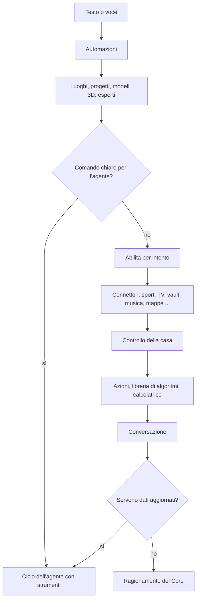

<div align="center">

# NUXIVA

**Un assistente domestico self-hosted che gira sul tuo hardware: voce, telecamere, controllo della casa, strumenti e agenti, con modelli locali di base e modelli cloud solo se li aggiungi tu.**

[🇬🇧 English](README.md) | [🇮🇹 Italiano](README_IT.md) | [🇫🇷 Français](README_FR.md)

Versione 5.3.0 · Debian / Ubuntu · [Nuxiva Personal and Commercial License 1.0](LICENSE)

</div>

---

## Indice

0. [Installazione](#0-installazione)
1. [Che cos'è Nuxiva e gli algoritmi che usa](#1-che-cosè-nuxiva-e-gli-algoritmi-che-usa)
2. [Cosa fa Nuxiva](#2-cosa-fa-nuxiva)
3. [Donazioni](#3-donazioni)

---

## 0. Installazione

### Sistemi supportati

**Debian 12** o **Ubuntu 22.04+** (x86_64 / arm64) con `apt-get`. Su Windows usa WSL2, oppure lo script sperimentale `install.ps1`.

| | Minimo | Consigliato |
| :--- | :--- | :--- |
| CPU | 4 core | 8+ core (AVX2) |
| RAM | 8 GB | 16–32 GB |
| Disco | 30 GB | 100+ GB NVMe |
| GPU | nessuna (modelli CPU quantizzati) | NVIDIA, 8 GB+ VRAM |
| Periferiche | nessuna (headless) | microfono, casse, webcam, display |

Le funzioni che richiedono hardware (telecamera, microfono, GPU) si disattivano da sole se l'hardware manca. Una macchina piccola può usare un nodo Ollama remoto (`NUXIVA_OLLAMA_URL`) o modelli cloud.

### Installazione

Un solo comando:

```bash
curl -fsSL https://raw.githubusercontent.com/AprileNunzio/Nuxiva/main/install.sh | sudo bash
```

Oppure da un clone:

```bash
sudo git clone https://github.com/AprileNunzio/Nuxiva.git /opt/Nuxiva
cd /opt/Nuxiva
sudo bash install.sh
```

`install.sh` installa solo il **supervisore** (`nuxiva-supervisor.service`). Il supervisore esegue poi i **31 passi di installazione** elencati in `installer_wizard/backend/steps.py` (script in `scripts/os/steps/`), mostra l'avanzamento sulla porta 80 e lascia l'assistente utilizzabile mentre i download pesanti proseguono in background, dal più piccolo al più grande.

```mermaid
flowchart LR
    A[install.sh] --> B[nuxiva-supervisor.service]
    B --> C[Analisi<br/>hardware, swap]
    C --> D[Sistema<br/>pacchetti, kiosk, Docker]
    D --> E[Isolamento<br/>sandbox, gVisor, Firecracker]
    E --> F[Nativo<br/>crate Rust, netguard, VPN]
    F --> G[Sensi<br/>Ollama, voce, visione, ascolto]
    G --> H[Modelli<br/>linguistici veloci + profondi]
    H --> I[Build del Core<br/>servizi, manutenzione]
    I --> J[(Assistente online)]
```



| Fase | Passi |
| :--- | :--- |
| Analisi | rilevamento del sistema, swap compresso sulle schede piccole |
| Sistema | pacchetti, sessione kiosk, motore Docker |
| Isolamento | sandbox, gVisor, micro-VM Firecracker (solo dove c'è KVM) |
| Nativo | crate Rust, driver del display, runtime GPU, hardening, netguard, VPN (WireGuard / OpenVPN / IPsec) |
| Sensi | Ollama, voce neurale, Bluetooth, riconoscimento facciale, riconoscimento vocale e parola di attivazione, riconoscimento musicale |
| Servizi | cartelle di rete, suite per l'ufficio, studio delle voci, conversione 3D |
| Intelligenza | modelli linguistici essenziali e profondi, consolidamento dello studio, build del Core |
| Fine | strumenti di manutenzione, riscaldamento |

I passi non critici (runtime GPU, voce, visione, Bluetooth…) possono fallire senza bloccare gli altri; il supervisore li riprova o li ripara.

### Primo avvio

1. Apri `http://<ip-del-server>/` per il display e la chat, e `http://<ip-del-server>:8080/` per il pannello di amministrazione (accesso con un account Linux tramite PAM).
2. La procedura guidata iniziale (`/setup`) è facoltativa: nome dell'assistente, rete, calibrazione del microfono, voce.
3. Segui l'installazione da terminale:

```bash
nuxivactl status        # fase, avanzamento e ogni passo
nuxivactl background    # download in coda con dimensione e avanzamento
nuxivactl logs          # log di installazione (anche: supervisor, core, ollama, voice, vision, ear)
nuxivactl setup-code    # codice di abbinamento per la procedura guidata
nuxivactl version       # revisione installata
```

### Aggiornamenti e riparazione

```bash
sudo nuxivactl update           # applica una revisione con la CI superata
sudo nuxivactl force-upgrade    # forza l'aggiornamento a un branch
sudo nuxivactl repair           # ripara un'installazione danneggiata
```

L'aggiornatore (`installer_wizard/backend/updater.py`) installa solo revisioni i cui job di CI sono riusciti. Una revisione che non parte viene segnata come difettosa per 30 minuti e `nuxiva-rollback.service` ripristina l'ultima funzionante. Se il sistema completo non riesce ad avviarsi, viene servita una pagina in modalità provvisoria con uno script di riparazione.

### Porte, servizi e percorsi

| Porta | Uso |
| :---: | :--- |
| 80 | Display / kiosk e chat |
| 8080 | Pannello di amministrazione, API REST, server MCP |
| 443 | HTTPS facoltativo, se c'è un certificato |
| 8443 (localhost) | Core |
| 11434 (localhost) | Ollama |

Unità systemd (`scripts/os/systemd/`): `nuxiva-supervisor`, `nuxiva-core`, `nuxiva-sandbox`, `nuxiva-netguard`, `nuxiva-ear`, `nuxiva-vision`, `nuxiva-voice`, `nuxiva-rollback`.

| Percorso | Contenuto |
| :--- | :--- |
| `/opt/Nuxiva` | Codice dell'applicazione |
| `/etc/nuxiva/nuxiva.env` | Configurazione (variabili `NUXIVA_*`) |
| `/var/lib/nuxiva/` | Stato: persone, sport, diari dell'umore, cache |

---

## 1. Che cos'è Nuxiva e gli algoritmi che usa

Nuxiva trasforma una macchina Linux (o un piccolo gruppo di macchine) in un assistente domestico. È composta da:

| Parte | Percorso | Linguaggio |
| :--- | :--- | :--- |
| Supervisore, funzionalità e widget | `installer_wizard/` | Python (FastAPI) |
| Core: instradamento, decisione, motori di ragionamento | `server/` | Python |
| Crate nativi | `native/crates/` | Rust, ogni crate `#![forbid(unsafe_code)]` |
| Client web: display kiosk e pannello di amministrazione | `client_web/` | React + Vite + Tailwind |
| Client Android | `client_apk/` | Kotlin |
| Satelliti: assistente Windows, nodo Linux, ESP32, context bridge | `client_satellite/` | Python, C++ |
| Sandbox del codice e proxy in uscita | `sandbox_broker/` | Python + Rust |

Ogni funzionalità è una cartella in `installer_wizard/features/<id>/` con un `feature.json` (oggi 82). Può aggiungere rotte HTTP (`api.py`), comandi vocali e di chat (`commands.py`), strumenti per gli agenti (`tools.py`), traduzioni e un'icona. Il supervisore le scopre all'avvio; niente va registrato a mano.

I modelli linguistici girano in locale tramite **Ollama**. I modelli cloud sono facoltativi e vengono messi nella stessa lista di priorità (`installer_wizard/features/cloud/catalog.py`: OpenAI, Anthropic, Google Gemini, xAI, Mistral, DeepSeek, Groq, Cerebras, OpenRouter, Together, Fireworks, Perplexity, Cohere, Alibaba Qwen, Moonshot, Zhipu, NVIDIA NIM, Hugging Face, SambaNova, DeepInfra, Azure OpenAI e qualsiasi endpoint compatibile con OpenAI).

### 1.1 Come viene gestita una richiesta

Il router della chat (`installer_wizard/features/chat/assistant.py`) prova una sequenza fissa di stadi. Il primo stadio che riconosce la richiesta risponde; uno stadio che non la riconosce solleva `LookupError` e passa al successivo.



**Controllo dei dati aggiornati** (`features/agent/grounding.py`). Al modello viene chiesto un verdetto JSON `{"lookup": true|false}` con temperatura 0 e timeout di 8 s. I verdetti restano in cache per 600 s (massimo 200 voci). Qualsiasi errore vale `false`. Se il verdetto è `true`, l'agente cerca sul web invece di rispondere a memoria.

**Catena di modelli di riserva** (`features/brain/llm.py`). `generate()` scorre la lista di priorità dei modelli locali e cloud e salta quelli che falliscono, così un modello guasto non blocca la risposta.

### 1.2 Router del Core e punteggio di complessità

`server/core/orchestrator/system1_router.py` calcola punteggi a parole chiave per le classi `conversation`, `action_direct`, `complex_task`, `whiteboard_canvas` e `browser_action`, e li trasforma in probabilità con una softmax:

```
p_i = exp(z_i − max z) / Σ_j exp(z_j − max z)
```

Un punteggio di complessità ψ sceglie il motore di ragionamento:

```
ψ = (0.45·L_task + 0.35·S_pred + 0.20·E_user) · (1 − 0.30·P_hw)        ogni termine limitato a [0, 1]
```

`L_task` è il punteggio del compito complesso, `S_pred` la difficoltà prevista, `E_user` l'emozione rilevata nell'utente e `P_hw` il carico dell'hardware.

| ψ | Motore (`server/core/reasoning/engines/`) |
| :--- | :--- |
| < 0.25 | `veloce_5_0` |
| < 0.50, oppure emozione dell'utente > 0.65 | `empatico_5_0` |
| < 0.75 | `pro_6_0` |
| ≥ 0.75 | `ultra_6_5` |

Sono disponibili anche `auto_6_5` e `legacy_4_2`.

### 1.3 Percorso rapido per le richieste note (memoria a embedding)

Le richieste già confermate vengono salvate come voci con un id, un peso, embedding di esempi positivi ed embedding di esempi negativi. Il confronto è scritto in Rust (`native/crates/cortex-core/src/hippocampus/`) ed esposto a Python come `RustNeuronIndex`.

- I vettori sono normalizzati L2 e confrontati con il prodotto scalare (similarità coseno). I vettori nulli, vuoti o non finiti vengono rifiutati.
- La voce migliore viene classificata con soglie fisse:

| Condizione | Risultato |
| :--- | :--- |
| similarità con un esempio negativo ≥ 0.60 | percorso lento (inibito) |
| similarità < 0.70 | percorso lento |
| similarità ≥ 0.85 e peso ≥ 0.75 | percorso rapido: risposta senza generare testo |
| peso ≥ 0.50 | zona grigia: verifica veloce |
| altrimenti | percorso lento |

Senza voci salvate il risultato è sempre il percorso lento.

### 1.4 Aggiornamento dei pesi e consolidamento notturno

`server/core/plasticity/rules.py` aggiorna i pesi delle voci del percorso rapido:

| Regola | Formula |
| :--- | :--- |
| Limiti | 0.05 – 0.99 |
| Rinforzo (confermata) | `w ← w + 0.10·(1 − w)` |
| Indebolimento (rifiutata) | `w ← w − 0.25·w` |
| Decadimento | emivita 30 giorni: `w ← w · 0.5^(giorni_inattivi / 30)` |
| Rimozione | peso ≤ 0.10 **e** inattiva da ≥ 90 giorni **e** non protetta |

`server/core/plasticity/scheduler.py` esegue tutto questo ogni notte alle **03:30** e recupera se l'ultima esecuzione è più vecchia di 36 ore.

### 1.5 Motore decisionale

`server/core/decision/` valuta i modelli e le azioni candidate:

- le distribuzioni di probabilità vengono validate (tolleranza sulla somma 1e-3, tolleranza di rinormalizzazione 2e-2);
- temperature scaling stimato con la log-verosimiglianza negativa;
- insiemi di predizione conforme (α limitato a 0.01 – 0.50);
- entropia scomposta in incertezza totale e aleatoria, confidenza `1 − H/ln K`;
- un punteggio finale che è la **media armonica pesata** degli assi, moltiplicata per un fattore quadratico quando un asse scende sotto la sua soglia minima.

| Asse (preset `NUXIVA_5AXIS`) | Peso | Soglia minima |
| :--- | :--- | :--- |
| Intelligenza | 0.30 | 55 |
| Calibrazione | 0.20 | – |
| Velocità | 0.15 | 50 |
| Costo | 0.15 | 50 |
| Sicurezza | 0.20 | 60 |

I preset `A_BALANCED`, `B_QUALITY` e `C_PRODUCTION` usano quattro assi.

### 1.6 Scelta dell'agente giusto

`installer_wizard/features/team/relevance.py` ordina agenti, strumenti e widget per una richiesta: elimina le parole vuote, riduce le parole alla radice di 5 caratteri e pesa le corrispondenze per campo (`identity 3.0, noun 4.0, capability 1.3, tool 1.6, tool_text 0.6, description 0.9, keyword 0.3`), più un bonus di 14 per le frasi intere e un bonus appreso di +2 per ogni conferma passata (massimo 4). Uno specialista viene assegnato solo sopra un punteggio di 5.0.

### 1.7 Punteggio di benessere

`installer_wizard/features/people/wellbeing/scoring.py` tiene per ogni persona e per ogni segnale una base di riferimento come media e varianza mobili esponenziali (α = 0.02). Ogni nuova lettura diventa uno z-score, viene compressa con una sigmoide e raggruppata in quattro aree: *tensione, stanchezza, ricettività, sollievo*. Le letture della telecamera vengono scritte nel diario dell'umore della persona al massimo una volta ogni 120 s, oppure dopo 900 s o quando cambia l'area.

### 1.8 Codice generato e abilità

`server/core/skill_forge/` raccoglie le richieste che Nuxiva non ha saputo gestire, fa scrivere a un modello un'abilità apposita, controlla il codice con uno scanner AST (`ast_scanner.py`) e lo esegue solo dentro la sandbox. `server/core/event_sourcing/` tiene un registro di sola aggiunta dei cambiamenti di stato.

### 1.9 Crate Rust nativi

| Crate | Cosa fa |
| :--- | :--- |
| `cortex-core` | Indice di embedding e soglie del percorso rapido (§1.3), più un insieme di piccoli moduli algoritmici con test, descritti sotto |
| `bus-core` | Router di topic: fino a 8 segmenti da 40 caratteri, fino a 65.536 sottoscrizioni, caratteri jolly; buffer circolare lock-free (1.024 posizioni di default) |
| `netguard` | Analisi dei pacchetti per il firewall: scansione di porte (25 porte), scansione di host (25 host), SYN flood (300/s), forza bruta (15 tentativi sulle porte di autenticazione), tunnelling DNS (lunghezza del nome 70, entropia 4.0), ICMP flood (200/s), volume di esfiltrazione dati, ARP spoofing |
| `egress` | Proxy in uscita per la sandbox: solo host in lista consentita, rifiuta indirizzi privati, di loopback e link-local |
| `crdt-core` | Mappa last-writer-wins per sincronizzare i nodi: vince il timestamp più recente, a parità decide l'id del nodo |
| `audio-dsp` | Rilevamento dell'attività vocale (RMS, zero-crossing rate, entropia spettrale), soglia adattiva mentre suona un contenuto, filtri biquad |
| `spatial-core` | Arbitraggio di finestre e widget sul display: ordine z, priorità, gestori di risorse / compiti / rete |
| `stage-core` | Pianificatore del display (quali superfici mostrare, ridurre o nascondere) e codificatore compatto per nuvole di particelle 3D |
| `agency-domain`, `agency-planner`, `agency-scheduler`, `agency-ledger`, `agency-codeindex`, `agency-daemon` | Motore dell'agenzia di progetti: progetti e compiti validati, grafo delle dipendenze e percorso critico, parallelismo da CPU / RAM / VRAM e modello, registro concatenato con HMAC, indice e ricerca nel codice, demone `nuxiva-agency` su socket Unix (permessi 0600, verifica dell'uid) |
| `langid` | Identificazione della lingua per la pipeline vocale (basata su `whatlang`) |
| `nuxiva-native` | Ponte PyO3 che espone i crate a Python |

I moduli aggiuntivi di `cortex-core` sono implementazioni compatte (circa 50–330 righe ciascuna) con i propri test unitari:

| Modulo | Algoritmo |
| :--- | :--- |
| `columns/cdcl.rs` | Risolutore SAT: propagazione unitaria, apprendimento di clausole dai conflitti, backjumping |
| `columns/egraph.rs` | E-graph con union-find, ricostruzione per congruenza ed estrazione a costo minimo |
| `columns/causal.rs` | Grafo causale con tabelle di probabilità condizionata, osservazione contro intervento `do()`, controfattuali semplici |
| `columns/invariant.rs` | Pattern matching e anti-unificazione per ricavare regole di riscrittura dagli esempi |
| `columns/solver.rs` | Risolutore di equazioni di secondo grado in tre varianti (passo per passo, forma canonica, formula diretta) |
| `columns/confrontation.rs` | Controllo dell'incertezza: quando l'entropia delle risposte candidate è troppo alta o il margine troppo basso, Nuxiva chiede all'utente e salva la risposta |
| `columns/ontology.rs` | Controllo dei residui sulle osservazioni e un catalogo fisso di cinque formalismi matematici con cui etichettarle |
| `neurons/` | Modello di neurone a impulsi di Izhikevich, vettori binari sparsi a 2048 bit con codifica k-winner-take-all, aggiornamento dei pesi STDP modulato da ricompensa |
| `self_model/` | Mantenimento della verità basato sulle giustificazioni (ritira le conclusioni quando una premessa viene rimossa), errore di calibrazione e scomposizione dell'incertezza |
| `social_tom/` | Record credenze–desideri–intenzioni e inferenza bayesiana degli obiettivi dalle azioni osservate |
| `subcortical/`, `workspace/` | Selezione delle azioni, instradamento dei segnali e diffusione a soglia tra i moduli |
| `embodied/` | Tabella dei giunti di un robot a 34 giunti con limiti e cinematica diretta semplice, macchina a stati CANopen CiA 402 e codifica della controlword, controllo del working counter EtherCAT, funzioni di equilibrio e di energia libera |

Questi moduli sono mattoni di base. La parte robotica (embodied) è solo un modello software: Nuxiva non include né pilota un robot fisico.

### 1.10 Sicurezza

- Accesso amministrativo tramite **PAM** di Linux (servizio `nuxiva-admin`), solo per `root` o per il gruppo admin.
- Le azioni rischiose passano da un controllo di approvazione e, dove configurata, dalla biometria vocale.
- Il codice generato gira solo nel **sandbox broker** (di default senza rete e senza accesso all'host), facoltativamente dentro gVisor o Firecracker; il traffico in uscita passa dal proxy Rust `egress`.
- `netguard` alimenta la funzionalità firewall; le regole del firewall vengono testate su `nftables` reale nella CI.
- Le chiavi API dei servizi cloud sono conservate in un vault cifrato sotto `/etc/nuxiva/`.
- Le pagine scaricate dagli agenti vengono filtrate da `safeweb`; gli host dei dati sportivi sono in lista consentita (ESPN, Jolpica).
- Segnalazione responsabile delle vulnerabilità: [SECURITY.md](SECURITY.md).

### 1.11 Test e CI

Il workflow `.github/workflows/ci.yml` gira a ogni push: sintassi Python e `pyflakes`; test unitari e API del supervisore più regole del firewall su `nftables`; test del Core e della sandbox; `fmt`, `clippy` e test Rust; controlli di sintassi JavaScript e shell; validazione del client web. Il repository contiene 337 file di test Python. Altri due workflow ricostruiscono il bundle web e l'assistente Windows.

### 1.12 Limiti

- La qualità delle risposte dipende dai modelli installati; i modelli piccoli solo CPU sono più lenti e meno precisi.
- I dati sportivi vengono da endpoint pubblici che possono cambiare o limitare le richieste.
- Alcune funzionalità sono sperimentali (per esempio `soup`, che richiede una GPU adatta).
- Debian e Ubuntu sono gli unici sistemi supportati.

---

## 2. Cosa fa Nuxiva

### Voce e conversazione

- **Parola di attivazione e ascolto** (`ear`): di' «Nuxiva» o «Ehi, Nuxiva»; riconoscimento vocale offline con pulizia del rumore, conversazione continua e riconoscimento di chi parla dalla voce.
- **Voci** (`voices`): oltre 600 voci in più di 60 lingue; Nuxiva risponde nella lingua in cui parli o in quella che chiedi e scarica da sola la voce che serve.
- **Studio delle voci** (`voicestudio`): crea nuove voci, progettate da parametri o copiate dalla tua voce mentre leggi una frase.
- **Abbassamento del volume** (`ducking`): abbassa musica, TV sui Chromecast e casse di Home Assistant mentre parli, e rimette il volume di prima alla fine.
- **Suoni** (`sounds`): effetti mentre ascolta o pensa, notifiche, allarmi, orari di silenzio e non disturbare.
- **Chat** (`chat`): conversazione di prova che mostra quale modello ha risposto e in quanto tempo.
- **Telegram** (`telegram`): parla con Nuxiva da ovunque con testo, voce e foto; notifiche di arrivi, guasti e ricorrenze.

### Modelli e ragionamento

- **Cervello** (`brain`): modelli locali e cloud in un'unica lista di priorità, con il modello in uso sempre visibile.
- **Motore Ollama** (`ollama`): inferenza locale con regolazione in base all'hardware e gestione dei contesti lunghi.
- **Capacità** (`capabilities`): dice a ogni modello collegato cosa sa fare Nuxiva, così nessun modello risponde «non posso» per qualcosa che Nuxiva supporta.
- **Comprensione dei comandi** (`understanding`): legge tutta la frase, i widget aperti e la conversazione recente; se due funzioni sono ugualmente probabili, fa decidere al modello.
- **Mente** (`mind`): dopo ogni scambio decide cosa tenere in memoria a lungo o a breve termine e cosa mandare allo studio.
- **Percorso rapido** (`cortex`): risponde alle richieste già apprese senza generare testo (§1.3).
- **Algoritmi** (`skills`): calcoli, conversioni e procedure scritti una volta come Python verificato e riutilizzati.
- **Studio** (`study`): a riposo studia le materie che scegli o che emergono nelle conversazioni, e usa ciò che impara nelle risposte.
- **Soup** (`soup`, sperimentale): di notte addestra un LoRA personale con ciò che ha studiato; richiede una GPU adatta.

### Agenti e strumenti

- **Agente con strumenti** (`agent`): pianifica passo per passo e usa strumenti reali finché il compito è finito, anche catene come «creami un martello in 3D e mandalo per email a Marco». Chiede conferma prima delle azioni rischiose.
- **Squadra** (`team`): ogni funzionalità agisce come un agente con i propri strumenti e la propria priorità; un coordinatore assegna le richieste con l'ordinamento del §1.6.
- **Esperti** (`experts`): agenti esperti identificati dal ruolo, che usano solo le abilità e gli strumenti del loro campo; puoi parlarci direttamente.
- **Flotta** (`fleet`): catalogo di agenti specializzati, creati quando servono e collegati a strumenti e widget.
- **Agenzia di progetti** (`agency`): una richiesta come "creami un sito e-commerce" diventa un progetto. Il Direttore pianifica la soluzione, i ruoli e un grafo di compiti con criteri di accettazione; il Critico si fa domande sul piano e rivede ogni compito consegnato sulle prove; gli agenti lavorano in parallelo nella cartella del progetto con strumenti (elencare, cercare, leggere e scrivere file, eseguire controlli in una sandbox senza rete) e possono far scrivere e collaudare nuovi strumenti dal Fabbro. I file vanno nella cartella condivisa `09 Progetti`. Il demone Rust `nuxiva-agency` tiene il grafo dei compiti, decide quanti agenti avviare in base all'hardware e al modello scelto nel Cervello e registra ogni modifica in un registro concatenato con HMAC. La pagina 80 mostra i progetti come una galassia con vista di dettaglio, comandabile con tocco, mani e voce.
- **Attività in background** (`tasks`): avanzamento, passi e annullamento per i lavori lunghi; sopravvivono ai riavvii.
- **Autonomia** (`autonomy`): esegue i compiti programmati, diagnostica i guasti e manda un riepilogo serale; le azioni delicate aspettano la tua approvazione.
- **Fucina** (`forge`): crea nuovi strumenti (combinando quelli esistenti), widget e funzionalità, disponibili agli agenti e ai client MCP.
- **Ricerca** (`research`): ricerca web su più fornitori con scaricamento sicuro, ordinamento e fonti citate; lo dice quando non trova nulla.
- **Azioni** (`actions`): file, siti web, cartelle condivise, ricerca di dispositivi, test di velocità, aggiornamenti, programmi e calcoli verificati.
- **MCP** (`mcpclient`): usa gli strumenti di server MCP esterni; Nuxiva espone anche i propri strumenti come server MCP sulla porta 8080.
- **Leggi** (`laws`): quattro regole di base fisse che ogni agente deve rispettare, più le tue regole obbligatorie.

### Casa

- **Home Assistant** (`home_assistant`): legge stanze, piani e dispositivi (Zigbee, Thread, Matter, Wi-Fi, Z-Wave, Bluetooth), li comanda a voce e sa dove c'è movimento o presenza.
- **Automazioni** (`automations`): inneschi multipli, condizioni annidate, rami, attese, ripetizioni, passi in parallelo, conferme a voce, variabili e traccia passo per passo di ogni esecuzione.
- **Abitudini** (`habits`): riconosce gli schemi ricorrenti e li propone come automazioni; segnala gli eventi insoliti quando non c'è nessuno.
- **Gemello digitale** (`twin`): simula un comando per la casa su una copia dello stato attuale e scarta le azioni che violano le regole di sicurezza.
- **Allarme rosso** (`redalert`): con allarmi di fumo, acqua o intrusione fa lampeggiare di rosso le luci di Home Assistant e ripete il messaggio su ogni Chromecast, poi ripristina le luci.
- **Piani e stanze** (`places`): dove si trovano server, satelliti, PC, telecamere e microfoni, così «accendi la luce» riguarda la tua stanza.
- **Scena e presenza** (`scene`): mappa spaziale di stanze, mobili e oggetti visti dalle telecamere; unisce volto, voce e tracker in un'unica stima di presenza.
- **Posizione** (`location`): GPS del telefono, display, reti Wi-Fi o indirizzo inserito a mano; l'indirizzo IP solo come ultima risorsa.
- **Meteo** (`weather`): previsioni orarie e settimanali, vento, qualità dell'aria, umidità, pressione, UV, pollini, alba e tramonto e fasi lunari.
- **Mappe** (`maps`): indicazioni stradali, tempi con il traffico e avvisi di partenza per il tragitto di lavoro e gli appuntamenti in agenda.

### Persone, telecamere e sicurezza

- **Persone** (`people`): profili con volti, relazioni, ricorrenze, preferenze, account collegati, promemoria, diario dell'umore e il punteggio di benessere del §1.7.
- **Visione** (`vision`): riconoscimento facciale locale, saluti personalizzati, nuove persone aggiunte in automatico.
- **Telecamere** (`cameras`): webcam, infrarosso e telecamere di rete in un unico posto, con vista dal vivo, modelli per le marche e impostazioni per ogni telecamera.
- **Sensori a telecamera** (`camsense`): insegni a una zona della telecamera stati come porta aperta / chiusa e Nuxiva li riconosce in locale.
- **NVR** (`nvr`): archivio degli eventi di telecamere e NVR esterni via MQTT, ricerca in linguaggio naturale, conservazione e avvisi.
- **Gesti con le mani** (`hands`): pizzica, trascina, scorri e zoom a due mani davanti alla webcam, attivo solo se la GPU del display regge.
- **Firewall** (`firewall`): analisi del traffico in tempo reale da `netguard`, regole da esperto e suggerimenti assistiti dall'IA.
- **VPN** (`vpn`): WireGuard client e server con QR, OpenVPN, IPsec IKEv2, Tailscale, Headscale e ZeroTier, con kill switch, protezione DNS e split tunneling.
- **Esploratore della rete** (`network`): scopre e classifica i dispositivi della rete di casa.
- **Vault** (`vault`): la memoria di Nuxiva in file di testo leggibili sul server (persone, fatti, abitudini, automazioni, diario giornaliero); le modifiche ai file tornano nella memoria.
- **Backup** (`backup`): archivi compressi con impronta SHA-256, verificabili e scaricabili, manuali o programmati.
- **Ripristino di fabbrica** (`factory_reset`): cancella tutti i dati e le credenziali con conferme multiple e verifica finale.

### Display e media

- **Desktop a widget** (`desktop`, 71 widget): ogni informazione è un widget che compare quando serve, in ordine di priorità.
- **Regista della schermata** (`stage`): decide cosa mostrare, ridurre o nascondere, evita i doppioni e impara dalle tue correzioni; può mostrare sculture di particelle degli oggetti di cui parlate.
- **Kiosk** (`kiosk`): modalità display dedicata e sempre accesa.
- **Aspetto** (`appearance`): personaggio 3D animato a figura intera, ologramma wireframe o nucleo leggero, scelto in base al dispositivo.
- **Lettore multimediale** (`music`): libreria, video, playlist, karaoke sincronizzato, Chromecast e DLNA, riconoscimento musicale.
- **Studio musicale** (`musicstudio`): scrive canzoni e testi, aggiunge strumenti, effetti e voci, con timeline, piano roll e mixer.
- **TV e IPTV** (`tv`): playlist M3U con gruppi e preferiti (HLS e MPEG-DASH), sugli schermi di Nuxiva, su un PC Windows, su Chromecast o TV DLNA.
- **Sport** (`sports`): squadre preferite per persona (nessuna di default); controllo dal vivo ogni 20 s durante una partita, 60 s vicino al calcio d'inizio, 600 s altrimenti; gol e risultati finali annunciati; un riepilogo notturno di risultati, classifiche e F1 così la maggior parte delle risposte è immediata, con recupero online automatico quando una partita inizia.
- **Lavagna** (`whiteboard`): lavagna a tutto schermo per scrivere e disegnare insieme.
- **Modelli 3D** (`models3d`): crea oggetti 3D su richiesta e apre qualsiasi file 3D in un widget da ruotare.
- **Diorami 3D** (`diorama`): costruisce una scena 3D a partire da una frase, un pezzo alla volta.
- **Giochi** (`games`): scacchi 3D contro Nuxiva con analisi tattica e comandi vocali.
- **Plancia** (`hub`): vista 3D di come una richiesta attraversa Nuxiva e di quali agenti stanno lavorando.

### Lavoro e produttività

- **Google** (`google`): ogni persona collega il proprio account; agenda, posta, cose da fare, rubrica, Drive e note, mostrati solo alla persona riconosciuta.
- **Documenti Office** (`documents`): Word, Excel, PowerPoint, ODT, ODS, ODP e PDF con temi, tabelle e grafici.
- **Sviluppo software** (`devstudio`): crea progetti (siti, app Python, API, app Node e React) in una cartella confinata, esegue i test in isolamento e pubblica i siti sulla rete di casa.
- **Cartella condivisa** (`shares`): cartella di rete protetta per documenti, siti, modelli 3D, codice e musica; la memoria di Nuxiva non viene mai condivisa.
- **Stampanti** (`printers`): stampanti USB e di rete e dispositivi CNC.
- **Banco riparazioni** (`repair_workbench`): collega un banco di riparazione all'analisi e agli agenti specialisti.
- **Proxmox** (`proxmox`): gestisce e monitora container LXC e macchine virtuali.

### Sistema e manutenzione

- **Pianificatore** (`scheduler`): tiene vivi i servizi in background (riavvio con attesa esponenziale, rilevamento dei blocchi) ed esegue i cron, recuperando le esecuzioni perse.
- **Collaudo** (`selftest`): prova le proprie funzioni ogni notte e dopo ogni aggiornamento; torna indietro se qualcosa di essenziale si rompe.
- **Aggiornamenti automatici** (`auto_update`): si aggiorna da GitHub, verifica e torna indietro in caso di errore.
- **Gestione delle risorse** (`governor`): misura il costo di funzionalità e widget e rimanda i lavori di fondo quando la macchina è sotto sforzo.
- **Hardware e driver** (`hardware`): rilevamento USB, PCIe e ACPI e aggiornamenti gestiti dei driver.
- **Bluetooth** (`bluetooth`): abbinamento, ordine preferito per uscita e microfono, riconnessione automatica.
- **Audio del display** (`devices`): casse, cuffie e microfoni, volume e muto.
- **Nodi** (`nodes`): stato, abbinamento sicuro e comandi per satelliti, display, altri server e microcontrollori.
- **Log di sistema** (`system_logs`): log della macchina e dei dispositivi con analisi ed esportazione protetta.

### Client

- **Web** (`client_web`): display kiosk e pannello di amministrazione; italiano, inglese, francese e spagnolo.
- **Android** (`client_apk`): parola di attivazione, riconoscimento della voce, flusso della fotocamera, ricerca del server e dati sulla salute da dispositivi BLE e Health Connect.
- **Assistente Windows** (`client_satellite/windows_assistant`): voce o Ctrl+Alt+Spazio, legge lo schermo o la webcam su richiesta, lavora con file e programmi tramite un controllo dei permessi, aggiornamenti firmati.
- Satelliti **nodo Linux** ed **ESP32**, e un context bridge per i sensori del desktop.

---

## 3. Donazioni

Se Nuxiva ti è utile a casa, puoi sostenerne lo sviluppo:

<p align="center">
  <a href="https://www.paypal.com/paypalme/NunzioAprile">
    
  </a>
</p>
