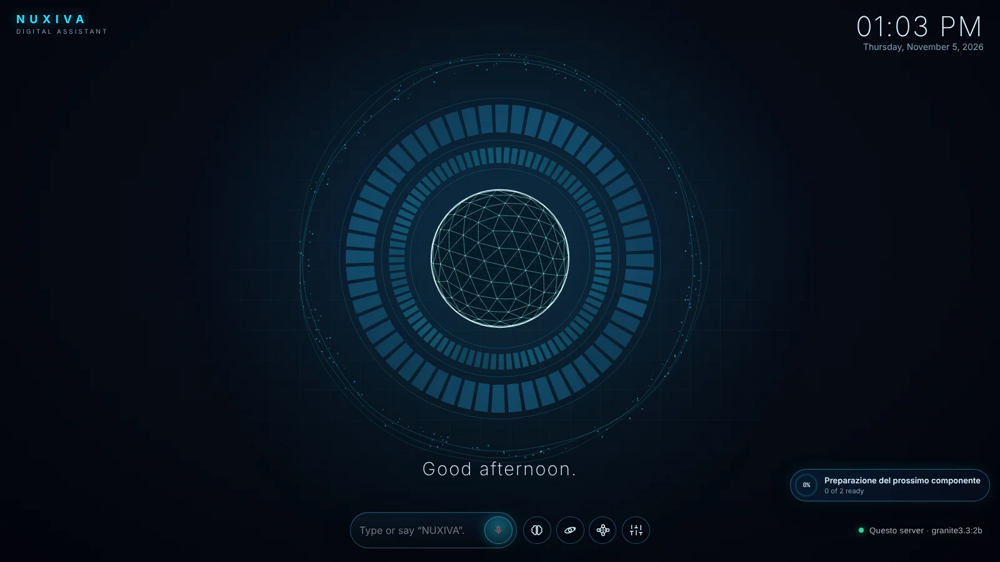
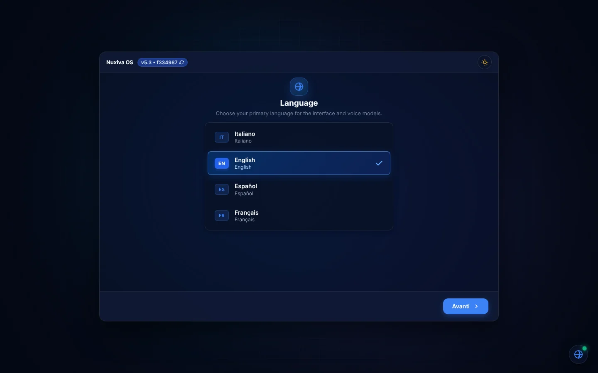
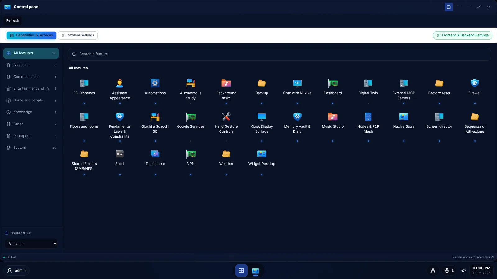
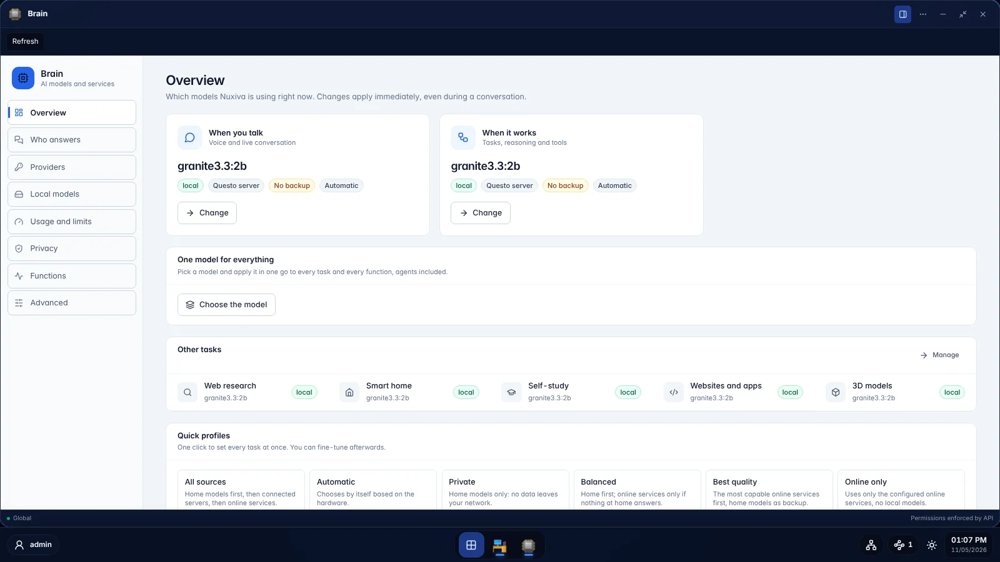
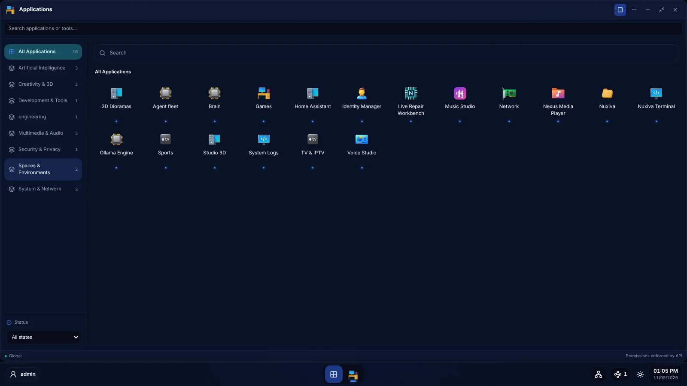
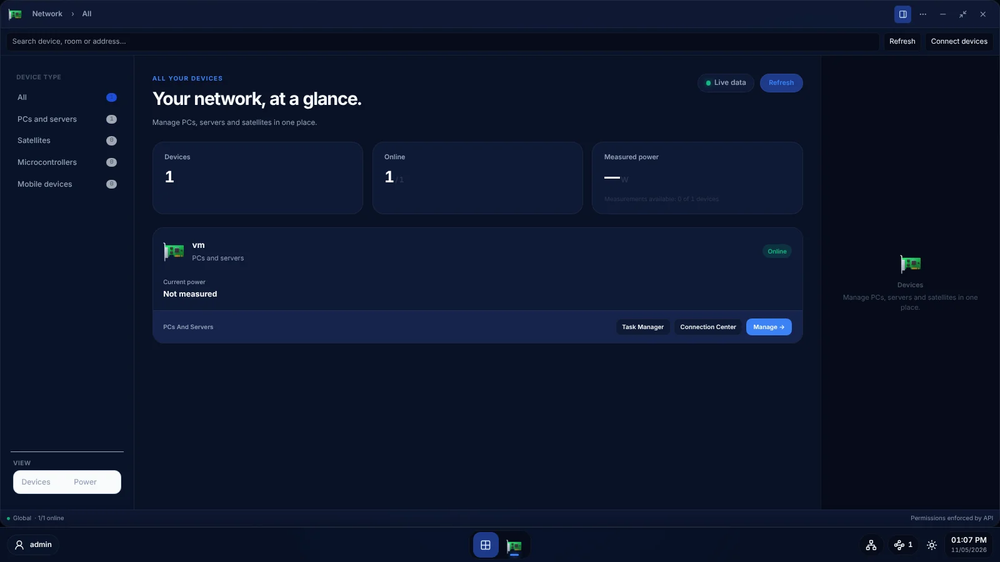
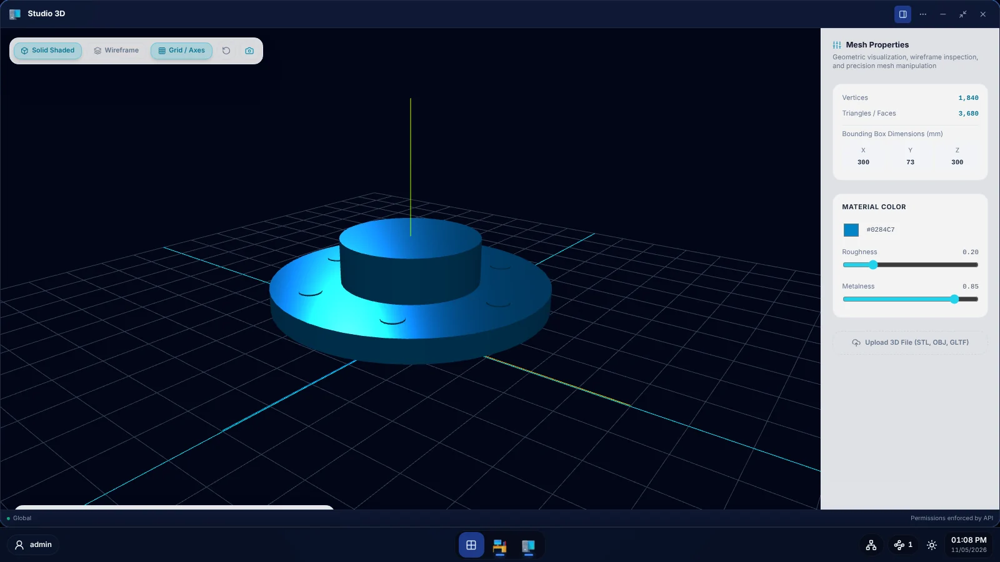
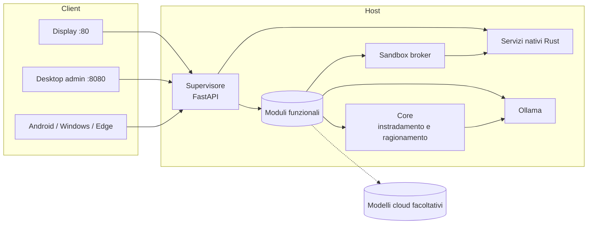
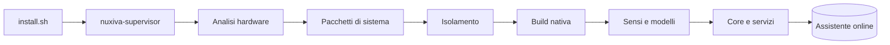

<div align="center">

# NUXIVA

**Un assistente per casa e lavoro, self-hosted e local-first, che funziona sul tuo hardware.**

Voce, visione, domotica, agenti e strumenti in un'unica piattaforma modulare. Modelli linguistici locali come impostazione predefinita, modelli cloud solo se li aggiungi tu.

[🇬🇧 English](README.md) · [🇮🇹 Italiano](README_IT.md) · [🇫🇷 Français](README_FR.md) · [🇪🇸 Español](README_ES.md)

[](https://github.com/AprileNunzio/Nuxiva/actions/workflows/ci.yml)


[](LICENSE)



</div>

---

## Indice

1. [Panoramica](#1-panoramica)
2. [Screenshot](#2-screenshot)
3. [Capacità](#3-capacità)
4. [Architettura](#4-architettura)
5. [Modello di sicurezza](#5-modello-di-sicurezza)
6. [Installazione](#6-installazione)
7. [Operatività](#7-operatività)
8. [Configurazione](#8-configurazione)
9. [Estendere Nuxiva](#9-estendere-nuxiva)
10. [Standard di ingegneria](#10-standard-di-ingegneria)
11. [Progetto](#11-progetto)

---

## 1. Panoramica

Nuxiva trasforma una macchina Linux, o un piccolo gruppo di macchine, in un assistente privato per la casa e per il lavoro. Tutto ciò che serve gira su hardware di tua proprietà: riconoscimento vocale, sintesi vocale, riconoscimento facciale, modelli linguistici, automazioni e archiviazione. Nulla esce dalla rete, a meno che tu non colleghi di proposito un servizio esterno.

Principi di progettazione:

| Principio | Cosa significa in pratica |
| :--- | :--- |
| **Local first** | I modelli linguistici girano tramite Ollama sull'host o su un nodo che controlli tu. I provider cloud sono facoltativi e stanno nella stessa lista di priorità dei modelli locali. |
| **Modulare** | Ogni capacità è un modulo autodescritto che il supervisore scopre all'avvio. Aggiungere un modulo non richiede alcuna registrazione centrale. |
| **Adattivo all'hardware** | Le funzioni che richiedono una telecamera, un microfono o una GPU si attivano solo quando quell'hardware è presente e abbastanza veloce. |
| **Sicuro per impostazione predefinita** | Accesso amministrativo tramite Linux PAM, conferme obbligatorie per le azioni rischiose, esecuzione in sandbox del codice generato, proxy di uscita con lista di host consentiti e unità systemd irrobustite. |
| **Automanutenzione** | Installazione a fasi, aggiornamenti condizionati alla CI, rollback automatico, autotest notturni e pagina di ripristino in modalità sicura. |
| **Multilingua** | Le interfacce sono localizzate in inglese, italiano, francese e spagnolo, e l'assistente risponde nella lingua in cui gli si parla. |

---

## 2. Screenshot

Tutti gli screenshot sono presi da una build non modificata del branch `main`.

| | |
| :---: | :---: |
| <br>**Procedura guidata di primo avvio** | <br>**Desktop di amministrazione: pannello di controllo** |
| <br>**Brain: instradamento dei modelli e profili** | <br>**Avvio applicazioni** |
| <br>**Rete, dispositivi e nodi** | <br>**Studio 3D** |

---

## 3. Capacità

Le capacità sono raggruppate per area. Ogni area è composta da moduli indipendenti in `installer_wizard/features/`; l'elenco dei moduli cresce nel tempo, quindi questa sezione descrive cosa copre ogni area invece di elencare ogni singolo modulo.

### Conversazione e voce
Parola di attivazione e riconoscimento vocale offline, sintesi vocale neurale in molte lingue, riconoscimento di chi parla, conversazione continua, clonazione e progettazione di voci, abbassamento automatico dei contenuti multimediali mentre l'utente parla, e chat remota con testo, voce e foto tramite bridge di messaggistica.

### Modelli e ragionamento
Un'unica lista di priorità che unisce i modelli locali di Ollama ai provider cloud facoltativi (compresi gli endpoint compatibili OpenAI) e passa automaticamente al successivo quando un modello non risponde. Instradamento dei modelli per attività, profili di privacy, limiti di utilizzo, percorso rapido per le richieste già confermate, una libreria di algoritmi verificati e un ciclo di studio nei momenti di inattività che riporta nelle risposte ciò che ha imparato.

### Agenti e automazione
Un agente che usa strumenti, pianifica passo dopo passo e chiede conferma prima delle azioni rischiose; un team di agenti specialisti scelti per pertinenza; un'agenzia di progetto che trasforma una richiesta in un grafo di attività pianificato ed eseguito da agenti in parallelo in uno spazio di lavoro isolato; attività in background che sopravvivono ai riavvii; autonomia programmata con approvazione umana per le azioni sensibili; e una fucina che compone nuovi strumenti, widget e moduli.

### Casa e ambiente
Integrazione con Home Assistant (stanze, piani, dispositivi, presenze), un motore di automazioni con trigger, condizioni, rami, cicli, passaggi paralleli e tracce di esecuzione, rilevamento delle abitudini, un gemello digitale che simula i comandi prima di eseguirli, allarmi di emergenza, mappa di piani e stanze, posizione, meteo e mappe.

### Persone, visione e sicurezza
Profili per persona con dati privati mostrati solo alla persona riconosciuta, riconoscimento facciale locale, gestione delle telecamere con visione dal vivo e sensori per telecamera, archivio eventi NVR con ricerca in linguaggio naturale, controllo con i gesti delle mani, esploratore della rete, firewall alimentato da analisi nativa dei pacchetti, gestione VPN multiprotocollo, cassaforte cifrata, backup verificabili e ripristino di fabbrica protetto.

### Display, media e creatività
Un desktop a widget in cui le informazioni compaiono quando sono pertinenti, un regista del display che organizza gli schermi tra i dispositivi, modalità kiosk, una presenza animata dell'assistente, riproduzione multimediale con casting, IPTV, sport in diretta, uno studio musicale, una lavagna condivisa, generazione e visualizzazione di modelli 3D, composizione di scene 3D e giochi.

### Lavoro e produttività
Collegamento dell'account Google per persona (calendario, posta, attività, contatti, Drive), generazione di documenti d'ufficio (Word, Excel, PowerPoint, OpenDocument, PDF), uno studio di sviluppo software con esecuzione isolata dei test, cartelle di rete protette, stampanti e dispositivi CNC, integrazione con il banco di riparazione e gestione di Proxmox.

### Sistema e manutenzione
Supervisione dei servizi con backoff e rilevamento dei blocchi, pianificazione in stile cron con recupero delle esecuzioni perse, un governatore delle risorse che rimanda il lavoro in background sotto carico, gestione di hardware e driver, gestione di Bluetooth e dispositivi audio, abbinamento e controllo multi-nodo, log di sistema con esportazione protetta e uno store modulare per le capacità facoltative.

### Client
| Client | Percorso | Ruolo |
| :--- | :--- | :--- |
| Web | `client_web/` | Desktop di amministrazione sulla porta 8080 (React, TypeScript, Vite, Tailwind) |
| Display | `installer_wizard/web/` | Display kiosk, procedura guidata e pagine di attivazione sulla porta 80 |
| Android | `client_apk/` | Parola di attivazione, riconoscimento della voce, flusso della fotocamera, rilevamento del server, dati di salute da dispositivi BLE e Health Connect |
| Windows | `client_satellite/windows_assistant/` | Assistente desktop attivabile con la voce o con una scorciatoia, controllo di file e app con permessi, aggiornamenti firmati |
| Edge | `client_satellite/linux_edge/`, `client_satellite/microcontrollers/` | Nodi edge Linux e satelliti ESP32 |
| Context bridge | `client_satellite/context_bridge/` | Bridge per i sensori del desktop |

---

## 4. Architettura



| Componente | Percorso | Tecnologia | Responsabilità |
| :--- | :--- | :--- | :--- |
| Supervisore | `installer_wizard/backend/` | Python, FastAPI, Uvicorn | Installazione, ciclo di vita, API HTTP e WebSocket, autenticazione, aggiornamenti, scoperta dei moduli |
| Moduli funzionali | `installer_wizard/features/` | Python | Capacità: rotte, comandi vocali e di chat, strumenti per gli agenti, traduzioni |
| Widget | `installer_wizard/agenti/<categoria>/<agente>/widget/` | JavaScript, CSS | Widget del display in parole semplici, dentro ogni agente |
| Core | `server/` | Python | Instradamento delle richieste, motori di ragionamento, motore decisionale, plasticità, event sourcing, generazione di skill |
| Livello nativo | `native/crates/` | Rust (edition 2024) | Codice critico per prestazioni e sicurezza, esposto a Python tramite PyO3 |
| Sandbox broker | `sandbox_broker/` | Python, Rust | Esecuzione isolata del codice generato, controllo del traffico in uscita |
| Installer | `scripts/os/` | Bash, systemd | Bootstrap, step di installazione, unità, `nuxivactl` |
| Client web | `client_web/` | React, TypeScript | Desktop di amministrazione |

### 4.1 Flusso di una richiesta

Una richiesta di testo o voce viene gestita dal router della chat in `installer_wizard/agenti/cognizione/chat/`. Attraversa una catena ordinata di stadi (automazioni, comandi diretti, skill di intento, connettori, controllo della casa, azioni, conversazione). Il primo stadio che riconosce la richiesta risponde; gli altri vengono saltati. Le richieste che hanno bisogno di informazioni aggiornate vengono affidate all'agente, che cerca prima di rispondere. La generazione scorre la lista di priorità dei modelli e salta quelli che falliscono, così un modello non disponibile non blocca mai una risposta.

### 4.2 Ragionamento del Core

Il Core (`server/core/`) classifica le richieste, ne stima la complessità e sceglie di conseguenza un motore di ragionamento. Un motore decisionale valuta modelli e azioni candidati su più assi (qualità, calibrazione, velocità, costo, sicurezza) con probabilità calibrate e stime di incertezza. Le richieste confermate vengono salvate in un indice nativo di embedding per poter rispondere su un percorso rapido; uno scheduler di plasticità rafforza, indebolisce, fa decadere ed elimina queste voci nel tempo. Formule e soglie esatte sono nel codice in `server/core/orchestrator/`, `server/core/decision/` e `server/core/plasticity/`.

### 4.3 Livello nativo Rust

Il workspace Rust in `native/` raccoglie i crate che richiedono velocità, sicurezza della memoria o isolamento rigoroso: bus dei messaggi, analisi dei pacchetti per il firewall, proxy di uscita, replica CRDT tra nodi, DSP audio, riconoscimento dei gesti, arbitraggio di display e finestre, token firmati, lettura dei sensori di salute, provisioning dei satelliti, motore dell'agenzia di progetto (dominio, pianificatore, scheduler, registro con catena HMAC, indice del codice, demone) e il bridge PyO3. L'elenco completo dei crate è in `native/Cargo.toml`.

### 4.4 Pipeline di installazione



`install.sh` installa solo il supervisore. Il supervisore esegue poi gli step di installazione definiti in `installer_wizard/backend/steps.py` (script in `scripts/os/steps/`), mostra l'avanzamento sul display e rende l'assistente utilizzabile il prima possibile, mentre i download più grandi proseguono in background. Gli step non critici possono fallire senza bloccare gli altri e vengono ritentati o riparati automaticamente.

---

## 5. Modello di sicurezza

| Livello | Meccanismo |
| :--- | :--- |
| Autenticazione | Accesso admin tramite Linux PAM (servizio `nuxiva-admin`), riservato agli account amministrativi; cookie di sessione HTTP-only firmati con HMAC e con scadenza; limite ai tentativi di accesso |
| Integrità delle richieste | Validazione di origine e host, header dedicato sulle chiamate che modificano lo stato, Content Security Policy rigorosa con Trusted Types |
| Protezione del primo avvio | La procedura guidata è raggiungibile solo dalla rete locale e solo finché la configurazione non è completata |
| Autorizzazione | Conferme obbligatorie per le azioni rischiose, biometria vocale facoltativa, visibilità per persona dei dati privati |
| Esecuzione del codice | Il codice generato gira solo nel sandbox broker, senza rete né accesso all'host per impostazione predefinita, facoltativamente in gVisor o in micro-VM Firecracker |
| Rete | Traffico in uscita della sandbox tramite il proxy Rust (solo host consentiti, indirizzi privati e di loopback rifiutati); analisi nativa dei pacchetti per il firewall; regole del firewall testate su `nftables` reale in CI |
| Segreti | Credenziali cloud in una cassaforte cifrata in `/etc/nuxiva/`; segreti azzerati in memoria nel codice nativo |
| Servizi | I servizi isolati (Core, agenzia, netguard) girano con utenti dedicati o dinamici, `NoNewPrivileges`, capability ristrette e irrobustimento `ProtectSystem` |
| Aggiornamenti | Vengono installate solo revisioni con i controlli CI superati; le revisioni che falliscono vengono annullate automaticamente |
| Codice nativo | `unsafe_code = "forbid"` su tutto il workspace; Clippy vieta `unwrap`, `expect` e `panic` |

Le vulnerabilità vanno segnalate in privato come descritto in [SECURITY.md](SECURITY.md).

---

## 6. Installazione

### Requisiti

| | Minimo | Consigliato |
| :--- | :--- | :--- |
| Sistema operativo | Debian 12 o Ubuntu 22.04+ | Ultima Debian stable o Ubuntu LTS |
| Architettura | x86_64 o arm64 | x86_64 con AVX2 |
| CPU | 4 core | 8+ core |
| Memoria | 8 GB | 16–32 GB |
| Archiviazione | 30 GB | 100+ GB NVMe |
| GPU | Non necessaria (modelli CPU quantizzati) | NVIDIA con 8 GB+ di VRAM |
| Periferiche | Nessuna (headless) | Microfono, altoparlanti, webcam, display |

Le macchine più piccole possono usare un nodo Ollama remoto o modelli cloud. Su Windows usa WSL2 oppure lo script sperimentale `install.ps1`.

### Installazione con un solo comando

```bash
curl -fsSL https://raw.githubusercontent.com/AprileNunzio/Nuxiva/main/install.sh | sudo bash
```

Senza `curl` (sistemi minimi):

```bash
wget -qO- https://raw.githubusercontent.com/AprileNunzio/Nuxiva/main/install.sh | sudo bash
```

L'installatore controlla prima il sistema (versione, architettura, permessi di amministratore, spazio libero, connessione e sorgenti dei pacchetti) e si ferma con un messaggio chiaro e tradotto se manca qualcosa. Fissa il commit esatto da installare e verifica l'installatore scaricato con l'impronta pubblicata da GitHub prima di eseguirlo: se non corrispondono, non viene eseguito nulla. Rilanciarlo è sicuro e riprende o ripara l'installazione.

### Ispezionare prima di eseguire

```bash
curl -fsSLo install.sh https://raw.githubusercontent.com/AprileNunzio/Nuxiva/main/install.sh
less install.sh
sudo bash install.sh --check   # solo controlli, non installa nulla
sudo bash install.sh
```

Opzioni: `--check` esegue solo i controlli, `--branch <nome>` installa un altro branch, `--ref <commit>` installa un commit esatto, `--sha256 <hash>` richiede anche un'impronta ottenuta in modo indipendente.

### Installazione da un clone

```bash
sudo git clone https://github.com/AprileNunzio/Nuxiva.git /opt/Nuxiva
cd /opt/Nuxiva
sudo bash install.sh
```

### Disinstallazione

```bash
sudo nuxivactl uninstall           # rimuove programma, servizi e file di sistema, conserva i dati
sudo nuxivactl uninstall --purge   # elimina anche dati, chiavi e account di servizio
```

Se `nuxivactl` non è disponibile:

```bash
curl -fsSL https://raw.githubusercontent.com/AprileNunzio/Nuxiva/main/install.sh | sudo bash -s -- --uninstall
```

Ollama, Docker e i pacchetti di sistema restano installati, perché possono servire ad altri programmi.

### Primo avvio

1. Apri `http://<host>/` da qualsiasi dispositivo della rete locale. Il display mostra l'avanzamento dell'installazione e diventa l'assistente appena pronto; non serve riavviare.
2. Completa la procedura guidata facoltativa su `http://<host>/setup`: lingua, rete, componenti, motore di intelligenza artificiale (locale, remoto o cloud), nome dell'assistente, microfono e voce. Le scelte vengono salvate in modo atomico e sopravvivono alle interruzioni di corrente.
3. Apri il desktop di amministrazione su `http://<host>:8080/` e accedi con un account amministratore Linux.

---

## 7. Operatività

### Riga di comando

```bash
nuxivactl status          # fase, avanzamento e stato degli step
nuxivactl background      # download in coda in background
nuxivactl logs [origine]  # install, supervisor, core, ollama, voice, vision, ear
nuxivactl setup-code      # codice di abbinamento per la procedura guidata
nuxivactl version         # revisione installata
sudo nuxivactl update     # installa l'ultima revisione che ha superato la CI
sudo nuxivactl force-upgrade [branch]
sudo nuxivactl repair     # ripara un'installazione danneggiata
sudo nuxivactl uninstall  # rimuove Nuxiva (aggiungi --purge per eliminare i dati)
```

### Aggiornamenti e ripristino

L'aggiornatore (`installer_wizard/backend/updater.py`) installa una revisione solo dopo che i suoi controlli CI sono riusciti. Una revisione che non si avvia viene marcata come difettosa e `nuxiva-rollback.service` ripristina l'ultima revisione funzionante. Se il sistema non riesce proprio ad avviarsi, vengono serviti una pagina in modalità sicura e uno script di riparazione.

### Porte di rete

| Porta | Servizio |
| :---: | :--- |
| 80 | Display, kiosk, procedura guidata, chat |
| 8080 | Desktop di amministrazione, API REST, server MCP (`/mcp`) |
| 443 | HTTPS facoltativo con certificati generati localmente |
| 8443 | API del Core (interna) |
| 11434 | Ollama, in ascolto su loopback |

### Servizi e percorsi

Le unità systemd sono definite in `scripts/os/systemd/` (supervisor, core, sandbox, netguard, agency, ear, vision, voice, rollback).

| Percorso | Contenuto |
| :--- | :--- |
| `/opt/Nuxiva` | Codice dell'applicazione |
| `/etc/nuxiva/nuxiva.env` | Configurazione (variabili `NUXIVA_*`) |
| `/etc/nuxiva/` | Chiavi, certificati e cassaforte cifrata |
| `/var/lib/nuxiva/` | Stato dell'applicazione |
| `/var/log/nuxiva/` | Log di installazione e di audit |

---

## 8. Configurazione

La configurazione è salvata come variabili `NUXIVA_*` in `/etc/nuxiva/nuxiva.env` ed è modificabile dal desktop di amministrazione (Pannello di controllo → Impostazioni di sistema). Ogni modulo dichiara le proprie impostazioni nel suo `feature.json`, così le nuove opzioni compaiono automaticamente nell'interfaccia.

Impostazioni comuni:

| Variabile | Scopo |
| :--- | :--- |
| `NUXIVA_UI_LANG` | Lingua dell'interfaccia (`en`, `it`, `fr`, `es`) |
| `NUXIVA_OLLAMA_URL` | Usa un nodo Ollama remoto al posto di quello locale |
| `NUXIVA_ALLOWED_HOSTS` | Nomi host aggiuntivi accettati dalla guardia di origine |
| `NUXIVA_PUBLIC_PORT`, `NUXIVA_ADMIN_PORT` | Sostituiscono le porte predefinite |

I provider di modelli cloud si aggiungono dall'applicazione **Brain**. Sono facoltativi, si inseriscono nella stessa lista di priorità dei modelli locali e possono essere limitati per attività tramite i profili di privacy.

---

## 9. Estendere Nuxiva

Un modulo è una cartella in `installer_wizard/features/<id>/`, oppure in `/var/lib/nuxiva/features/<id>/` per i moduli installati localmente:

```text
features/<id>/
├── feature.json     metadati, categoria, impostazioni, capacità, icona
├── api.py           rotte HTTP                          (facoltativo)
├── commands.py      comandi vocali e di chat            (facoltativo)
├── tools.py         strumenti per agenti e client MCP   (facoltativo)
└── language/        en.json, it.json, fr.json, es.json
```

I widget seguono lo stesso schema in `installer_wizard/agenti/<…>/<agent>/widget/<id>/` (`widget.json`, `widget.js`, `widget.css`, `language/`). Il supervisore scopre moduli e widget all'avvio; gli strumenti diventano disponibili all'agente, al team di specialisti e ai client MCP esterni senza ulteriori collegamenti.

È possibile collegare server MCP esterni come fonti di strumenti, e Nuxiva espone i propri strumenti, risorse e prompt come server MCP sulla porta 8080 (vedi `installer_wizard/MCP.md`).

---

## 10. Standard di ingegneria

| Area | Standard |
| :--- | :--- |
| Architettura | Clean Architecture, separazione delle responsabilità, colocazione per funzionalità, file piccoli e con un solo scopo |
| Python | Python 3.11+, servizi FastAPI tipizzati, controlli di sintassi e `pyflakes` a ogni push |
| Rust | Edition 2024, `unsafe_code` vietato su tutto il workspace, Clippy `all` come errore, `rustfmt` obbligatorio |
| Web | React e TypeScript, CSP rigorosa, i18n completa senza testi scritti nel codice, layout responsive |
| Gestione degli errori | Eccezioni gestite ai confini di I/O, rete e archiviazione; gestori globali; gli errori non vengono mai scartati in silenzio |
| Test | Test unitari e di API per supervisore, Core e sandbox; test di parità nativa; test Rust; regole del firewall su `nftables` reale; test del client web |
| CI | `.github/workflows/ci.yml` esegue tutti i controlli a ogni push; workflow dedicati compilano il bundle web e l'assistente Windows |

---

## 11. Progetto

- **Contribuire:** vedi [CONTRIBUTING.md](CONTRIBUTING.md) e il [Codice di condotta](CODE_OF_CONDUCT.md).
- **Sicurezza:** vedi [SECURITY.md](SECURITY.md).
- **Software di terze parti:** vedi [THIRD_PARTY_NOTICES.md](THIRD_PARTY_NOTICES.md).
- **Licenza:** [Nuxiva Personal and Commercial License 1.0](LICENSE). Le revisioni precedenti distribuite con licenza MIT restano coperte da [LICENSE-MIT-LEGACY](LICENSE-MIT-LEGACY).

### Sostieni il progetto

Se Nuxiva ti è utile, puoi sostenerne lo sviluppo:

<p align="center">
  <a href="https://www.paypal.com/paypalme/NunzioAprile">
    
  </a>
</p>
