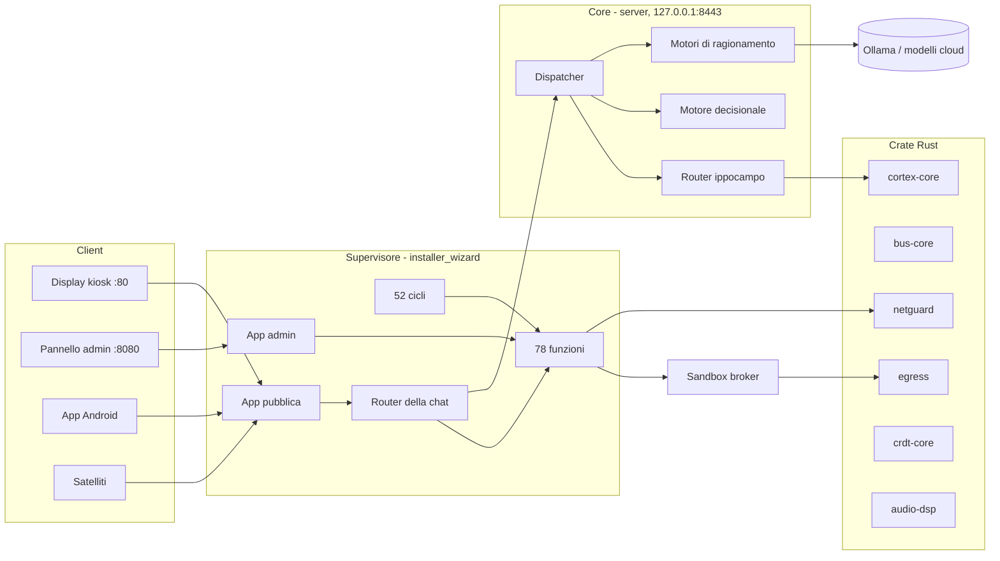
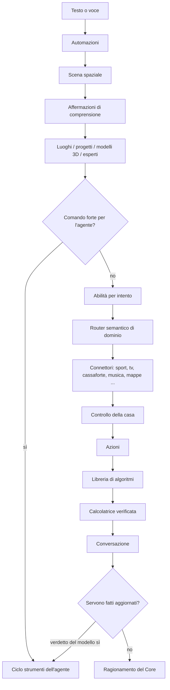
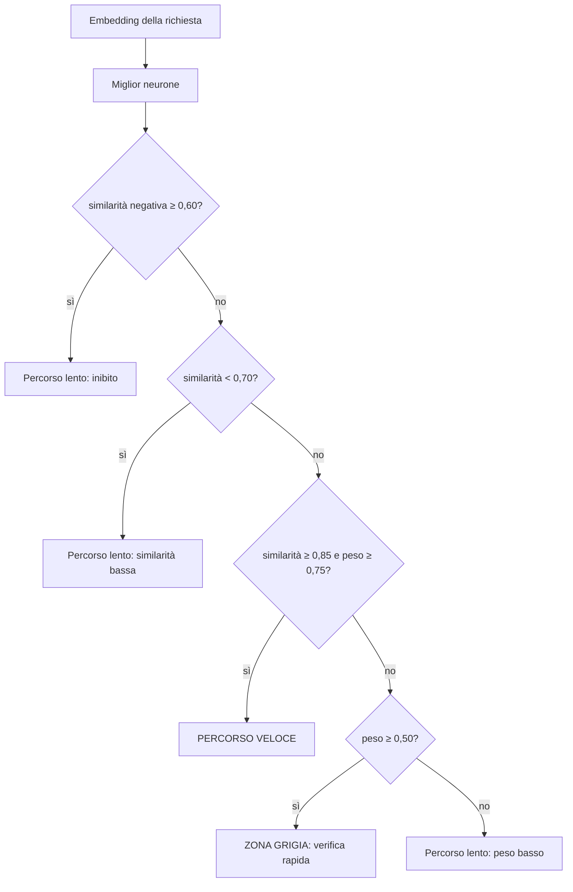
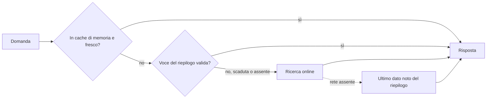

<div align="center">

# NUXIVA

**Un sistema operativo privato e self-hosted per l'assistente di casa e la mesh di intelligenza artificiale.**

[🇬🇧 English](README.md) | [🇮🇹 Italiano](README_IT.md) | [🇫🇷 Français](README_FR.md)

Versione 5.3.0 · Licenza MIT · Debian / Ubuntu

</div>

Questo documento descrive ciò che il repository contiene **oggi**. Ogni numero, soglia e formula riportati qui è stato letto dal codice sorgente; dove si tratta di una scelta progettuale e non di una garanzia, lo si dice.

---

## Indice

1. [Cos'è Nuxiva](#1-cosè-nuxiva)
2. [Il repository in sintesi](#2-il-repository-in-sintesi)
3. [Architettura](#3-architettura)
4. [Come viene risposta una richiesta](#4-come-viene-risposta-una-richiesta)
5. [Il Core: instradamento, memoria e ragionamento](#5-il-core-instradamento-memoria-e-ragionamento)
6. [Agenti, strumenti e risposte ancorate ai fatti](#6-agenti-strumenti-e-risposte-ancorate-ai-fatti)
7. [Sport: preferiti, riepilogo notturno, ricerca online](#7-sport-preferiti-riepilogo-notturno-ricerca-online)
8. [Persone, benessere e fotocamera](#8-persone-benessere-e-fotocamera)
9. [Crate Rust nativi](#9-crate-rust-nativi)
10. [Supervisore e auto-riparazione](#10-supervisore-e-auto-riparazione)
11. [Modello di sicurezza](#11-modello-di-sicurezza)
12. [Installazione](#12-installazione)
13. [Porte, servizi e percorsi](#13-porte-servizi-e-percorsi)
14. [Client](#14-client)
15. [Controlli di qualità](#15-controlli-di-qualità)
16. [Limiti onesti](#16-limiti-onesti)
17. [Contribuire, licenza, supporto](#17-contribuire-licenza-supporto)

---

## 1. Cos'è Nuxiva

Nuxiva trasforma una macchina (o una piccola flotta) in un assistente domestico che ascolta, vede, parla, controlla la casa ed esegue strumenti, mantenendo i dati in locale per impostazione predefinita. Combina:

- un **Supervisore** (FastAPI) che serve il display pubblico e il pannello di amministrazione, scopre le funzioni all'avvio e mantiene vivi 52 cicli in background;
- un **Core** (Python, porta 8443 solo in locale) che instrada ogni richiesta attraverso una memoria veloce di schemi, un motore decisionale e un insieme di motori di ragionamento;
- **crate Rust nativi** per i percorsi critici (memoria di schemi, bus di eventi, analisi di rete, controllo dell'uscita, sincronizzazione CRDT, DSP audio);
- un **client React** (display kiosk, pannello admin, widget), un client Android e nodi satellite.

Nuxiva è software libero. Funziona completamente offline una volta installati i modelli; i modelli cloud sono opzionali e si mescolano tramite liste di priorità.

## 2. Il repository in sintesi

| Area | Percorso | Contenuto verificato |
| :--- | :--- | :--- |
| Supervisore e funzioni | `installer_wizard/` | 78 funzioni auto-scoperte (`feature.json`), 70 widget, 6 app a livello supervisore, backend in `backend/` |
| Core | `server/` | ~39.900 righe di Python: decisioni, router dell'ippocampo, plasticità, ragionamento, fucina di abilità, event sourcing |
| Codice nativo | `native/crates/` | 9 crate Rust, 109 funzioni `#[test]` |
| Client web | `client_web/` | 34 app core, 16 app, 12 app nodo, lingue IT / EN / FR / ES |
| Client Android | `client_apk/` | Kotlin, Gradle |
| Satelliti | `client_satellite/` | `context_bridge`, `linux_edge`, `microcontrollers`, `windows_assistant` |
| Sandbox | `sandbox_broker/` | backend processo / Docker / gVisor / Firecracker, proxy di uscita |
| Giochi | `giochi/` | scacchi 3D |
| Script di sistema | `scripts/os/` | passi di installazione, riparazione, rollback, 8 unità systemd |
| Test | `**/test_*.py` | 313 file di test Python |

Provider cloud nel catalogo (`features/cloud/catalog.py`): OpenAI, Anthropic, Google Gemini, xAI, Mistral, DeepSeek, Groq, Cerebras, OpenRouter, Together, Fireworks, Perplexity, Cohere, Alibaba Qwen, Moonshot, Zhipu, NVIDIA NIM, Hugging Face, SambaNova, DeepInfra, Azure OpenAI e qualunque endpoint compatibile OpenAI.

## 3. Architettura



Le funzioni sono cartelle plug-in in `installer_wizard/features/<id>/`. Ognuna si dichiara in `feature.json` e può esporre `api.py` (rotte HTTP), `commands.py` (connettore voce e chat), `tools.py` (strumenti dell'agente), `language/` e un'icona. Il supervisore le scansiona all'avvio; nulla viene registrato a mano.

## 4. Come viene risposta una richiesta

Il router della chat (`features/chat/assistant.py`) è una cascata ordinata. Vince il primo stadio che sa rispondere; uno stadio che non riconosce la richiesta solleva `LookupError` e passa il turno al successivo.



Due regole progettuali valgono per questa cascata:

- **Nessun elenco di argomenti scritto nel codice.** Se una domanda richiede informazioni aggiornate lo decide il modello (`features/agent/grounding.py`: verdetto JSON `{"lookup": bool}`, timeout 8 s, cache 600 s, al massimo 200 voci, `False` in caso di qualunque errore). A quale sport, campionato o squadra si riferisce una frase lo decidono un catalogo di dati e un piano costruito dal modello (`features/sports/understand.py`). Aggiungere uno sport significa aggiungere una riga al catalogo, non codice.
- **Degradare con grazia.** Ogni stadio che parla con la rete o con un modello intercetta i propri errori e passa oltre, oppure risponde onestamente che la fonte non è raggiungibile.

## 5. Il Core: instradamento, memoria e ragionamento

### 5.1 Router di Sistema 1 e punteggio di complessità ψ

`server/core/orchestrator/system1_router.py` calcola logit per parole chiave per le classi `conversation`, `action_direct`, `complex_task`, `whiteboard_canvas` e `browser_action`, poi una softmax:

```
p_i = exp(z_i - max z) / Σ_j exp(z_j - max z)
```

Uno scalare di complessità ψ sceglie il motore di ragionamento:

```
ψ = (0.45·L_task + 0.35·S_pred + 0.20·E_user) · (1 − 0.30·P_hw)      tutti i termini limitati a [0, 1]
```

| ψ | Motore |
| :--- | :--- |
| < 0,25 | `veloce_5_0` |
| < 0,50, oppure emozione dell'utente > 0,65 | `empatico_5_0` |
| < 0,75 | `pro_6_0` |
| ≥ 0,75 | `ultra_6_5` |

In `server/core/reasoning/engines/` esistono anche `auto_6_5` (meta-orchestrazione) e `legacy_4_2`. `L_task` è il logit di compito complesso / 10, `E_user` l'emozione rilevata, `P_hw` la pressione hardware.

### 5.2 Ippocampo: percorso veloce appreso

Le richieste confermate spesso vengono memorizzate come **neuroni**: un identificativo, un peso sinaptico, un insieme di vettori di embedding positivi (dendriti) e di vettori negativi (inibizioni). Il confronto è implementato in Rust (`cortex-core/src/hippocampus`) ed esposto a Python tramite `RustNeuronIndex`.

- I vettori sono normalizzati L2; la similarità è un prodotto scalare (coseno). Vettori nulli, vuoti o non finiti vengono rifiutati.
- Si sceglie il miglior candidato, poi `decide` applica:



Senza alcun neurone il verdetto è percorso lento (`NoNeurons`). L'istantanea dell'indice è serializzata in JSON e le istantanee malformate vengono rifiutate.

### 5.3 Plasticità e ciclo REM notturno

`server/core/plasticity/rules.py` implementa aggiornamenti limitati di tipo hebbiano:

| Regola | Valore |
| :--- | :--- |
| Limiti del peso | 0,05 – 0,99 |
| Potenziamento | `w ← w + 0,10·(1 − w)` |
| Depressione | `w ← w − 0,25·w` |
| Decadimento | emivita 30 giorni: `w ← w · 0,5^(giorni_inattivi / 30)` |
| Potatura | peso ≤ 0,10 **e** inattivo da ≥ 90 giorni **e** non protetto |

Lo scheduler (`plasticity/scheduler.py`) esegue i compiti di consolidamento ogni notte alle **03:30** e recupera se l'ultima esecuzione risale a più di 36 ore prima.

### 5.4 Motore decisionale

`server/core/decision/` valuta candidati (modelli o azioni) con matematica esplicita:

- validazione della distribuzione (tolleranza sulla somma 1e-3, tolleranza di rinormalizzazione 2e-2);
- temperature scaling stimato per log-verosimiglianza negativa;
- insiemi di predizione conformale (α limitato a 0,01 – 0,50);
- scomposizione dell'entropia in incertezza totale e aleatoria, confidenza normalizzata `1 − H/ln K`;
- un punteggio composito, la **media armonica pesata** di cinque assi, moltiplicata per un cancello quadratico di soglia minima:

| Asse | Peso (preset `NUXIVA_5AXIS`) | Soglia minima |
| :--- | :--- | :--- |
| Intelligenza | 0,30 | 55 |
| Calibrazione | 0,20 | – |
| Velocità | 0,15 | 50 |
| Costo | 0,15 | 50 |
| Omeostasi della sicurezza | 0,20 | 60 |

L'intelligenza mescola benchmark aperti e sigillati al 50/50. I preset `A_BALANCED`, `B_QUALITY` e `C_PRODUCTION` usano quattro assi.

### 5.5 Fucina di abilità ed event sourcing

`server/core/skill_forge/` raccoglie le richieste fallite, fa scrivere un'abilità a un modello, ne analizza l'AST e la esegue solo dentro il livello di isolamento e la sandbox. `server/core/event_sourcing/` conserva un registro append-only dei cambiamenti di stato.

## 6. Agenti, strumenti e risposte ancorate ai fatti

- **Registro degli strumenti**: le funzioni decorate con `@tool` in `features/agent/` (file, posta, media, sistema, pacchetti, telecamere, schermo, RPA) e nel `tools.py` di ogni funzione vengono scoperte a runtime.
- **Ciclo dell'agente** (`agent/agent.py`): il modello pianifica, chiama strumenti, legge i risultati e chiede conferma prima delle azioni rischiose. La data di oggi è inserita nelle sue regole.
- **Orchestratore CEO** (`features/team/ceo.py`): scansiona agenti, strumenti e widget e li ordina con `relevance.py`: i token sono filtrati dalle parole vuote, ridotti a 5 caratteri e valutati con pesi per campo `identity 3,0, noun 4,0, capability 1,3, tool 1,6, tool_text 0,6, description 0,9, keyword 0,3`, un bonus di frase di 14, bonus appresi (+2 per conferma, tetto 4) e un punteggio minimo di 5,0 prima di assegnare uno specialista.
- **Ricerca** (`features/research/`): ricerca web multi-provider, scaricamento sicuro, estrazione e ordinamento, con generatore di rapporti.
- **Ancoraggio ai fatti**: vedi §4: il modello decide se rispondere dalla memoria o cercare; se uno strumento fallisce, all'agente viene detto di ripiegare sulla ricerca web invece di scusarsi.
- **Livello Cervello / LLM** (`features/brain/llm.py`): `generate(kind, as_json, component, timeout)` percorre una catena di priorità di modelli Ollama locali e cloud, saltando quelli inutilizzabili, così un modello guasto non ferma la risposta.

## 7. Sport: preferiti, riepilogo notturno, ricerca online

Lo sport è interamente **guidato dai dati**.

- `features/sports/catalog.py` elenca i campionati (calcio, NHL, NBA, WNBA, NFL, MLB e altri) con percorso ESPN e alias; la Formula 1 usa l'API Jolpica/Ergast. Non servono altri servizi né chiavi API.
- La domanda dell'utente viene associata a una squadra o a un campionato sull'indice reale delle squadre, poi `understand.plan` chiede al modello `{sport, want, focus}`. La risposta passa per un percorso generico: classifica, risultati del giorno, scheda squadra o scheda F1, più un widget sul desk (`sport_match`, `sport_table`, `f1_race`).
- **Preferiti**: salvati per persona (e un profilo per tutta la casa) in `sports.json`. **Per impostazione predefinita nessuno segue nulla**: nessun controllo continuo, nessun riepilogo.
- **Osservatore in diretta**: segue solo le squadre preferite, ogni 20 s durante una partita, 60 s quando ce n'è una vicina, 600 s altrimenti. Annuncia calcio d'inizio, gol, espulsioni e risultati finali e richiama un widget quando una persona che li segue si avvicina allo schermo (pausa di 30 min).
- **Riepilogo notturno** (`features/sports/digest.py`): dopo le 03:00, una volta al giorno, scarica per i campionati dei preferiti i tabelloni (ieri, oggi, domani), calendari e risultati delle squadre, classifiche ed elenchi squadre e, per la F1, calendario, ultimi risultati e i due campionati. Tutto è salvato in `sports_digest.json`.



Ogni voce del riepilogo porta una scadenza pari al primo calcio d'inizio tra le partite non concluse di quel campionato (al massimo 30 ore; scade subito se una partita è in corso). Prima del calcio d'inizio la risposta salvata è esatta; appena la partita comincia, la stessa domanda va automaticamente online. Salvare i preferiti di una persona invalida il riepilogo, così le nuove squadre vengono scaricate al ciclo successivo; `POST /api/sports/digest/build` forza un aggiornamento.

## 8. Persone, benessere e fotocamera

- **Persone**: profili, ruoli, voci, account collegati (ad es. Google) e promemoria per persona.
- **Misuratore di benessere**: medie mobili esponenziali per persona e segnale; gli scostamenti diventano z-score, compressi con una sigmoide e raggruppati in quattro aree: *tensione, esaurimento, ricettività, sollievo*.
- **Fotocamera**: il misuratore di affetto della pipeline di visione legge il volto di una persona riconosciuta. Dopo un periodo di calibrazione ogni lettura viene registrata nel **diario degli stati d'animo** della persona con fonte `camera` (al massimo una voce ogni 120 s, una nuova se l'area cambia o passano 900 s), con evidenze come «volto: tensione, attivazione 62/100, tono −0,3». Il diario è modificabile e l'utente può dare un riscontro sulle voci di fotocamera e assistente.
- Tutto resta in file di stato locali; nulla viene inviato a un servizio cloud se l'utente non ne configura uno.

## 9. Crate Rust nativi

| Crate | Ruolo | Dettaglio verificato |
| :--- | :--- | :--- |
| `cortex-core` | Indice dei neuroni dell'ippocampo, arbitro, validatore di slot | soglie 0,85 / 0,70 / 0,60 e pesi 0,75 / 0,50; capacità dei dendriti limitata |
| `bus-core` | Router dei topic e tipi di evento | topic fino a 8 segmenti da 40 caratteri, fino a 65.536 sottoscrizioni, pattern con caratteri jolly; buffer ad anello senza lock (1.024 posti di default) per gli impulsi sinaptici con trasmettitori eccitatori/inibitori |
| `netguard` | Analisi dei pacchetti per il firewall | rilevatori: scansione porte (25 porte / 10 s), scansione host (25 host), SYN flood (300/s), forza bruta (15 tentativi / 60 s sulle porte di autenticazione), tunnel DNS (lunghezza nome 70, entropia 4,0), ICMP flood (200/s), volume di esfiltrazione, ARP spoofing; elenco MAC fidati, pausa per avviso |
| `egress` | Proxy di uscita con politiche per la sandbox | pattern di host, rifiuta indirizzi non pubblici (RFC 1918, loopback, link-local e altri in una lista di blocco) |
| `crdt-core` | Mappa last-writer-wins per la sincronizzazione tra pari | vince il timestamp più recente; a parità vince l'id nodo maggiore; la fusione restituisce il numero di voci cambiate |
| `audio-dsp` | Rilevamento dell'attività vocale e filtri | RMS, tasso di attraversamento dello zero ed entropia spettrale; soglia adattiva quando c'è audio in riproduzione; frame di coda; soppressione della musica; filtri biquad |
| `spatial-core` | Arbitraggio desktop/banco di lavoro | z-stack, priorità, governatori di risorse, compiti e rete, router di intenti |
| `langid` | Identificazione della lingua | usato dalla pipeline vocale |
| `nuxiva-native` | Ponte PyO3 che espone i crate a Python | arbitraggio, audio, bus, cortex, mesh, scanner, workbench |

## 10. Supervisore e auto-riparazione

- **Due app web**: pubblica (porta 80) e admin (porta 8080), più un ascoltatore HTTPS opzionale (porta 443) quando è presente un certificato. In modalità demo si spostano su 8000 / 8001 / 8002.
- **Guardiano dei cicli** (`backend/loops.py`): ciascuno dei 52 cicli in background è avvolto; un arresto lo riavvia con backoff esponenziale (da 1 s fino a un massimo configurabile, 60 s di default) e un battito rileva i blocchi (fattore di default 5× il periodo del ciclo). Un ciclo stabile per 120 s azzera il backoff.
- **Aggiornatore** (`backend/updater.py`): aggiorna solo a una revisione i cui job di CI (`validate-python`, `tests`, `kernel-tests`, `native-core`, `validate-scripts`, `validate-web-client`) sono riusciti; una revisione che non parte viene marcata *cattiva* per 30 minuti e l'ultima revisione buona viene ripristinata da `nuxiva-rollback.service`.
- **Modalità sicura** (`backend/safe_mode.py`): una pagina minima e uno script di riparazione automatica quando il sistema completo non riesce ad avviarsi.
- **Dist del frontend**: un workflow GitHub ricompila `client_web/dist` dal sorgente, quindi il server non ha mai bisogno di Node a runtime.

## 11. Modello di sicurezza

- L'accesso admin usa **PAM** di Linux (servizio `nuxiva-admin`) e richiede `root` o l'appartenenza al gruppo amministrativo.
- Le funzioni si attivano o disattivano con variabili d'ambiente; le azioni sensibili passano da un cancello di approvazione (funzione authz) e dalla biometria vocale dove configurata.
- Il codice generato gira solo nel **sandbox broker** (senza rete e senza accesso all'host di default); isolamento opzionale con gVisor e micro-VM Firecracker; il traffico in uscita passa dal proxy Rust `egress`.
- `netguard` alimenta la funzione firewall; le regole del firewall sono testate in CI su `nftables` reale.
- I segreti (chiavi cloud) stanno in una cassaforte cifrata sotto `/etc/nuxiva/`.
- Il contenuto web scaricato dagli agenti passa dal filtro `safeweb`; gli host esterni per i dati sportivi sono limitati a una lista consentita (`ESPN`, `Jolpica`).
- Divulgazione responsabile: vedi [SECURITY.md](SECURITY.md).

## 12. Installazione

Supportati: Debian 12 o Ubuntu 22.04+ (x86_64 / arm64). È richiesto `apt-get`.

```bash
curl -fsSL https://raw.githubusercontent.com/AprileNunzio/Nuxiva/main/install.sh | sudo bash
```

oppure da un clone:

```bash
sudo git clone https://github.com/AprileNunzio/Nuxiva.git /opt/Nuxiva
cd /opt/Nuxiva
sudo bash install.sh
```

`install.sh` avvia il servizio del supervisore; il supervisore esegue poi **31 passi ordinati** (`installer_wizard/backend/steps.py`, script in `scripts/os/steps/`): analisi del sistema, memoria compressa, pacchetti di sistema, kiosk, Docker, sandbox, gVisor, Firecracker, core nativo, driver video e GPU, hardening di sicurezza, netguard, VPN, Ollama, voce neurale, Bluetooth, visione, ascolto, riconoscimento musicale, condivisioni di rete, suite d'ufficio, studio delle voci, conversione 3D, modelli linguistici essenziali e profondi, consolidamento dello studio, compilazione del Core, servizi, manutenzione e riscaldamento. I download pesanti avvengono in background, dal più piccolo, così l'assistente è utilizzabile subito. I passi non critici (GPU, voce, visione, ascolto…) possono fallire senza bloccare il resto.

Windows è supportato tramite WSL2 (Ubuntu 22.04 / Debian 12) o lo sperimentale `install.ps1`.

| | Minimo | Consigliato |
| :--- | :--- | :--- |
| CPU | 4 core | 8+ core |
| RAM | 8 GB | 16–32 GB |
| Disco | 30 GB | 100+ GB NVMe |
| GPU | nessuna (modelli su CPU) | NVIDIA con 8 GB+ di VRAM |

Comandi utili: `nuxivactl background`, `nuxivactl repair`, `nuxivactl update --force`.

## 13. Porte, servizi e percorsi

| Porta | Uso |
| :---: | :--- |
| 80 | Display pubblico / kiosk, chat |
| 8080 | Pannello admin, API REST, server MCP |
| 443 | HTTPS opzionale |
| 8443 (localhost) | Core |
| 11434 (localhost) | Ollama |

Unità systemd in `scripts/os/systemd/`: `nuxiva-supervisor`, `nuxiva-core`, `nuxiva-sandbox`, `nuxiva-netguard`, `nuxiva-ear`, `nuxiva-vision`, `nuxiva-voice`, `nuxiva-rollback`.

| Percorso | Contenuto |
| :--- | :--- |
| `/opt/Nuxiva` | Codice dell'applicazione |
| `/etc/nuxiva/nuxiva.env` | Configurazione (le variabili d'ambiente si leggono con `env_get`; esistono circa 130 nomi `NUXIVA_*` distinti) |
| `/var/lib/nuxiva/` | Stato: persone, sport (`sports.json`, `sports_digest.json`), diari degli stati d'animo, cache |

## 14. Client

- **Client web** (`client_web`, React + Vite + Tailwind): display kiosk con desk di widget dinamici, volto 3D e pannello admin con 34 app core (persone, impostazioni del Cervello, firewall, telecamere, studio delle voci, aggiornatore, cassaforte, VPN, meteo, …). L'interfaccia admin usa il tema chiaro. Traduzioni: italiano, inglese, francese, spagnolo.
- **Android** (`client_apk`): client Kotlin.
- **Satelliti** (`client_satellite`): nodo Linux edge, microcontrollori, assistente Windows (con proprio workflow CI), context bridge.
- **MCP**: Nuxiva espone i suoi strumenti come server MCP sulla porta admin e può usare server MCP esterni (`installer_wizard/MCP.md`).

## 15. Controlli di qualità

Il workflow GitHub **Nuxiva CI Pipeline** gira a ogni push:

1. sintassi Python (`py_compile`) e `pyflakes` su `server`, `sandbox_broker`, `installer_wizard`, `client_satellite`;
2. test unitari e API del supervisore (`unittest discover`), più regole del firewall su `nftables` reale;
3. test del kernel del Core e del sandbox broker;
4. Rust 1.89: `fmt`, `clippy`, test, build del modulo Python, test di parità nativa e del bus, test del proxy egress, test nativi di cortex;
5. controlli di sintassi JavaScript e shell;
6. validazione del client web.

Altri due workflow ricompilano il bundle del frontend e l'assistente Windows.

## 16. Limiti onesti

- Il vocabolario «neurale» (neuroni, sinapsi, REM) dà il nome a meccanismi reali e semplici: similarità tra vettori con soglie, pesi limitati con decadimento, un lavoro notturno. Non è una simulazione biologica e il buffer di impulsi in Rust è un tipo di coda, non un simulatore di reti a impulsi.
- La qualità dipende dai modelli installati; i modelli piccoli su sola CPU rispondono lentamente e ragionano meno bene.
- I dati sportivi vengono da endpoint pubblici che possono cambiare o limitare le richieste; il riepilogo notturno e il ripiego sull'ultimo dato noto attenuano il problema, ma non garantiscono l'accuratezza in diretta.
- Le funzioni che dipendono dall'hardware (fotocamera, array di microfoni, GPU) si disattivano da sole se l'hardware manca.
- Debian e Ubuntu sono gli unici host ufficialmente supportati.

## 17. Contribuire, licenza, supporto

Nuxiva è scritto e mantenuto da **Nunzio Aprile (NunzioTech)** e rilasciato con licenza **MIT**. I contributi sono benvenuti: leggi [CONTRIBUTING.md](CONTRIBUTING.md) e il [Codice di condotta](CODE_OF_CONDUCT.md). Grazie a tutti coloro che segnalano errori, provano l'hardware e inviano patch.

Il progetto è libero e resta libero. Se ti è utile, puoi sostenerne lo sviluppo:

<p align="center">
  <a href="https://www.paypal.com/paypalme/NunzioAprile">
    
  </a>
</p>
